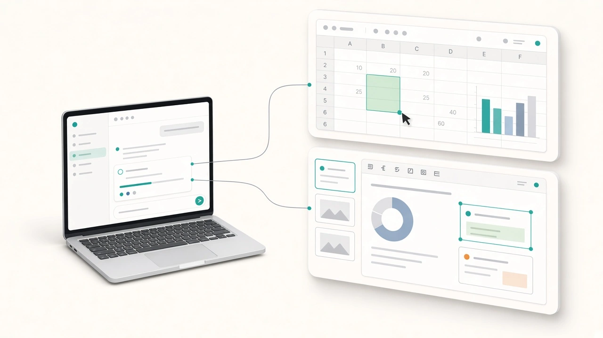
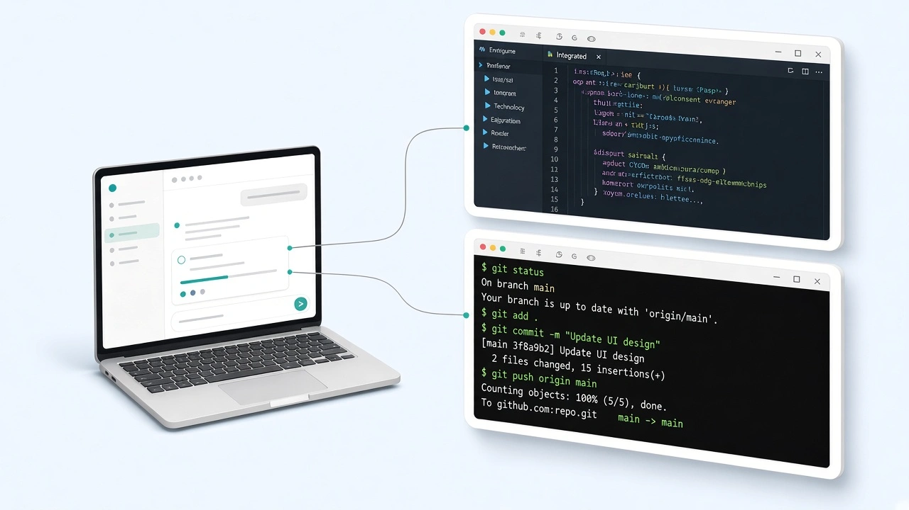

<p align="center">
  
</p>

# 百智办公 · MonkeyAI

**团队 AI 办公工作台，企业级开源 AI 办公管理平台。**

百智办公是一款面向团队的开源 AI 办公工作台。用自然语言提出需求，让 AI 完成办公、编程与设计任务，直接交付工作成果。支持团队资源共享、统一管控与私有化部署。

[官网](https://work.baizhi.cloud/) · [产品文档](https://work.docs.baizhi.cloud/) · [独立部署](#独立部署) · [客户端下载](#客户端下载) · [微信交流群](#社区与支持)

[](./LICENSE)

## 办公、编程、设计，让 AI 直接交付工作成果

一个工作台覆盖多种工作模式。提供相关资料，说明目标和交付要求，让 AI 执行任务、整理结果。

### 办公：把日常琐事，交给 AI 完成

制作 PPT、编写文档、处理表格、整理文件。从零散的资料出发，整理出一份清晰的工作成果。

> 例如：把这些资料整理成汇报 PPT，并汇总表格中的关键数据。



### 编程：把开发需求，变成可用的代码

从架构设计到编写代码、修复问题，让 AI 参与开发任务，把精力留给更重要的技术判断。

> 例如：根据这份需求实现功能，补充测试，并修复运行中发现的问题。



### 设计：把脑海创意，变成眼前的作品

从海报、平面设计到交互设计与短剧制作，围绕你的想法展开创作，让表达不止于文字。

> 例如：围绕活动主题制作海报，并给出配套的页面设计。


## 企业级管理，让团队协作有章可循

通过企业管理面板，统一管理团队的 AI 资源、访问权限与使用情况。

| 能力 | 团队可以做什么 |
| --- | --- |
| 团队资源共享 | 在团队内共享大模型、知识库、技能、专家、MCP 连接器和规则，让成员复用已有资源。 |
| 资源使用与计费 | 掌握资源使用情况，对资源使用进行计费管理。 |
| 权限控制与使用审计 | 控制资源访问权限，记录并审计资源使用情况。 |
| 团队使用统计 | 查看团队资源使用情况与统计数据，为资源配置提供依据。 |

团队可以接入自己的模型服务，通过 MCP 连接器连接业务工具，再结合知识库、技能、专家和规则，适配自己的工作流程。

## 独立部署

一个命令，搭建属于自己团队的百智办公服务器：

```bash
bash -c "$(curl -kfsSL https://release.monkeycode-ai.com/public/monkeyai-install.sh)"
```

轻量配置：**1 核 CPU + 1 GB 内存**。实际配置可按团队规模、存储容量与任务负载调整。

- **数据由你管理**：将团队数据保存在自己的服务器上，自主安排访问权限、数据备份与保留策略。
- **独立的运行环境**：在自己的基础设施中运行，按团队的节奏安排升级和维护，掌握服务配置与运行状态。
- **按业务自由扩展**：基于开源代码定制工作空间，选择适合的模型与工具，连接已有业务系统。

安装与配置请参阅[产品部署文档](https://work.docs.baizhi.cloud/)。从源码使用 Docker Compose 启动、配置代理与证书、备份和升级，请参阅[仓库部署与运维说明](./monkeyai/README.md)。

## 在线体验

### 体验客户端

1. 下载对应平台的[客户端](#客户端下载)。
2. 填写演示服务器地址：`https://demo.work.baizhi.cloud/`。
3. 通过邮箱接收验证码登录。

### 体验管理后台

打开 [演示管理后台](https://admin.demo.work.baizhi.cloud/)，查看团队资源、权限、使用统计与计费管理等功能。

| 项目 | 内容 |
| --- | --- |
| 地址 | <https://admin.demo.work.baizhi.cloud/> |
| 演示账号 | `admin@baizhi.cloud` |
| 演示密码 | `work.baizhi.cloud` |

## 客户端下载

电脑、手机或浏览器，都能连接同一个团队。办公室、出差途中或远程办公，沿用熟悉的设备接入工作空间。

| 平台 | 入口 |
| --- | --- |
| Web | [打开演示服务器](https://demo.work.baizhi.cloud/) |
| Windows x64 | [下载安装包](https://release.monkeycode-ai.com/public/monkeyai/desktop/win/x64/MonkeyAI-latest-win-x64.exe) |
| macOS Apple Silicon | [下载安装包](https://release.monkeycode-ai.com/public/monkeyai/desktop/mac/arm64/MonkeyAI-latest-mac-arm64.dmg) |
| macOS Intel | [下载安装包](https://release.monkeycode-ai.com/public/monkeyai/desktop/mac/x64/MonkeyAI-latest-mac-x64.dmg) |
| Linux x64 | [下载 AppImage](https://release.monkeycode-ai.com/public/monkeyai/desktop/linux/x64/MonkeyAI-latest-linux-x86_64.AppImage) |
| Android | 敬请期待 |
| iOS | 敬请期待 |
| Linux ARM64 | 敬请期待 |
| 鸿蒙桌面 | 敬请期待 |

最新的平台版本与下载地址可在[官网客户端下载区域](https://work.baizhi.cloud/#clients)查看。

## 版本与服务

从免费版开始了解，按团队规模、管理与服务需求选择方案。

| 方案对比 | 免费版 | 付费版 |
| --- | --- | --- |
| 价格 | ¥0 | [咨询购买](https://baizhi.cloud/consult) |
| 团队席位 | 最多 10 个席位 | 席位方案请咨询 |
| 云电脑 | 不提供 | 支持 |
| 技术支持 | 不提供 | 提供 |
| 内置内容 | 基础内容 | 更丰富的内置内容 |

## 常见问题

### 不会编程，也能使用吗？

可以。日常办公和创作任务可以直接用自然语言描述，例如“把这些资料整理成汇报 PPT”或“分析这份表格”。提供文件、说明目标与交付要求即可。

### 可以接入自己的模型和业务工具吗？

可以。团队可以配置模型服务，通过 MCP 连接器接入工具，并结合知识库、技能、专家和规则适配工作流程。配置方法见[产品文档](https://work.docs.baizhi.cloud/)。

### 私有化部署后，数据会发送到哪里？

团队数据保存在自有服务器。使用外部模型或工具时，相关内容仍会发送到所配置的服务；企业可以根据自己的要求选择服务、配置权限与数据访问范围。

### 可以修改源码或做二次开发吗？

可以查看、修改和二次开发，使用、修改及分发须遵循本仓库的 [AGPL-3.0 许可证](./LICENSE)。

## 社区与支持

加入微信交流群，交流使用与部署经验，获取 AI 资源包。


- [产品文档](https://work.docs.baizhi.cloud/)
- [企业咨询与购买](https://baizhi.cloud/consult)
- [提交问题或建议](https://github.com/chaitin/MonkeyCode/issues)

## 开发与仓库说明

- [服务部署与运维](./monkeyai/README.md)
- [后端开发说明](./monkeyai/backend/README.md)与 [API 文档](./monkeyai/backend/api/README.md)
- [企业管理后台开发说明](./monkeyai/admin/README.md)
- [官网开发说明](./monkeyai/landing/README.md)与[官网源码](./monkeyai/landing/)

原 MonkeyCode 项目介绍保留在 [README.monkeycode.md](./README.monkeycode.md)，原中文介绍见 [readme.cn.md](./readme.cn.md)。

## License

本项目使用 [GNU Affero General Public License v3.0](./LICENSE) 开源。
