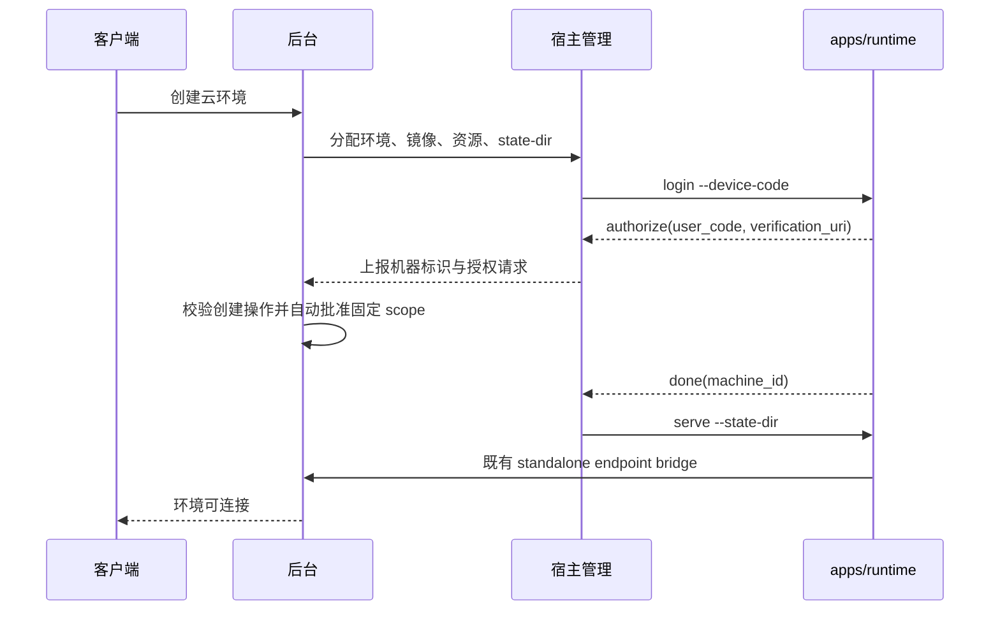
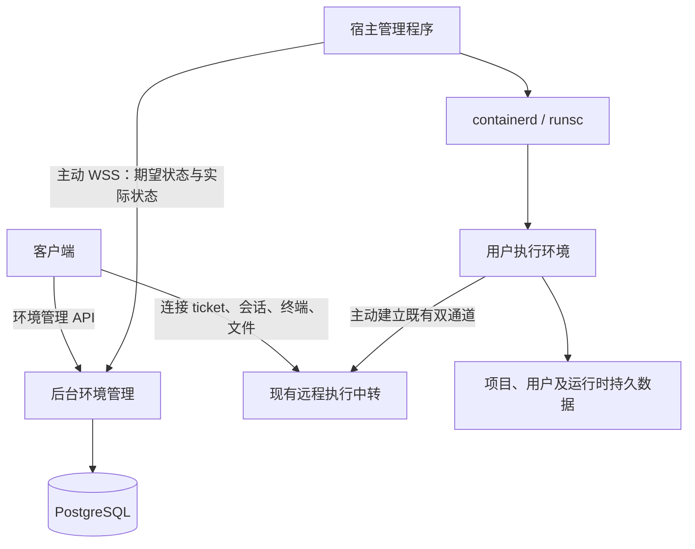

# 云端执行环境设计方案

状态：基础链路源码已完成，真实宿主闭环待统一人工验收。本文保留完整设计目标，尚未交付的运维能力及实际接口以 [实施记录](cloud-environment-implementation.md) 和 [客户端接口](environment-client-api.md) 为准。

日期：2026-10-28。代码核对基线：后台仓库 `74166746`；运行时仓库 `MonkeyAI/apps/runtime` 当前 `b66614cd`。文中路径相对 `monkeyai/`，运行时路径单独注明。

本文确定首期实现边界及后续扩展契约。标注为“建议默认值”的参数须在 Linux 宿主验证后冻结；不能将设计目标或参考资料视为当前系统已具备的能力。

## 1. 需求与关键决策

### 1.1 已确认需求

- 管理员预设可用镜像、资源和存储规格；用户在客户端选择一个预设，一键创建云端环境。
- 完整管理链路为：客户端 → 后台管理 → 宿主管理 → 执行环境。
- 宿主管理运行在宿主机上，主动与后台通信，控制本机环境。
- 环境长期存在，保留项目与用户目录；停止后可以再次启动。
- 首期不支持 Docker、Compose、浏览器、图形桌面或 Windows。
- 需要资源控制，并为后续 Firecracker 和 Kubernetes 接入保留边界。

### 1.2 首期推荐组合

| 项目 | 决策 |
| --- | --- |
| 后台 | 沿用 Go、PostgreSQL、pgx、sqlc 的模块化单体 |
| 宿主管理 | 独立 Go 守护进程 `monkeyai-engine`，由 systemd 管理 |
| 容器管理 | 专用于云环境的 containerd，通过 Go 客户端访问本地 Unix socket |
| 隔离 | gVisor `runsc`，通过对应 containerd shim 启动 |
| 资源控制 | 宿主 cgroup v2、存储配额、网络策略及经验证的沙箱内限制 |
| 镜像 | 管理员维护的 Linux OCI 镜像预设，固定架构及摘要；平台定义兼容契约 |
| 存储 | 首期本地 XFS 配额目录；持久数据与运行实例分离 |
| 调度 | 后台选择宿主，宿主二次核验；首次分配后固定宿主 |
| 管理通信 | 宿主主动建立 WSS 长连接，HTTP 完成注册与认证 |
| 任务连接 | 复用已有设备、远程中转、终端和文件协议 |
| 协调机制 | PostgreSQL 保存期望状态，后台和宿主分别持续核对；不增加消息队列 |

首期只交付 gVisor 驱动，不同时交付 runc 供普通用户切换。未来可信资源池可单独开放 runc，禁止因兼容性问题自动降级隔离。

Firecracker 是宿主执行驱动的扩展；Kubernetes 是环境供应后端的扩展，两者不放入同一个枚举或同一个驱动接口。

### 1.3 首期明确不提供

- 内存快照、进程休眠恢复、热迁移、宿主故障自动迁移。
- 系统根目录修改的持久化、环境内 root、特权容器、宿主目录和设备自定义挂载。
- 任意镜像无条件兼容、镜像构建服务、在环境内运行 Docker。
- 公网端口发布、SSH 入口、通用端口转发；现有文件预览不等于代理开发服务器。
- 跨用户共享环境、资源转移、分布式中转、多副本后台高可用。
- 计算资源自动扣费；首期记录用量，资源配额与现有积分额度分别管理。

## 2. 术语与不变量

业务术语补充在 [后端领域词汇](../backend/CONTEXT.md)。实现中区分以下对象：

| 对象 | 定义及身份 |
| --- | --- |
| 环境 | 用户长期持有的执行目标，`environment_id` 稳定 |
| 运行实例 | 环境某次启动形成的实体，`instance_id` 每次启动重新生成 |
| 执行端 | 现有远程执行目标，沿用 `(user_id, machine_id)`，环境与其一对一绑定 |
| 宿主 | 承载运行实例的 Linux 节点，`host_id` 独立于用户执行端 |
| 持久卷 | 独立于运行实例的存储对象，`volume_id` 不随启动变化 |
| 管理操作 | 创建、启动、停止等异步生命周期操作，使用 `operation_id`，不是用户会话 |

必须保持：

1. 所有环境归属于当前系统的一个用户；沿用系统单实例边界，不新增租户模型。
2. 一个环境同一时刻至多有一个可写运行实例；失联不能当作已停止。
3. 环境 ID、machine ID、运行实例 ID 和宿主 ID 不互相替代。
4. 删除运行实例不自动删除持久卷；停止不释放持久存储配额。
5. 容器存活、运行时就绪、远程可连接分别判断。
6. 用户不能通过镜像参数、环境变量或远程终端获得宿主管理权限。
7. 配额、实际限制和能力声明一致；不支持的资源约束必须拒绝，不能忽略。
8. 管理消息允许重复，所有副作用可核对、可去重；不承诺消息恰好投递一次。

## 3. 当前项目能力与增量

| 当前能力 | 复用方式 | 需要增加的部分 |
| --- | --- | --- |
| `internal/endpoint` 的设备与执行登记 | 云环境作为用户执行端出现 | 环境绑定、托管来源、生命周期联动 |
| `internal/relay` 双通道、ticket、终端和文件代理 | 云端运行时主动连接现有中转 | 托管环境身份验证、当前实例检查 |
| `internal/identity` OAuth、独立设备授权 | 首期复用设备码授权、刷新和撤销机制 | 后续可增加无人工设备码的环境引导授权 |
| `internal/session` 会话目录和上报 | 继续按 machine ID 关联 | Linux 无界面运行时的会话数据持久化验收 |
| `internal/apikey` 独立执行调用密钥 | 保留与执行授权绑定的模型、MCP 调用方式 | 环境状态校验、连接撤销与删除时授权撤销 |
| PostgreSQL、迁移、审计、配置 | 沿用现有工程约定 | 新增环境管理业务表和宿主管理入口 |

现有 `deployment_mode` 仅包含 `desktop_managed/standalone`；首期云环境沿用 `standalone`，无需修改该约束。后续引入 `cloud_managed` 时，证明校验和数据库约束都需要显式扩展，不能只在客户端发送新值。

现有中转在线路由保存在进程内。首期仍只有一个活动后台中转进程；增加宿主数量不改变这一部署限制。发布允许短暂断连，宿主和运行时重连，已受理会话是否继续由运行时保证。

服务端已有协议不代表 Linux 无界面执行程序已经具备本方案要求。可独立发布、无桌面依赖的运行时是首期交付前置条件，需跨组件联调。

### 3.1 现有运行时的实际位置与复用方式

环境内运行时已经位于独立仓库 `/Users/yoko/chaitin/ai/aicoding/MonkeyAI/apps/runtime`，模块路径为 `github.com/chaitin/MonkeyAI/runtime`。它不是需要从零新建的组件，云环境应在此基础上增加一种部署模式。

当前可直接复用的代码边界：

| 目录或入口 | 已有能力 | 云环境复用方式 |
| --- | --- | --- |
| `cmd/monkeyai-runtime/` | `serve`、独立登录、独立启动、状态和退出 | 首期直接调用现有 `login --device-code`、`serve --state-dir`、`status` 和退出流程 |
| `internal/app/` | runtime 组合根，会话、引擎、终端、上传、文件和本地 HTTP 面 | 继续作为容器主进程；宿主只负责生命周期，不调用业务方法 |
| `internal/remote/` | 执行公钥、设备状态、远程开关、发布与撤销 | 首期直接复用 standalone；后续再新增 `cloud_managed` 部署来源和环境／实例绑定 |
| `internal/controlplane/` | 控制面 API、资源同步、品牌和调用凭据 | 复用用户资源读取；首期不增加 runtime 专用 bootstrap 入口 |
| `internal/session/` | 会话队列、状态、事件和恢复资料 | 将 profile 挂载到环境持久卷；停止后不恢复运行进程，只恢复磁盘资料 |
| `internal/workspace/` | workspace 根、路径校验、目录和 Git 查询 | 把 `/workspace` 作为唯一用户项目卷挂载点 |
| `internal/store/` | profile、sessions、队列、配置和本地持久化 | 把 profile 与用户目录、运行时数据卷分开规划，不能把凭据暴露给普通文件 API |
| `internal/host/` | 当前 Electron／宿主到 runtime 的 stdin/stdout 启动握手 | 首期不使用该入口；通过现有 standalone CLI 启动，无需修改 runtime |
| `internal/installation/` | 独立安装根、账号、凭据和状态目录 | 不直接复用独立设备安装流程；云环境身份由后台按实例签发 |

因此，方案中的“环境内运行时”应解释为现有 `apps/runtime` 的 Linux headless 构建，而不是另写一个只负责执行命令的服务。首期不修改该仓库，容器入口直接使用已有命令：

```text
monkeyai-runtime login --device-code --state-dir /var/lib/monkeyai-runtime \
    --server <后台地址> --name <环境名称>
monkeyai-runtime serve --state-dir /var/lib/monkeyai-runtime \
    --engine-bin /opt/monkeyai/ohmyagent
```

宿主管理程序负责运行第一个命令。首期由用户创建环境这一明确动作触发后台自动批准对应的设备授权，runtime 仍按原协议轮询并保存凭据，宿主随后启动 `serve`；客户端不再出现第二次设备码确认。长期执行私钥和 OAuth 凭据由现有 runtime 保存在 state-dir 内的受限目录，不能把后台管理 token、宿主 token 或用户 refresh token 放入镜像环境变量。

首期数据库将环境绑定到 runtime 返回的 `machine_id`，后台按该 machine ID 使用已有 endpoint、connection ticket 和 relay 能力。这样后台知道“哪个 standalone endpoint 属于哪个环境”，但协议层仍将它视为独立执行端。后续需要无交互引导、实例级授权或更严格的云环境身份时，再增加 `cloud_managed` 部署来源；那时才同步修改 runtime 的部署模式校验、远程状态文件、设备声明、授权兑换和启动测试。

#### 首期不修改 runtime 的启动流程



登录操作本身可以是异步环境操作；如果后台授权策略不满足、请求过期或宿主断线，后台保留结构化失败原因及已有 state-dir，核实授权和身份状态后重试，不因超时删除唯一设备身份。自动批准只允许由已认证用户创建的环境操作触发，固定为 `device:bind device:publish session:report`，绑定 user、environment、host 和 machine 公钥，并设置很短的有效期；不能做成按 machine ID 无条件自动批准。重复重试先检查已有 `machine_id` 和授权状态，不能为同一个环境并行启动两个 login。

首期要持久化整个 runtime state-dir，而不只是项目目录，因为现有 standalone 模式的设备密钥、凭据、账号映射、profile 和会话资料都通过该目录关联。宿主将用户项目卷挂载到固定路径，并在客户端能力说明中约定工作区路径；runtime 本身不需要知道该路径是云盘还是本地目录。

## 4. 总体架构与模块边界



### 4.1 后台管理

- 鉴权、用户资源配额、规格与镜像策略。
- 环境记录、调度绑定、资源预留、异步操作和期望状态。
- 宿主接入、能力目录、在线观测、撤销和维护状态。
- 受限设备请求自动批准、执行端关联、审计和用量事件。
- 不直接访问 containerd，不 SSH 到宿主执行脚本，不保存用户会话正文。

### 4.2 宿主管理

宿主管理程序统一命名为 `monkeyai-engine`，负责云环境基础设施管理。它与 `apps/runtime` 内部负责会话执行的任务引擎是不同组件；预设中的 `task_engine.version` 和 runtime 的 `--engine-bin` 仍指任务引擎。

- 检查宿主前置条件，报告总容量、预留容量和能力。
- 执行镜像拉取、卷准备、配额、网络、容器创建和回收。
- 本地串行核对每个环境，恢复进程崩溃中断的操作。
- 报告实例状态、资源观测、运行时健康和错误原因。
- 以宿主系统服务身份访问本机 containerd、网络和存储；权限不下放到环境。

### 4.3 环境内运行时

- 作为容器主进程，管理子进程回收与优雅退出。
- 执行会话、命令、终端、上传下载及会话记录持久化。
- 完成环境专用身份兑换、设备证明及中转连接。
- 不控制宿主资源，不创建其他环境，不持有用户客户端 refresh token。

### 4.4 建议代码布局

```text
backend/internal/environment/   环境、宿主、配额、操作、供应接口及 SQL
backend/internal/identity/      受限设备请求自动批准与执行授权
backend/internal/endpoint/      托管执行端登记
backend/internal/relay/         复用中转及新增实例校验
engine/                        新增的独立 Go 模块与宿主管理程序
  cmd/monkeyai-engine/
  internal/control/            认证与后台协议
  internal/reconcile/          本地状态核对
  internal/driver/             驱动接口与 gVisor 实现
  internal/storage/            卷和配额
  internal/network/            网络及访问策略
  internal/state/              本地检查点
apps/runtime/                  现有运行时仓库（另一个 Git 仓库）
  cmd/monkeyai-runtime/        原有 standalone 入口，不修改
  internal/app/                runtime 组合根
  internal/remote/             设备发布、租约、撤销与中转连接
  internal/session/            会话和执行状态
  internal/workspace/          workspace 路径与文件能力
```

接口定义在使用方，集成层显式适配。跨进程共享的是版本化 JSON 契约，不是后端内部包；首期不创建通用 `common/provider/framework` 库。遵循 [后端工程约束](../backend/AGENTS.md)，生成代码和共享集成点由集成工作统一维护。

## 5. 两层扩展契约

### 5.1 环境供应接口

后台面向供应后端提交完整期望规格，并取得观测结果。语义为 `Apply`、`Inspect`、`Inventory`、`Capabilities`；远程调用只表示受理或当前观测，不同步等待环境可用。

统一规格包括：环境与实例 ID、配置代次、调度代次、镜像摘要、运行时版本、资源规格、卷引用、网络策略及目标状态。规格不包含本机路径、containerd 对象、Pod 结构或 Firecracker API 字段。

- `host` 后端：后台完成宿主选择，宿主管理执行本机资源操作。
- `kubernetes` 后端：集群管理组件主动连接后台，通过 K8s API 管理资源；由 Kubernetes 调度到节点。

首期只实现 `host`。K8s 接入后原链路中的“资源管理执行方”换为集群组件，不要求每个 K8s 节点再运行一套绕过 kubelet 的宿主管理。

### 5.2 宿主执行驱动

宿主管理内部提供 `Prepare/Create/Start/Stop/Inspect/Remove` 的最小语义，驱动接收已经授权和规范化的规格。存储和网络准备由宿主管理协调，驱动返回底层实例引用。

- `gvisor`：OCI 镜像、containerd snapshot、runsc shim。
- `firecracker`：客体内核、根文件系统、块设备、TAP、jailer 和 microVM。

不要求驱动都具备热调整、快照、迁移和相同启动参数；这些由显式能力表示。两类后端不能通过任意 JSON 透传绕过资源与权限验证。

## 6. 数据模型

以下为逻辑表名，正式迁移实施时按仓库工具生成序号，不预占迁移编号。

| 表 | 主要字段 | 约束 |
| --- | --- | --- |
| `environment_hosts` | ID、名称、架构、版本、公钥、认证版本、能力、总量与可分配量、维护状态、连接代次、最后心跳 | 名称不作身份；撤销节点禁止新授权 |
| `environment_presets` | ID、版本、名称、描述、镜像引用与摘要、架构、driver、runtime／engine 版本、资源、存储、网络策略、状态和最低宿主能力 | 版本不可变；停用阻止新建，不改变已保存的环境规格 |
| `environments` | ID、user_id、machine_id、名称、preset_id、preset_version、backend、provider_id、driver、镜像摘要、资源快照、卷绑定、host_id、desired_state、phase、generation、observed_generation、assignment_epoch、current_instance_id | machine_id 在首次初始化前为空，绑定后用户与 machine 唯一；host_id 仅用于宿主后端，provider_id 为后端实例引用 |
| `environment_instances` | ID、environment_id、assignment_epoch、generation、provider_ref、boot_id、阶段、起止时间、退出原因 | 未确认结束的实例每环境至多一个 |
| `environment_volumes` | ID、user_id、environment_id、用途、backend、provider_ref、宿主或拓扑约束、容量和 inode 配额、状态、保留期限 | 无运行实例的卷仍存在并占配额 |
| `environment_operations` | ID、操作者、目标、动作、幂等键、请求摘要、目标代次、阶段、进度、错误、时间 | 操作者＋动作＋目标范围内幂等；禁止无限增长 |
| `environment_reservations` | 环境、实例、宿主、CPU、内存及开销、磁盘、状态 | 创建／启动与预留同事务；释放需要权威终态 |
| `environment_credentials` | 环境、实例、宿主、公钥、设备授权请求摘要、过期与消费状态、授权族引用 | 首期记录现有设备码请求与 standalone 授权结果；owner 从环境记录获取 |
| `environment_usage_events` | 实例、事件序号、运行起止、资源规格、数据来源及完整性 | 重复事件不重复入账；失联时段标为待核对 |

用户配额配置至少包含环境总数、同时运行数、预留 CPU、预留内存和持久存储总量。首期采用系统默认＋用户覆盖；不复用积分额度字段，也不强制引入分组继承逻辑。

### 6.1 环境预设

后台维护 `environment_presets`，客户端只能选择启用的预设，不能直接提交镜像引用、containerd 参数、网络规则或资源数值。预设至少包含：

| 字段 | 说明 |
| --- | --- |
| `preset_id`、`version`、`name`、`description` | 面向客户端的稳定标识和展示信息 |
| `image_ref`、`image_digest`、`architecture` | 管理员批准的 OCI 镜像及不可变摘要 |
| `driver`、`runtime_version`、`engine_version` | 首期固定为 gVisor 及已验证运行时组合 |
| `cpu_millis`、`memory_bytes`、`pids_limit` | 环境总资源上限和调度预留 |
| `workspace_bytes`、`home_bytes`、`runtime_bytes`、`inode_limit` | 项目、用户和运行时数据配额 |
| `network_policy` | 预设的出站访问策略，不允许用户扩大 |
| `status`、`min_host_capabilities` | 启停状态和宿主准入条件 |

用户创建环境时只提交 `preset_id`、环境名称（可选）和幂等键。后台事务读取当前预设版本，将完整解析结果复制到 `environments` 的规格快照中；之后管理员修改或下线预设，不改变已有环境。预设下线只阻止新建和切换到该预设；已有环境按保存的快照重启，不强制停止已经运行的环境，除非管理员另行发起治理操作。

首期可以提供 `基础开发`、`标准开发` 等少量预设。预设的名称和数值是产品契约，必须经过真实宿主容量与 gVisor 兼容性验证后发布；不能因为底层资源不足而在创建时静默降级。

所有用户入口按 `user_id + environment_id` 查询。管理员能够治理停止、删除和查看资源指标，但不因管理角色自动获得用户会话、终端或文件权限。

宿主本地保存必要的应用代次、实例引用、卷映射和操作步骤检查点。采用独占进程锁、每环境文件锁、原子文件替换和目录同步；containerd 标签及实际磁盘状态作为恢复核对依据。本地记录损坏不能触发目录批量删除。

规格名称仅用于展示和选择，环境保存解析后的数值快照及规格版本。管理员修改某个规格模板不能悄悄改变已运行环境的资源限制。

## 7. 状态与生命周期

### 7.1 状态分离

`desired_state` 仅为 `running/stopped/deleted`。观测阶段为：

```text
pending → preparing → starting → running → stopping → stopped
                      └→ failed             └→ failed
stopped → preparing
任意非终态 → deleting → deleted
```

`failed` 不意味着实例已消失。另行记录 `instance_present`、`runtime_ready`、`relay_online`、`stale` 以及 `reason`。宿主失联只将观测标记过期，不把状态改成已停止，也不释放资源预留。

环境“可连接”需要：当前实例正在运行、运行时健康、设备证明完成、既有中转在线且授权有效。API 返回独立 `connectable` 字段。

`failed` 对当前启动代次锁定：协调器可以重试镜像拉取等尚未启动的暂时性失败，但不能因为 `desired_state=running` 就无限重启已退出的用户运行实例。失败后用户再次显式启动会产生新的代次和操作，即使目标值仍是 `running`。后台重启只恢复协调，不重放会话命令。

### 7.2 创建与首次启动

1. 客户端提交 `preset_id`、可选名称和幂等键；后台验证预设仍启用、用户可见、用户配额及环境数量额度。
2. 后台事务读取预设的当前版本，创建环境、持久卷记录、操作和初始资源预留；machine ID 暂为空，由 runtime 初始化后绑定，返回 `202`。
3. 根据架构、驱动能力、镜像策略、容量、维护状态选择宿主；按固定锁顺序复核并写入分配。资源不足进入有期限的排队状态，不无限占用启动名额。
4. 宿主接收完整规格，验证配置与调度代次，二次检查实际容量。仅接受绑定给自己的环境。
5. 宿主按已发布预设中的摘要拉取镜像，核验运行时与任务引擎发行包；不在创建过程中解析浮动标签。准备独立配额目录、网络和只读根文件系统。
6. 创建实例并启动现有 standalone 登录流程。runtime 生成身份，engine 在同一实例中运行 `status --state-dir` 取得公开 machine ID 和公钥，与设备码一起上报。后台核验当前创建操作和待批准请求后自动批准，再启动 serve 并完成设备证明。
7. 宿主上报实例运行，运行时建立中转。后台汇合两侧状态，标记 `connectable=true`，操作成功。

镜像已经提供摘要时仍验证拉取内容与摘要一致。排队、解析和拉取有分别的截止时间，超时操作终止；是否释放预留取决于资源是否确实未创建或已清理。

客户端创建统一以运行为目标，不暴露 `start` 参数。等待计算资源期间保留已分配存储；排队到期将该启动代次标为失败，释放没有实体占用的计算预留，不自动重新排队。

### 7.3 停止与再次启动

- 显式停止代表允许中断环境内会话，客户端提交前展示影响；接口采用目标状态与 `If-Match`，不把客户端断开当作停止。
- 先按环境状态阻止新连接和新会话，撤销既有连接票据；宿主发送 SIGTERM 让运行时保存状态并退出。普通停止保留 standalone 授权族和调用密钥，后台网关根据关联环境状态阻止停止期间的新调用。
- 建议优雅退出期限 30 秒，随后由宿主终止整个沙箱。必须确认执行实体及相关进程退出，才能释放计算预留。
- 删除本次临时根、网络和临时数据，保留项目、用户和运行时业务数据；持久存储继续占配额。
- 再次启动创建新 `instance_id/boot_id`，复用环境、machine ID、执行密钥、standalone 授权和持久数据；授权过期时按本次显式启动操作重新编排设备登录。系统目录从原镜像摘要重建。
- 进程和正在执行的命令不会恢复；运行时应将未完成操作标为中断或结果未知，不自动重放有副作用的命令。

### 7.4 规格与镜像更新

首期只允许确认停止的环境切换预设，并推进 `generation`；也可以单独修改环境名称。运行中切换预设返回 `409/environment_must_stop`，不暗中重启。切换时重新校验用户配额、存储容量和目标宿主能力，并为新预设生成新的规格快照。

持久卷只允许扩容，不支持缩容；扩容先预留存储，再修改实际配额，失败则核对实际值后回滚预留。镜像更新不覆盖既有用户文件，客户端需要了解新镜像与旧用户依赖可能不兼容。

### 7.5 删除与持久数据

`DELETE` 默认 `data_policy=retain`：撤销访问、停止并删除运行资源，保留卷供导出或后续清理。环境 API 保留墓碑及数据引用；保留数据建议默认 7 天，期限可配置且在删除前展示，期间持续占配额。

`data_policy=purge` 表示显式删除持久数据；后台记录审计并要求匹配资源版本。宿主失联时只能处于删除待处理，不能声称物理数据已清除。

实例删除完成与卷清理完成分别记录；卷对象保留用于后台重试。保留期结束的清理必须核实没有活动实例、没有其他合法绑定、目标路径仍属于该卷。环境 ID 和墓碑保留至所有操作和数据清理收敛，禁止因消息迟到重建已删除环境。

首期保留期内的数据导出由管理员运维流程完成，采用停止态归档；不承诺已有客户端具备回收站恢复界面。

## 8. 后台与宿主协议

### 8.1 宿主身份

管理员创建有效期建议 10 分钟的一次性接入凭据，限制使用次数、宿主类别和可注册名称。宿主本地生成 Ed25519 密钥，提交公钥和接入凭据；后台原子消费凭据并建立 host ID。

后续用服务端一次性挑战及宿主私钥签名换取短期宿主 access token，建议有效期 15 分钟；挑战绑定 server ID、host ID、用途、随机数及期限。私钥仅保存在宿主受限目录，不进入镜像、用户目录和日志。

宿主 WSS 使用独立认证入口及 audience，不经过用户 OAuth 的 `RequireAgent`。服务端对在线连接定期复验认证版本；续期不能绕过管理员撤销。正式部署必须验证 TLS 证书，禁止默认跳过验证。

管理端创建接入凭据建议使用 `POST /api/admin/v1/environment-host-enrollments`；宿主使用 `POST /api/host/v1/enroll` 注册，`POST /api/host/v1/challenges` 获取挑战，`POST /api/host/v1/token` 证明并兑换 token。所有入口限制速率与正文大小，错误不能回显凭据；名称和平台信息由策略校验，不等于硬件可信证明。

### 8.2 建连与消息

新入口建议为 `/api/host/v1/connect`。握手交换协议版本、host ID、宿主 boot ID、当前能力及已应用代次；后台返回 `connection_epoch`，同宿主新连接使旧连接不再具备下发或上报资格。

管理消息使用版本化 JSON：

```json
{
  "version": 1,
  "type": "environment.apply",
  "message_id": "消息标识",
  "operation_id": "操作标识",
  "host_id": "宿主标识",
  "connection_epoch": 7,
  "environment_id": "环境标识",
  "instance_id": "本次实例标识",
  "assignment_epoch": 1,
  "generation": 3,
  "spec": {
    "desired_state": "running",
    "driver": "gvisor",
    "image_digest": "sha256:镜像摘要",
    "resource_profile": "规格标识",
    "resources": {"cpu_millis": 2000, "memory_bytes": 4294967296},
    "volume_refs": ["项目卷标识", "用户卷标识", "运行时数据卷标识"]
  }
}
```

消息类型至少包括 `hello/welcome/heartbeat/environment.apply/operation.ack/environment.status/inventory.request/inventory.page/error`。示例中的中文标识是占位值，实施时 ID、摘要、字段范围和必填约束均进入 Schema。

建议心跳 15 秒、45 秒未收到有效心跳标记失联。控制消息上限 256 KiB，清单分页每页最多 100 项；日志和文件不通过管理通道传输。消息队列有界，满时断连并重新同步，不能无限缓存内存。

`ack` 仅表示接收，成功必须依据实际资源状态。进度允许丢失，最终状态通过清单恢复。宿主状态携带单调 `report_seq`，后台按宿主 boot、连接代次、实例和序号拒绝旧报告。

实例创建后的优雅停止通过宿主驱动发送终止信号并等待退出；不依赖已撤销的用户中转连接。宿主管理协议只接受生命周期操作，不能借管理权限提供任意宿主 shell。

### 8.3 幂等与协调

- API 幂等键建议保留 7 天，同键同请求返回原操作，同键不同请求返回 `409`。
- 环境 `generation` 随目标规格变化递增；旧代次不得覆盖新代次。
- `assignment_epoch` 用于调度归属，不与现有中转的 `lease_epoch` 混用。
- 每环境宿主侧串行执行；在每个外部副作用前重新核对目标代次。创建过程中到达停止／删除请求，转入取消和清理，不等旧流程自然完成后再次启动。
- 本地创建资源携带环境、实例、代次和管理者标签。重试先查询和认领匹配资源，再决定是否创建。
- 后台持久化期望状态与操作的事务是发送依据；发送失败由后台扫描重发，不依赖只在内存中的通知。
- 节点重连先上传分页清单，再核对后台目标。未知资源先隔离调查，未知持久卷不自动删除。

令牌和代次不能远程停止网络分区中的旧实体。首期通过固定宿主、不自动迁移和本地唯一运行锁避免双写；未来迁移必须先证明旧实体已退出，或通过宿主隔离及存储写入隔离完成 fencing。

## 9. 云环境身份与现有执行协议

### 9.1 三种身份独立

| 身份 | 权限 |
| --- | --- |
| 用户客户端 | 管理自己的环境，通过既有 ticket 访问执行端 |
| 宿主管理 | 报告和管理分配到本宿主的环境；无用户会话访问授权 |
| 环境运行时 | 发布自己的执行端、上报自己的会话、使用本环境受限调用密钥 |

宿主运维权限在物理上可以读取该宿主环境数据，本方案不提供对宿主管理员的机密计算保护；应用层权限仍禁止将宿主身份当作用户身份访问其他环境。

### 9.2 引导与运行授权

首期不改 runtime，采用现有 standalone 设备授权流程：

1. 用户创建／启动请求明确授权平台为其建立云端执行端。
2. 宿主管理为环境创建独立 `state-dir`，运行 `monkeyai-runtime login --device-code`。
3. runtime 返回设备码和验证地址；宿主管理将授权请求上报，后台根据创建操作自动批准固定 scope。
4. 批准后 runtime 将凭据、设备公钥、machine ID 和 profile 写入该环境的 state-dir；宿主管理只启动同一 state-dir 的 `serve`。
5. 后台沿用现有 `purpose=runtime`、`device:bind device:publish session:report` 和 standalone endpoint 规则，将返回的 machine ID 与 environment ID 建立一对一绑定。
6. 模型、MCP 调用继续使用绑定执行授权的专用调用密钥，不下发用户全局密钥。

设备码授权本身原本支持人工确认；云环境首期把用户创建环境作为等价的明确授权，由后台代为完成一次批准。因此不需要 runtime 改动，也不需要把设备码展示给用户。设备码、验证地址和错误码仍通过宿主控制协议传递，不能写入用户镜像环境变量；若自动批准失败，操作返回明确错误，而不是退回人工流程。

宿主管理只允许将已分配环境的 machine ID 回写到对应记录；后台拒绝同一 machine ID 绑定多个活动环境。响应丢失时先查询已有 endpoint 和 state-dir，再决定是否重试，不能重复登录生成多个设备。

执行密钥、凭据和 profile 由现有 standalone runtime 保存在独立 state-dir。停止时保留 state-dir，启动时复用；删除时按数据策略清理。备份恢复到新环境必须生成新 machine ID 和密钥，不能复制活跃身份。

后续若需要不经过设备码协议的实例级引导，再新增 `cloud_managed` 部署来源和 `POST /api/runtime/v1/bootstrap`；届时同步修改 runtime 的部署模式校验、远程状态文件、设备声明、授权兑换和启动测试。首期不把该扩展作为上线前置条件。

普通停止或同环境实例替换时撤销旧连接票据并核实旧实体退出，保留 standalone 授权；删除、用户停用或显式设备撤销时撤销授权族及相关调用密钥。暂停远程访问不等于操作系统进程已停止；后台保持停止待确认状态直至宿主核实退出。

### 9.3 执行端撤销与环境管理联动

云环境的正常停止／删除走环境 API。若用户通过既有设备撤销入口移除远程登记，立即使访问失效，并将环境目标改为停止、保留数据；不能被宿主自动重新发布绕过撤销。

再次显式启动才可批准恢复云环境登记，按既有登记版本检查处理。管理员资源治理不能顺带签发用户连接 ticket。

## 10. 镜像契约与运行时注入

首期兼容范围建议为 Linux AMD64、经验证的 Debian／Ubuntu 类镜像；支持外部 OCI 仓库，宿主架构必须匹配，不启用模拟执行。版本清单记录 containerd、runsc、shim、CNI、宿主内核及运行时版本，禁止使用浮动 `latest` 作为部署锁定值。

镜像契约：

- 运行用户固定为非 root UID/GID 1000，`HOME=/home/monkey`，默认工作目录 `/workspace`；镜像必须允许该身份读取和执行所需程序。
- 预设镜像必须包含经过签名和版本校验的 `monkeyai-runtime` 及其 `--engine-bin` 对应引擎，或者由宿主管理以只读方式挂载同一版本的运行时发行包；运行时版本和引擎版本写入预设，不能由用户替换。
- 平台入口启动现有 `monkeyai-runtime login --device-code`／`serve --state-dir` 流程；首期不运行用户自定义 ENTRYPOINT 或初始化脚本。
- 若使用只读注入目录，运行时以只读目录挂载到 `/opt/monkeyai`。其动态库依赖必须列入镜像契约；不能假设任意运行时都能作为静态二进制注入。
- 工作目录和用户目录由平台挂载；初次创建时从镜像相应目录复制初始化内容，不跟随越界符号链接，不覆盖已有卷。
- 系统根文件系统只读，`/tmp`、`/run`、`/dev/shm` 使用有界临时挂载。需要系统包的用户构建新镜像；用户目录内的语言依赖、虚拟环境及配置可长期保留。
- 丢弃 Linux capabilities，启用 no-new-privileges；不开放宿主 PID／网络／IPC namespace、设备、socket、可写 cgroup 或自定义宿主路径。

镜像拉取在宿主执行，限制压缩包、解包大小、文件数、层数、并发和拉取期限，避免镜像准备耗尽宿主。使用 containerd 的镜像内容校验和解包机制，不自行用 shell 拼接 tar 解压。

私有仓库凭据仅供宿主拉取：后台加密保存、日志脱敏、按仓库授权、短期下发，不写入用户环境。首期可只开放管理员配置的仓库凭据；用户自助管理凭据作为后续能力。

镜像仓库地址、重定向和凭据 realm 都必须按宿主出站策略验证，不能让指定镜像成为访问宿主或云元数据的代理。内部仓库由管理员明确放行。

共享镜像缓存按摘要管理，只有没有活动或准备中引用的内容可回收；镜像撤销策略分别定义“禁止新启动”和“强制停止”，不自动混淆。

## 11. 持久化与容量控制

### 11.1 挂载布局

| 环境路径 | 内容 | 生命周期与配额 |
| --- | --- | --- |
| `/workspace` | 项目和用户产物 | 持久化，独立容量与 inode 配额 |
| `/home/monkey` | 用户配置、依赖、缓存 | 持久化，独立容量与 inode 配额 |
| `/var/lib/monkeyai-runtime` | 完整 standalone state-dir，包含身份、凭据、profile 和会话资料 | 持久化，有界；不经通用文件 API 暴露凭据 |
| `/tmp`、`/run`、`/dev/shm` | 临时文件 | 每次启动重建，限制大小并计入内存预算 |
| 系统根目录 | 镜像内容 | 只读，不持久化修改 |

运行时数据虽不属于用户项目，仍是“停止后继续访问原会话”的必要条件。任务程序与运行时处于同一沙箱时，不把文件权限视为足以抵御该环境所有代码的隔离边界；环境身份必须始终被限制在本环境。

### 11.2 首期存储实现

宿主使用专用 XFS 数据文件系统并开启 project quota；每卷目录有独立 project ID、字节及 inode 硬限额。权限、配额和 project 继承设置成功后才能挂载到环境。后台仅持有 volume ID，实际路径保存在宿主卷映射中。

不支持项目配额的节点不声明持久卷硬配额能力，首期不接收普通用户环境。周期性 `du` 只能用于观测，不能代替配额。

环境日志、运行时状态和镜像缓存分别设置总量及单项上限；系统盘与用户数据盘分开。即使使用稀疏文件或共享存储，容量承诺也不能只按当前已用字节调度。

首期持久容量不超卖：已分配硬配额之和＋运行时元数据预算＋安全余量不能超过数据盘可用容量。停机不释放这些预留。

### 11.3 备份与迁移边界

首期本地持久化能承受进程重启和正常宿主重启，不能抵御磁盘损坏或宿主丢失。投入生产前配置停止态备份：归档项目、用户和运行时业务资料，保存镜像摘要、UID/GID、规格、校验和及版本；活动凭据不作为可跨环境复用的备份内容。

备份可写入现有 S3 兼容对象存储的独立前缀／桶，并采用与技能资源不同的权限及保留策略；首期不建设在线备份服务或用户自助快照。

恢复要求先隔离旧实例；同环境恢复需处理身份与授权版本，新环境恢复必须生成新身份。以停止态恢复演练验证恢复点和时长，不承诺未经测量的 RPO/RTO。

## 12. 资源规格、限制与调度

### 12.1 规格示例

以下为建议初始规格，不是已验证容量或性能承诺：

| 参数 | 基础规格示例 | 执行方式 |
| --- | --- | --- |
| CPU 上限与预留 | 2 核 | `cpu.max`＋后台预留，首期不超卖 CPU 预留 |
| 环境总内存 | 4 GiB | 外层 `memory.max`，包含 Sentry、Gofer、临时文件等环境开销 |
| swap | 0 | 对应 cgroup v2 禁用 swap |
| 项目容量 | 20 GiB | XFS project quota |
| 用户容量 | 10 GiB | XFS project quota |
| 运行时数据容量 | 2 GiB | 独立配额，计入用户存储总量 |
| 临时目录 | 512 MiB | 有界临时挂载，计入环境内存 |
| 沙箱内任务数 | 512，须兼容验证 | 沙箱内受保护的进程控制器；非宿主 PID 数量 |
| 宿主辅助进程／线程 | 根据实测单独设置 | 外层 `pids.max`，避免过低限制破坏 runsc |
| 文件描述符 | 每进程 4096 | 经验证的 RLIMIT，另有宿主总量保护 |
| 网络带宽 | 可选 100 Mbit/s | 宿主 veth＋流量控制，限制收发方向 |

容器规格内存表示沙箱总预算，可供用户程序使用的内存小于该数值。宿主程序、镜像拉取和后台监控另计系统预留；如果未来规格改为承诺纯业务内存，需额外预留运行时开销，不能沿用同一标签而改变含义。

### 12.2 gVisor 特有约束

- CPU、内存硬限制放在宿主外层，核验 Sentry、Gofer 和相关辅助进程的实际 cgroup 归属；不能只对运行时主 PID 记账。
- 宿主 PID 限制主要约束运行时实现的进程／线程，不等同沙箱内用户进程数。
- 核对的上游 `sys_rlimit.go` 明确将 `ProcessCount` 列为可设置但不执行的限制，不能用 `ulimit -u` 证明进程限制生效。
- 所选固定版本必须验证沙箱内 pids 控制器的 fork／clone 限制及不可修改性。若版本不能提供这一能力，不声明硬进程上限；若产品将硬进程上限作为准入要求，则阻止上线，不能退回特权 runc。
- gVisor 的 CPU／内存限制不能假定在沙箱内部不同进程之间有效；首期只承诺环境整体资源边界。
- 文件 I/O 可能经过 Gofer 和共享文件系统，不能只设置 `io.max` 后宣称达到每环境 IOPS 承诺。首期提供容量硬限额和宿主磁盘保护；精确 IOPS／带宽仅在固定存储组合验证后作为能力开放。

### 12.3 配额与调度算法

创建时检查环境总数和持久容量，启动时检查同时运行数、CPU 和内存总量。新环境先筛选健康、非维护、架构匹配、能力满足且有存储的节点，再按预留后 CPU／内存最大利用率升序选择；镜像缓存命中只作为同分优先项。

```text
可调度 CPU = 节点可分配 CPU - 所有未释放的 CPU 预留
可调度内存 = 物理内存 - 系统预留 - 所有未释放的环境内存预留
可调度存储 = 专用数据盘容量 - 安全余量 - 全部持久配额及平台存储预算
```

后台按用户、宿主的固定顺序加锁，在同一事务内验证和预留。宿主接受指令时再次核对本地容量与实际盘状态，不足则拒绝并报告原因。失联、启动超时、停止失败的预留不能直接释放，必须核对实例是否存在。

已有环境启动只允许原宿主或同一受支持存储拓扑；首期不自动换宿主。资源规格变更均在停止态完成。

## 13. 网络与环境隔离

每个环境独立网络 namespace 和 veth，使用固定版本 CNI 组件完成地址分配及连接；宿主管理用 nftables 和流量控制落实网络策略。containerd namespace 只用于管理分类，不作为用户隔离边界。

默认允许受控 DNS 和访问公网所需出站流量，拒绝其他环境、宿主管理地址、平台数据库、容器 socket、云元数据以及未授权私网。后台中转、模型网关、制品仓库等部署在私网时，由管理员按目的地址和端口精确放行。

在宿主网络层检查实际目的地址，覆盖 IPv4、IPv6 和域名解析后地址变化；没有实现 IPv6 策略时禁用环境 IPv6。DNS 只允许指定解析器。网络策略限制连接目的地，不承诺阻止用户通过公网代理访问间接目标。

宿主启停和用户任务出站分开：宿主可访问镜像仓库，不意味着用户环境可访问全部管理网段。默认不暴露任何入站端口，客户端经平台中转使用任务、终端和文件。

## 14. 对外 API 草案

正式实现写入 `backend/api/agent.yaml` 和 `admin.yaml`，不另建重复的公开 OpenAPI 文档。宿主线协议单独版本化，不开放给用户 token。

### 14.1 客户端接口

| 方法与路径 | 行为 |
| --- | --- |
| `GET /api/v1/environment-presets` | 返回当前用户可用的启用预设和展示信息 |
| `POST /api/v1/environments` | 提交 `preset_id` 创建并启动，返回 `202` 和操作 ID |
| `GET /api/v1/environments` | 本人环境分页列表 |
| `GET /api/v1/environments/{id}` | 规格、观测、ETag、machine ID、数据保留信息和可连接状态 |
| `PATCH /api/v1/environments/{id}` | 改名或停止态切换到另一个可用预设；使用 `If-Match` |
| `PUT /api/v1/environments/{id}/state` | 设置 `running/stopped`，返回异步操作 |
| `DELETE /api/v1/environments/{id}?data_policy=retain` | 删除环境，显式指定数据策略并匹配版本 |
| `GET /api/v1/environment-operations/{id}` | 查询本人操作进度和结构化错误 |

客户端新增 `environment:read/environment:manage` scope，既有 token 不自动扩权。连接目标仍通过 `POST /api/v1/endpoints/{machine_id}/connections`，不引入第二套终端票据。客户端不获得任意镜像仓库、宿主路径或底层驱动参数的写权限。

所有写入要求 `Idempotency-Key`；已有资源修改另要求 `If-Match`。幂等命中优先返回原结果，不因其 ETag 已变化而把同一次重试误判为新操作。不同操作冲突由目标状态与代次协调，响应给出当前操作 ID。

列表／详情使用轮询及 ETag；首期不必新增客户端事件推送。响应字段建议：

```json
{
  "id": "环境标识",
  "name": "开发环境",
  "machine_id": "稳定执行端标识",
  "desired_state": "running",
  "phase": "starting",
  "generation": 3,
  "observed_generation": 2,
  "runtime_ready": false,
  "connectable": false,
  "stale": false,
  "operation_id": "操作标识",
  "reason": null
}
```

### 14.2 管理入口

管理端至少提供宿主接入凭据、宿主列表与详情、维护／撤销、用户配额、环境资源列表、停止／删除治理、操作记录和保留数据清理。请求沿用管理员 Cookie、CSRF 和审计规则。

维护状态包括：可调度、停止新分配、维护中、已撤销。停止新分配不停止已有环境；维护前需要显式停止环境。撤销立即阻止宿主新认证，但物理清理仍需节点恢复或带外运维完成。

### 14.3 错误语义

| 错误码 | 含义及处理 |
| --- | --- |
| `quota_exceeded` | 用户额度不足，修改配置后重试 |
| `capacity_unavailable` | 无满足能力和预留的宿主，可限时排队 |
| `host_unreachable` | 状态未知，不能推断已停止 |
| `image_incompatible` | 镜像不满足契约，不自动切换隔离方式 |
| `unsupported_capability` | 后端不能落实规格要求 |
| `environment_must_stop` | 修改要求先停止 |
| `generation_conflict` | 基于最新 ETag 重新判断用户意图 |
| `storage_quota_exceeded` | 容量或 inode 满，保留数据并报告 |
| `runtime_not_ready` | 实例存活但执行服务未可用 |
| `cleanup_pending` | 运行资源或数据删除尚未确认 |

同步校验用合适的 HTTP 4xx／5xx；已接受的异步操作将错误放在操作结果，不把 `202` 当作创建成功。用户响应不含主机路径、凭据和原始内部错误。

## 15. 故障恢复与资源回收

| 故障 | 处理 |
| --- | --- |
| 后台重启 | 从数据库恢复期望状态，宿主重连清单对齐；中转重新握手 |
| 宿主管理崩溃 | containerd／shim 中已有实例继续；守护进程重启后认领匹配实体 |
| 宿主与后台断网 | 已运行会话继续，停止新创建和自发重启；恢复后先核对目标 |
| 宿主重启 | 先联机核对目标，再启动仍要求运行的环境；不离线盲目复活旧实例 |
| 容器主进程退出 | 报告失败、清理实际资源，默认不自动重启或重放会话 |
| 创建成功但上报丢失 | 通过实例 ID、标签和清单认领，不能再次创建 |
| 镜像准备中收到停止 | 停止启动链路，取消专属准备资源；共享内容按引用回收 |
| OOM | 记录外层 cgroup 事件，终止残余实体并给出明确原因 |
| 数据盘满／inode 耗尽 | 拒绝新增，保留既有数据；允许不依赖新增磁盘空间的停止操作 |
| 节点永久丢失 | 保留未知状态与预留；管理员确认隔离后从备份恢复或标记数据丢失 |
| 删除指令重复／乱序 | 墓碑和代次保证删除不被旧启动指令覆盖 |
| 运行时密钥损坏 | 不自动覆盖登记公钥；按显式身份重置流程处理并撤销旧授权 |

容器运行生命周期不绑定宿主管理进程的正常退出；systemd 配置与 shim 行为必须验证。升级宿主管理先停止新分配，不能因重启服务杀掉全部用户环境。

宿主重启恢复属于受控恢复：以新的宿主 boot ID 和实际清单证明旧实体已退出，后台将旧实例标为中断、撤销旧连接并保留原 standalone 授权，才分配新的实例 ID。只恢复环境服务，不恢复进程或重放命令；若该代次此前已因用户程序退出而失败，则不借宿主重启解除失败锁定。

资源回收分为实例资源、共享镜像缓存、孤立卷三类。只有实例退出及挂载、网络、cgroup 清理完成后，操作才报告相应终态。不可删除的残余资源继续记账、告警并重试，不能用数据库删除掩盖实际泄漏。

## 16. 用量、日志和可观测性

首期不接入资源收费规则，但记录可以核对的运行事实：实例 ID、宿主、规格、开始、退出、异常、时间来源和报告序号。进程内持续时长用单调钟，跨组件时间用 UTC；断网期间补报带序号，不按客户端在线时长计量。

资源使用率不能替代预留；停止失败或失联时段标为不确定，未来计费策略单独决定，不能推测已停止或自动结算。

核心指标包括创建／启动耗时分位数、镜像命中率、可连接率、排队数、预留与实际使用差异、OOM、卷使用／inode、宿主失联、协调重试、清理积压和中转连接数。

日志携带 environment、instance、operation、host、generation，凭据和用户文件内容不进入管理日志。用户程序输出走会话／终端；后台仅保存有界的诊断摘要。管理审计覆盖创建、停止、删除、镜像修改、扩容、配额调整、宿主注册和撤销。

## 17. 部署、升级与运维

首期支持经过验证的 Linux AMD64 宿主，具备 cgroup v2、独立数据盘、XFS project quota、网络组件和足够的内核能力。正式安装脚本执行只读预检，所需挂载和系统配置由部署流程显式完成，不在接入时格式化已有磁盘。

建议每台宿主运行专用 containerd 实例，数据目录和 socket 与系统其他工作负载隔离；确需共享时只能管理自有 namespace、标签和路径，不能执行全局 prune。

宿主管理通过 systemd 自启动，配置使用独立文件；私钥和本地状态目录只有宿主服务可读。日志轮转和磁盘高水位策略在上线前配置。对外只需 HTTPS 出站，宿主管理不开放用户可访问的监听端口。

版本升级顺序：后端先兼容新协议及数据库 → 停止宿主新分配 → 升级宿主程序 → 维护窗口升级 containerd/runsc → 验证后恢复调度。运行时版本按环境固定，在下一次显式启动生效；不热替换正在执行会话的程序。

数据库采用增量迁移，关闭功能只能阻止新管理操作，不能遗忘已有环境。回滚前核对运行环境和凭据；首期沿用 standalone，但旧版不具备关联环境状态校验，因此回滚前必须停止环境并撤销相关授权，不能只移除环境表。

## 18. Firecracker 扩展

后台与客户端模型不变，宿主增加 `firecracker` 驱动和能力检测：

- 检查 `/dev/kvm`、CPU 架构、客体内核和 jailer；宿主是虚拟机时还需确认嵌套虚拟化可用。
- 镜像准备阶段将 OCI 内容转换为受支持的客体根文件系统，配合平台内核、启动程序和任务运行时。
- 缓存键包含 OCI 摘要、内核摘要、运行时和转换器版本；转换时限制文件、容量和权限，不执行镜像中不受控的宿主脚本。
- 持久数据以块设备交付，宿主网络改为 TAP；客户端不接触这些差异。
- 固定 vCPU、客体内存与外层进程限制，明确客体内存和宿主额外开销；块设备与网络可使用对应限速能力。
- 环境独立身份、WSS 中转、会话持久化和目标状态机制继续复用；实例级 runtime 凭据另行设计。

本地目录不会自动变成虚拟磁盘。已有环境迁移要求停止旧实例、撤销旧授权、确认无写入后复制数据、校验并切换存储绑定，失败可回到旧绑定；切换完成前不能两边同时写。首期不实现此迁移工具。

Docker／Compose 若后续恢复为需求，应在 Firecracker 客体中单独设计和验收，不暴露宿主 Docker socket。

## 19. Kubernetes 扩展

新增集群管理组件，它使用与后台同类的主动管理协议，但身份是受限的集群供应后端。后台不预先指定某台 worker，由 Kubernetes 调度；持久存储拓扑由 PVC／CSI 和调度约束决定。

| 统一概念 | Kubernetes 映射 |
| --- | --- |
| 运行实例 | 带 environment、instance、generation 标签的 Pod |
| 持久卷 | PVC，保留策略显式设置，不由 Pod 级联删除 |
| 隔离策略 | 管理员配置的 RuntimeClass 与调度约束 |
| CPU／内存预留和上限 | requests／limits，运行时额外开销按 RuntimeClass 配置避免漏算或重复计算 |
| 停止 | 终止并删除 Pod，保留 PVC |
| 镜像与运行时准备 | 受控 init container／注入镜像及安全上下文 |
| 网络限制 | 支持策略的 CNI；NetworkPolicy 本身不等于带宽限制 |

用户不提交任意 Pod YAML；不允许任意 RuntimeClass、hostPath、hostNetwork、特权容器或 service account。任务 Pod 默认关闭服务账户 token 自动挂载；集群管理组件通过专用命名空间及最小 RBAC 操作资源。

首版 K8s 适配可直接管理 Pod＋PVC，不必先定义 CRD。集群组件自身持续核对后台目标与 K8s 资源，不以控制器重启为理由生成重复 Pod。

Pod 删除超时、节点失联、PVC 为 RWO 都不足以证明旧进程停止。强制删除后重新创建存在双写风险，仍须存储与节点 fencing；跨节点恢复不因接入 Kubernetes 自动承诺。

PVC 请求容量不一定是硬配额，ephemeral-storage limit 也可能通过驱逐而非即时硬拒绝实现。能力目录需要区分“硬限制”“驱逐阈值”“仅观测”，不能把这些当作同等保证。

Firecracker 与 K8s 组合需要额外的 CRI／运行时集成及维护评估；本设计不假设配置一个 RuntimeClass 就能运行原生 Firecracker。

## 20. 验收与性能验证

真实验证必须在目标 Linux 宿主完成；macOS 开发机和替身协议测试不能代替 gVisor、配额及网络验证。

| 类别 | 必须覆盖的验收 |
| --- | --- |
| 基础闭环 | 创建 → 可连接 → 执行命令／终端／文件 → 停止 → 重启，原项目、用户目录和会话资料仍在 |
| 镜像契约 | 固定摘要、非 root、只读根目录、持久目录初始化、私有仓库、架构不匹配及启动失败 |
| 身份 | 设备申请过期／重复批准／响应丢失、请求与公钥替换、跨用户及跨实例冒用、用户停用与密钥撤销 |
| 并发与幂等 | 重复创建、启动与删除竞争、旧代次迟到、创建成功上报丢失、两次同时启动 |
| CPU／内存 | 真实压力下限额有效，辅助进程计入，OOM 可诊断且邻居不受无界影响 |
| 进程与文件 | fork／clone 压力、沙箱控制器不可篡改、宿主 PID 保护、文件描述符、容量与 inode 硬限制 |
| 网络 | 用户间隔离、宿主管理／元数据／私网拒绝、允许服务可达、IPv6 与 DNS 变化无绕过 |
| 生命周期 | 优雅停止超时、强制退出、挂载残留、删除保留／清除、数据到期清理不越界 |
| 故障 | 后台重启、宿主管理被杀、宿主重启、断网恢复、数据盘满、实际资源存在但数据库操作超时 |
| 资源核对 | 配额并发不超卖、未知实例不释放预留、孤立资源可发现、镜像 GC 不删除在用内容 |
| 客户端联调 | 真实无界面运行时、设备目录、授权恢复、客户端断线后会话继续、结果未知不重放 |
| 运维 | 宿主管理升级不中断既有容器、停止态备份与恢复、功能关闭和回滚 |

建议实验负载为 Git 操作、Node/Python/Go 常见项目安装与构建、并发终端和大文件读写。测量冷／热启动 p50/p95、空闲开销、构建耗时、文件 I/O、并发环境数和管理中转负载，再确定正式规格与容量，不预先承诺“秒级启动”或单机数量。

gVisor 进程限制、文件 I/O 归属和跨目录挂载兼容性是选型验证门槛。如果关键需求无法满足，应记录证据并重新选择驱动，而不是将验证缺口隐藏为实现细节。

## 21. 实施阶段与交付状态

| 阶段 | 交付 | 完成标准 | 当前状态 |
| --- | --- | --- | --- |
| 设计 | 业务模型、接口边界、生命周期、资源及扩展方案 | 文档可评审，已区分现有能力和新增项 | 初稿完成 |
| P0 选型验证 | 固定 Linux／containerd／runsc 组合、镜像契约和资源实验 | Linux 无界面运行时可运行，关键隔离与限额有证据 | 预检、静态校验及部分真实组件验证完成；完整宿主验收待执行 |
| P1 宿主闭环 | 宿主注册、状态协议、本地驱动、存储和网络 | 单宿主通过测试指令完成创建／停止／恢复和幂等 | 驱动、网络、资源与持久化源码及自动检查完成；真机待验收 |
| P2 后台集成 | 环境 API、配额、调度、操作、云身份及既有中转接入 | 客户端接口到宿主的完整闭环和越权测试通过 | 接口与自动检查完成；真机待验收 |
| P3 客户端接口与运维 | 接入接口、维护、备份与审计 | 接口验证、备份恢复、故障测试通过 | 接口完成，运维待补齐；客户端实现不在本仓范围 |
| P4 生产试运行 | 少量用户、容量测量、资源回收与告警 | 关键指标和故障恢复达到冻结的验收要求 | 未开始 |
| 后续 Firecracker | 新驱动、镜像转换和磁盘适配 | 同一环境接口通过对应驱动验收 | 不在首期 |
| 后续 Kubernetes | 集群供应组件及 Pod／PVC 适配 | 生命周期、权限、存储和资源语义保持一致 | 不在首期 |

按用户最新实施安排，先实现真实驱动和后续链路代码，再统一人工验收。运行时发行物、gVisor 进程限制、配额和隔离仍属于上线验收条件，不阻止源码实现；当前进度以 [实施记录](cloud-environment-implementation.md) 为准，不把设计或源码完成状态当作运行验收通过。

## 22. 参考与证据边界

仓库依据：

- [远程执行协议](remote-runtime-protocol.md)
- [远程执行后端方案](remote-runtime-backend-plan.md)
- [既有互通验证及未验收项](remote-runtime-interop-validation.md)
- [后端领域词汇](../backend/CONTEXT.md)
- [后端工程约束](../backend/AGENTS.md)

2026-10-28 查阅的上游资料：

- [gVisor containerd 接入](https://gvisor.dev/docs/user_guide/containerd/quick_start/)
- [gVisor 兼容性与限制](https://gvisor.dev/docs/user_guide/compatibility/)
- [gVisor rlimit 实现](https://github.com/google/gvisor/blob/master/pkg/sentry/syscalls/linux/sys_rlimit.go)
- [gVisor 任务创建与 pids 检查](https://github.com/google/gvisor/blob/master/pkg/sentry/kernel/task_start.go)
- [Firecracker 启动前置条件与镜像](https://github.com/firecracker-microvm/firecracker/blob/main/docs/getting-started.md)
- [Kubernetes RuntimeClass](https://kubernetes.io/docs/concepts/containers/runtime-class/)

上游主分支会变化，资料证明的是技术路径及需要注意的边界，不是锁定版本的验收结果。P0 必须记录实际发行版本、源码提交、配置、硬件和测试输出，再形成可部署基线。
