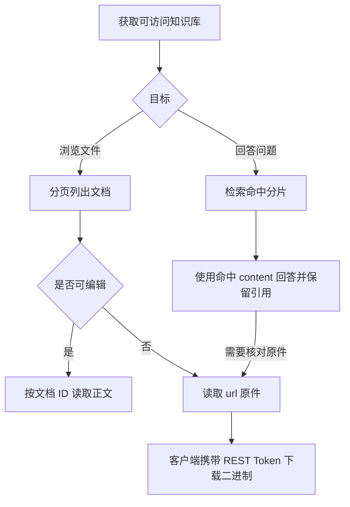
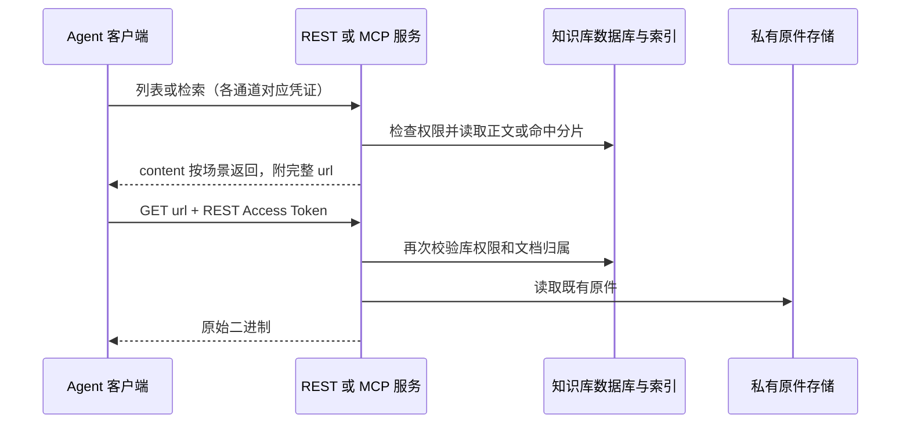

# Agent 多格式知识库接入说明

本文面向通过 REST 或 MCP 接入 MonkeyAI 知识库的 Agent 客户端，描述当前代码契约。目标流程是：选择知识库 → 列出文档或检索 → 读取可编辑正文或下载原件。接口定义以 [Agent OpenAPI](../backend/api/agent.yaml) 和 [MCP 工具定义](../backend/internal/kb/mcptools.go) 为准。

## 1. 身份与入口

| 通道 | 入口 | 凭证 |
| --- | --- | --- |
| Agent REST | `{服务端地址}/api/v1/kb` | 有效客户端 Access Token，放在 `Authorization: Bearer <access_token>` |
| MCP | 从资源目录获取 `mcp_gateway.url`，知识库入口为 `POST /mcp/kb` | 平台 API Key，需 `mcp:invoke`，放在 Bearer 请求头 |
| 原件资源 | 文档返回的完整 `url` | REST 客户端 Access Token；网页会话也可读取 |

每次请求校验身份与知识库读取权限；写入还需内容写权限。**MCP Key 不能替代 REST Access Token 下载 `url`**。只有 MCP 凭证时，可检索正文分片；独立 JPG/PNG 原图可用 `kb_get_document_image`，PDF/Office 原件下载需客户端另外具备 REST 身份。

MCP 使用标准初始化与 `tools/list` 发现工具，再通过 JSON-RPC `tools/call` 调用。普通工具结果优先读取 `result.structuredContent`，兼容客户端可解析 `result.content` 中的 text JSON；检查 `isError`。MCP 外层 `content` 是协议内容块，不是文档对象里的正文 `content`。

## 2. 格式与字段契约

| 格式分类 | 原始格式 | REST 详情中的 `content` | 原件 `url` |
| --- | --- | --- | --- |
| 可编辑 | TXT、MD、HTML、SVG、CSV | 已保存的完整正文/源码 | 上传并保留原件时有值；直接创建且无原件时为空 |
| 不可编辑 | DOCX、XLS、XLSX、PPTX、PDF、JPG/JPEG、PNG | 固定 `""` | 有原件时为完整资源地址 |

DOC、PPT 等不支持的格式在导入时拒绝。服务端归一化 `jpeg → jpg`、`markdown → md`、`htm → html`。按原始 `file_type` 判定，不按转换后的 Markdown 或 MIME 判定。

关键字段：

- `node_type`：`document` 或 `folder`；文件夹不作为文档下载。
- `content_editable`：格式是否支持编辑，不代表当前用户有写权限。
- `content`：列表不返回此字段。读取详情时，不可编辑文档返回空字符串是**响应投影**，数据库仍保存 AnyDoc/LLM 解析正文，用于学习和检索。不要将空字符串解释为“解析失败”或“文档无内容”。
- `url`：`{PublicURL}/api/kb/{kb_id}/assets/{document_id}.{ext}`。无原件、文件夹或未配置 PublicURL 时为空字符串。
- `has_original`：是否有关联原件；与 `url` 结合判断。若为 true 而 url 为空，检查部署的 PublicURL。
- `status`：`pending / learning / learned / failed`，表示学习状态。读取已保存正文或原件不要求学习完成。

**检索是例外**：REST `/kb/search` 与 MCP `kb_search` 的结果 `content` 返回命中的解析正文分片，包括 PDF、Office 和图片。它不是完整文档，不要用检索分片覆盖原文。

MCP `kb_get_document` 默认不返回可编辑格式正文，需 `include_content: true`；不可编辑格式始终返回 `content: ""`。`kb_read_document` 对可编辑格式分页读取正文，对不可编辑格式返回空 `content`、文档元数据和原件 `url`，不能用它绕过完整解析正文限制。

## 3. 推荐读取流程



列表显式传 `page` 和 `page_size`，根据 `total_count` 遍历；列表只返回元数据。若使用树形响应，递归处理 `children`，跳过文件夹。不要把一次返回或检索的 `top_k` 当作完整文档清单。



## 4. REST 调用示例

以下是路径及请求体示例，替换真实 ID 和服务端地址。所有请求带 REST Bearer Token。

```http
GET /api/v1/kb?page=1&page_size=20
GET /api/v1/kb/{kb_id}/documents?page=1&page_size=20
GET /api/v1/kb/{kb_id}/documents/{document_id}
```

列表中的 PDF 文档示例（仅展示相关字段）：

```json
{
  "id": "<document_id>",
  "kb_id": "<kb_id>",
  "node_type": "document",
  "file_type": "pdf",
  "content_editable": false,
  "has_original": true,
  "url": "https://your-server.example/api/kb/<kb_id>/assets/<document_id>.pdf"
}
```

检索：

```http
POST /api/v1/kb/search
Content-Type: application/json

{"kb_ids":["<kb_id>"],"query":"报销需要哪些材料","top_k":8}
```

从响应 `items` 读取 `content`、`kb_id`、`document_id`、`chunk_id`、`citation` 和 `url`。图片检索可传 `file_types: ["jpg", "png"]`；这个过滤字段当前不支持任意文档格式。不要从 Markdown 猜测 PDF 页码、单元格或图片坐标。

直接 GET 文档 `url` 获取二进制，不再自行拼接 `/file/detail`。客户端将字节保存为文件或交给支持对应格式的阅读器。PDF/JPG/PNG 原件内联返回；HTML/SVG 等强制附件。旧 `/api/v1/kb/{kb_id}/documents/{document_id}/file/detail` 下载接口仍兼容可用。

## 5. MCP 调用示例

发送至发现的知识库 MCP 地址，并携带 MCP Key。列出文档：

```json
{"jsonrpc":"2.0","id":1,"method":"tools/call","params":{"name":"kb_list_documents","arguments":{"kb_id":"<kb_id>","page":1,"page_size":20}}}
```

常用工具与参数：

| 操作 | 工具 | 参数示例 |
| --- | --- | --- |
| 选择知识库 | `kb_list` | `{"page":1,"page_size":20}` |
| 读取详情 | `kb_get_document` | `{"kb_id":"…","document_id":"…","include_content":true}` |
| 分页读取可编辑正文 | `kb_read_document` | `{"kb_id":"…","document_id":"…","offset":0,"limit":4000}` |
| 检索 | `kb_search` | `{"kb_ids":["…"],"query":"报销材料","top_k":8}` |
| 读取独立图片原图 | `kb_get_document_image` | `{"kb_id":"…","document_id":"…"}` |

正文分页按 Unicode 字符偏移，后续使用 `next_offset` 并携带首页 revision 作为 `expected_revision`，避免拼接不同版本；限制每页最多 16000 字符。发生版本冲突后重新读取。

独立图片工具返回 MCP image 内容块，原图内联上限为 8 MiB；超限需 REST 下载或网页预览。不要让模型生成或搬运图片 Base64。客户端需支持 image 内容块才能实际展示原图。

## 6. 导入与编辑

只读 Agent 可不实现此节。需要写入时使用已有权限体系：

1. REST 使用 `POST /api/v1/kb/{kb_id}/imports/upload`，multipart 上传 `file`，可带 `title`、`parent_id`；同一次上传重试复用客户端生成的 32 位十六进制 `upload_key`。原件最大 32 MiB。
2. TXT/MD/HTML/SVG/CSV 直接保存；JPG/PNG 同步调用视觉模型，必须提供 `model_id`；PDF/Office 可能返回 `pending`。
3. 遇到 `pending`，按 `poll_after_seconds` 调用 `POST /api/v1/kb/{kb_id}/imports/query`，传 `task_context`，直到 `completed/document_id` 或失败。`completed` 表示文档已保存，不表示索引已学习完成。
4. MCP 使用 `kb_upload_file` 和 `kb_get_file_import_status`。先仅传 `kb_id` 获取上传入口，再由客户端在模型上下文之外读取本地字节并上传；遵循工具返回的上下文及轮询指引。

转换上下文有效期、失败重试及结果确认遵循 [文件解析方案](knowledge-base-file-parsing.md)。页面或客户端退出后不依赖后台轮询继续入库；`retryable` 时复用原上下文有界重试，图片付费请求结果不确定时不要盲目重发。

直接创建文本使用 `POST /api/v1/kb/{kb_id}/documents` 或 `kb_create_document`。仅可编辑格式允许更新正文；MCP 长文档优先使用分段读取和 `kb_edit_document`，携带 `expected_revision`。大正文与文件字节由客户端程序处理，不要求模型复制整份文件作为工具参数。

## 7. 失败处理与升级验收

| 情况 | 客户端处理 |
| --- | --- |
| REST 401 | 刷新或重新获取登录凭证；不要拿 MCP Key 代替 |
| 403 或 404 | 检查身份和资源授权；404 也可能是资源不可见、原件缺失或已删除 |
| 不可编辑格式 `content` 为空 | 正常契约；需要全文时读原件，需要问答时检索 |
| `url` 为空 | 不发起空地址请求；结合 has_original 检查缺失原件或部署配置 |
| 学习失败或无检索命中 | 检查 status/error_message；不据此认定原件丢失 |
| 文档数量较多 | 减小 page_size，逐页处理，仅将任务相关内容送入模型 |

**Breaking Changes**：旧客户端若依赖文档详情中的 PDF/Office Markdown 或图片描述，需迁移为原件读取或检索分片；文档列表只返回元数据，需按文档 ID 读取正文。原件 url 为完整地址，不能重复拼接域名。此契约不新增数据库表字段，不清空数据库正文，也不改变学习存储。

升级先发布兼容空正文、完整资源 URL 和列表正文的客户端，再发布后端；确认 PublicURL 是客户端实际可访问的外部地址。回滚时恢复对应响应契约及客户端版本，保留原件、正文和索引，无需数据库回滚。

接入验收至少覆盖：MD（直接创建/上传）、PDF、PNG；REST 与 MCP 列表/详情字段；PDF/PNG 检索分片；下载字节与上传原件一致；未授权、跨库、撤权和删除后的拒绝；MCP Key 单独不能下载 REST 原件。当前代码的单元/接口契约检查不替代这些真实客户端验收；数据库用例未运行，全量测试仍有已记录的身份权限范围和错误码翻译失败。
