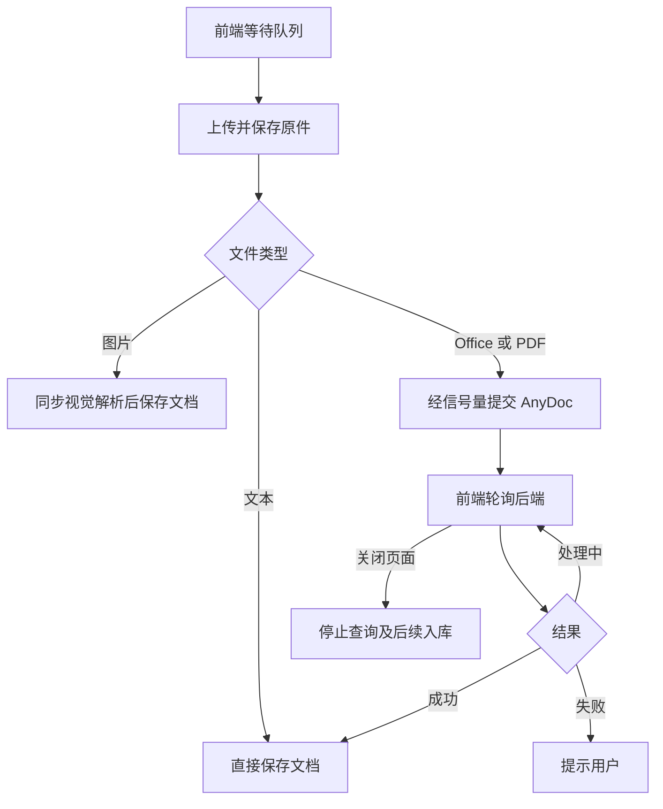
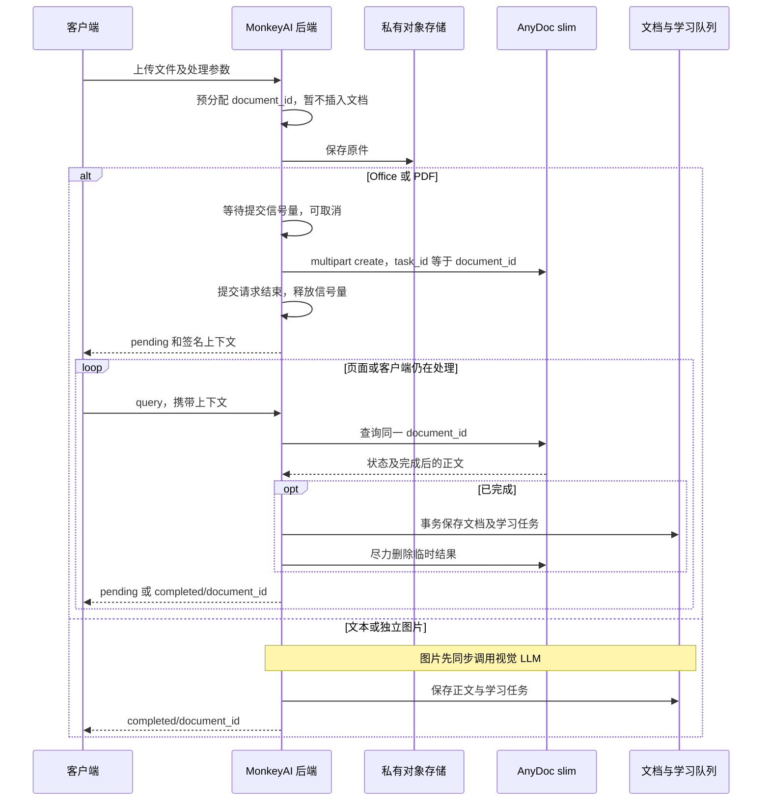

# 知识库多格式兼容及文件解析方案

更新日期：2026-11-25。统一导入接口、document_id 复用及提交信号量已完成源码接入；无任务表或后台解析 worker。实际验证及待验收项见第 9 节。

## 1. 目标与格式范围

统一网页、REST、MCP 的文件导入能力：保存原件，按格式生成正文，再复用现有分块、索引和学习流程。批量导入由客户端逐文件编排；知识库资源包仍沿用既有 Markdown 包契约。

| 输入格式 | 处理方式 | 正文编辑 |
| --- | --- | --- |
| TXT、Markdown | 直接保存 UTF-8 文本 | 允许 |
| HTML、SVG | 保存源码，提供安全预览 | 允许 |
| CSV | 保存 UTF-8 文本，支持源码编辑与导出 | 允许 |
| DOCX、XLS、XLSX、PPTX、PDF | AnyDoc slim 转为 Markdown | 只读 |
| JPEG/JPG、PNG | 视觉 LLM 生成画面描述和图中文字 | 只读 |
| DOC、PPT 及其他未支持格式 | 上传时拒绝，提示转为支持格式 | 不适用 |

`file_type` 表示**原始格式**，由后端依据后缀及内容校验确定：`markdown → md`、`htm → html`、`jpeg → jpg`。直接创建文本正文统一为 `md`。转换后的正文 MIME 为 `text/markdown`，原始 `file_type` 不变；历史未知格式不默认可编辑。

AnyDoc 只承担 Office/PDF 转换，视觉 LLM 只承担独立图片解析。文本导入不依赖这两者；重新学习和索引重建均读取已保存正文，不再次转换或识图。复杂排版、扫描件、公式和加密文件的质量须以真实样本验收为准。

## 2. 用户流程与模块职责

对外统一为 **上传并处理 → 前端查询 → 完成**。前端控制批量文件的等待队列；后端不保存解析任务、不运行轮询 worker。TXT/Markdown/HTML/SVG/CSV 上传后直接保存；图片同步调用视觉 LLM 后保存；Office/PDF 提交 AnyDoc 后由客户端持续查询，查询成功时后端直接入库。



- **前端**：编排上传、有限并发、繁忙退避和轮询；等待队列及上下文仅在内存中，刷新或关闭页面后不恢复。
- **后端**：鉴权、保存原件、预分配文档 ID，通过信号量限制提交请求并发，查询成功后事务保存文档及学习任务。
- **AnyDoc**：限制实际解析并发，异步执行 Office/PDF 转换，临时保存结果；客户端离开不保证上游停止。
- **存储与学习模块**：复用现有原件存储、文档表和学习队列，文档保存成功后学习照常执行，不受页面关闭影响。



## 3. 导入接口与文档 ID

当前接口契约如下。管理端前缀为 `/api/admin/v1/kb/{id}`，Agent 端为 `/api/v1/kb/{id}`；下表路径相对上述前缀。每次调用检查当前用户、知识库及目标目录权限，管理端仅写系统知识库。

| 接口 | 用途与主要契约 |
| --- | --- |
| `POST /imports/upload` | multipart 文件、标题、父目录，图片另传 model_id。保存原件并开始处理；文本和图片成功后返回 completed/document_id，Office/PDF 返回 pending 及签名上下文。不返回转换正文。原件保存后的可恢复错误须附原件上下文。 |
| `POST /imports/query` | 接收签名任务上下文，查询 AnyDoc；转换完成则校验并直接保存文档及学习任务，返回 completed/document_id。属于写操作。 |
| `POST /imports/result` | 通过原件上下文查询目标文档是否存在，用于保存响应丢失后的恢复。 |
| `GET /imports/models` | 列出当前用户可用的视觉文本模型。 |
| `GET /documents/{documentId}/file/detail` | 鉴权下载原件；preview=true 对受支持的 PDF、JPEG、PNG 提供内联预览。 |

网页与 MCP multipart、MCP Base64 上传均支持客户端生成的 32 位十六进制 `upload_key`。同一用户、知识库、文件名、文件内容及键确定同一文档 ID；客户端重传必须复用键，主动新建副本使用新键。脚本上传前输出键，响应丢失后通过 `--upload-key` 重试单个文件。未传键的旧客户端继续按新上传处理。

上传时预分配 `document_id`，直接用作 AnyDoc `task_id`；解析完成前不插入 document，不额外生成解析任务 ID。不新增任务列表或持久化重试接口。提交响应不确定时使用同一上下文和 ID 查询确认，不自动生成新 ID。upload 另支持 JSON 原件上下文及处理参数，供仍在线的客户端在繁忙或提交网络异常后复用原件继续提交；与 multipart 新上传互斥，重试前先核对已保存文档及同 ID 上游任务。

仅收到 `restart_required=true` 时清理原件上下文并分配新键，该标志用于转换任务失败、过期或不存在。普通处理失败、保存结果不确定及本地等待超时保留原键与原件上下文，用户重试先查 `result`。`retryable` 只控制有限自动退避，不能据其缺省值判断是否需要新建文档；图片失败仍要求显式重试。

不落表时仍需由签名上下文绑定原件键、document_id、用户、知识库、标题、目录及有效期，后端不能信任客户端传入的裸 ID 或任意对象路径。`import_context` 用于原件引用及保存结果查询，`task_context` 用于 Office/PDF 轮询；不向客户端返回派生正文，不再使用 result_context 或显式 commit。原件上下文最长 24 小时，转换及图片回调上下文最长 30 分钟。

slim 归档内嵌图片、转换器资源及公网外链图片。外链下载校验全部 DNS 地址并固定拨号到已验证公网 IP，拒绝内网、保留地址、重定向及带凭据的 URL，按实际字节验证图片格式、像素和大小。MonkeyCode 图片回调及正文图片上传接受 BMP、TIFF，按原格式保存并返回对应 MIME；anydoc 的 BMP 原样上传和 TIFF 转 PNG 行为沿用原实现，下载或上传失败会返回任务失败。TIFF 浏览器内联显示能力取决于浏览器，接收支持不代表所有浏览器均可预览。MonkeyAI 校验最终图片资源地址和对象存在后入库。图片替换按语法节点定位，保留普通正文、链接及代码示例。

### MCP 与文件传输

- 同 Key 的 `POST /mcp/kb/{id}/files/upload` 上传真实文件并开始处理，返回 completed 或 pending；图片显式传 model_id，同步解析保存。
- `kb_upload_file` 返回上传说明，或用已取得的原件上下文继续处理；`kb_get_file_import_status` 通过任务上下文查询并在完成时保存，属于写操作。
- 本地脚本 `monkeyai/scripts/kb-file-import.py` 负责文件读取、上传及轮询，使用环境变量 MONKEYAI_MCP_KEY，图片使用 --model-id。客户端退出后不保证完成入库。
- 程序化 file_name/data_base64 与原件上下文互斥；32 MiB 文件编码上限 44,739,244 字节，完整请求上限 44,804,780 字节，普通工具仍为 1 MiB。文件字节由客户端程序传输，禁止 Agent 生成或搬运大段 Base64。
- 每次 MCP 请求重新验证 Key 和权限；纯 MCP 客户端没有文件读取/上传能力时，不能只凭本地路径导入。图片读取工具沿用 kb_get_document_image。

## 4. Office/PDF 转换与图片回调

| AnyDoc slim 内部接口 | 契约 |
| --- | --- |
| `POST /api/slim/task/create` | multipart `task_id`、`file`、`uploader`；新接收返回 202，相同输入的保留任务返回 200；响应不回传任务 ID。 |
| `GET /api/slim/task/result?task_id=...` | 返回 in_process/failed/completed；完成时 `data.markdown` 为正文，不是下载路径。 |
| `DELETE /api/slim/task/delete?task_id=...` | 删除终态任务；运行中返回 409，不取消转换。 |

后端读取已保存原件，使用预分配 document_id 提交 slim。同一次提交重试保持 task_id 和 uploader 稳定，先查询、确认未接收才上传。AnyDoc 返回 429/503 时前端使用有上限且带随机抖动的退避，不立即重复传输大文件；已接收任务返回 404 时提示失效，不永久显示 pending。

单次 HTTP 请求预算 2 分钟，前端约每 3 秒查询，总预算 30 分钟。关闭页面后停止后续查询和保存，不安排后台补偿；AnyDoc 已接收的任务可能继续执行，结果由其 1 小时终态 TTL 清理。文档已持久化时尽力删除临时结果，失败不回滚文档。

正文插图由 AnyDoc 回调 `POST /internal/kb/imports/images/upload?token=...`。配置 `uploader.type=1`、`dir=document_id`，回调校验短期签名、当前写权限和 multipart `path`，只允许导入目录前缀及单层安全文件名，不把客户端路径作为存储键。

图片回调使用专用精简凭证，仅签入 purpose、import_id、document_id、actor、kb、admin、expires。标题、目标目录、模型及原件元数据保留在导入和轮询上下文中，避免长中文标题使 AnyDoc 的 uploader JSON 超过 8192 字节。同一导入重试保持回调凭证稳定，旧完整回调凭证仍沿用原校验规则有效至过期，新凭证也兼容原校验器。

图片按内容摘要保存为知识库 assets；成功协议必须为 HTTP 200 和 `{"code":0,"err":"","data":"/api/kb/<id>/assets/<name>"}`。正文保存稳定的鉴权资源路径，保存正文前检查图片属于当前知识库且真实存在；拒绝外部或缺失图片，避免缺图结果入库。正文插图与独立图片导入的区别见 [知识库正文图片上传](knowledge-base-image-upload.md)。

## 5. 独立图片解析与检索

JPEG/PNG 不调用 AnyDoc。用户显式选择有权使用、已启用、`kind=text` 且 `supports_vision=true` 的模型，复用 OpenAI Chat Completions、OpenAI Responses 或 Anthropic Messages 协议。后端验证模型能力、权限与额度，不自动切换模型。

固定提示词要求返回 `description`、`text` 两个 JSON 字段：描述画面对象、动作和场景，并提取图中文字；无文字不算失败。后端将两部分按字面文本放入独立 Markdown 代码块，保留换行并安全处理代码围栏。空描述、拒绝、截断或超限均失败；图片内的指令不触发工具执行。

图片由上传请求同步调用模型，不经过 AnyDoc。等待图片信号量和解析共用 100 秒预算，网关读超时为 150 秒，为计费收尾预留时间；网页图片上传与脚本请求预算为 180 秒。并发解析按预分配文档 ID 使用 PostgreSQL advisory lock 互斥，锁由独立短生命周期连接持有，避免占满业务连接池；部署容量须计入每个解析请求额外的一条数据库连接。结果未持久化时，断网或重启后的重试可能再次调用模型并计费，不做静默付费重试。

原图由后端从对象存储读取，程序化编码为供应商图片输入；Base64 不经过编排 Agent，但解析 LLM 会接收图片。内部识图入口允许 32 MiB 原图的 Base64 编码长度，另预留 64 KiB 给提示词和 JSON；公网模型代理仍限制完整请求为 32 MiB。供应商自身的图片限制仍然适用，不静默压缩、裁剪或改用公开图片 URL。

图片正文只读，原图与描述对照展示：桌面左右等宽，小屏上下排列。检索索引画面描述及图中文字，图片描述补充中文单字索引；不引入图像 embedding 或以图搜图，重学不重复识图。

REST/MCP 检索支持 `file_types` 过滤，须在召回和 top_k 截断前执行；同一图片的多个分片按文档 ID 合并。结果附带后端关联的 `image` 元数据和鉴权预览/下载地址，不依据模型生成的链接找原图。描述遗漏会影响召回，图中文字命中也不能直接认定画面含有对应对象。

MCP 搜索默认不内联图片，客户端按需调用 `kb_get_document_image`；单图预算为 8 MiB 原始字节，Base64 约 10.7 MiB，另加 JSON 开销。超限明确失败并提供鉴权访问入口。目标客户端必须支持 image 内容块及最终附图，返回 URL 或描述不等于已验证出图。

## 6. 正文、安全与失败恢复

### 正文与资源限制

- 原件最多 32 MiB；正文及索引文本各最多 16 MiB，须为非空 UTF-8、无 NUL；图片最多 2500 万像素，并校验真实格式及后缀匹配。
- AnyDoc JSON 响应读取预算为正文上限的六倍加 64 KiB，再校验解码后的正文；上传、提交和模型调用还须满足客户端、网关及供应商限制。
- 编辑能力由持久化 `file_type` 和当前权限共同决定。派生正文禁止替换、局部修改或清空，标题及目录可按权限修改；重新生成须显式重新导入。
- 原件为不可变快照。文本编辑修改已保存正文；学习和重学读取正文。Markdown 按标题、段落、列表和表格分块，其他源码按纯文本索引；每片最多 1200 rune、重叠最多 200 rune。
- Markdown 清理活动 HTML；HTML/SVG 使用净化副本和无脚本、无同源权限的 sandbox 预览，禁止外部资源及导航，SVG 禁止 foreignObject。不能安全预览时显示源码及原因。
- 引用定位到文档及真实正文片段，不从普通 Markdown 猜测 PDF 页码、幻灯片、单元格或图片坐标。未知格式使用通用图标，文件夹保留文件夹图标。

### 信号量与页面关闭

前端限制当前页面的并行导入数；后端进程内信号量限制同时向 AnyDoc 传输原件的提交请求数，默认 2。获取槽位须支持请求取消，等待期间不读取原件到内存，不持有数据库事务；请求结束或取消后释放。多后端实例的信号量各自独立，不宣称是跨实例全局限流。

**提交信号量不等于解析槽位**：AnyDoc create 异步返回，释放提交信号量时转换可能仍在运行。实际解析并发由 AnyDoc 自身的 PARSER_CONCURRENT 兜底；容量已满返回 429，由仍在线的客户端等待后重试。这样无需保留任务到终态的本地槽位，也不需要后台轮询来回收槽位。上游容量仍须依据大文件实测配置，信号量不能代替容器资源限制。

用户关闭页面或取消操作后，取消正在等待和传输的请求，停止后续状态查询、重试及保存。AnyDoc 已接收的解析可能继续运行，不主动取消、不后台跟进。关闭前已进入数据库提交阶段的请求可能已经保存成功，不能承诺关闭页面即可回滚；已保存文档的学习任务照常执行。

### 保存去重与恢复边界

原件先保存，正文就绪后才创建 document。解析或模型失败不创建空文档；数据库与对象存储不共享事务，未入库原件延迟清理，删除前检查正式文档引用及上下文有效期。

文档与初始学习任务在同一事务提交，复用预分配 document_id 去重；存在且知识库、创建者、原件匹配时返回已有文档，不覆盖内容或重复学习。提交网络错误或响应损坏时返回可重试状态，客户端保留原件上下文和同一任务 ID，先查询确认再决定是否提交。并发查询遇到上游任务不存在时再次核对已保存文档，避免另一请求保存并清理结果后误报失败。转换结果仍可读取则继续查询保存，不重新转换。图片付费调用结果不确定时不静默重试。

上下文及等待队列仅存客户端内存，不恢复关闭或刷新的页面，不承诺后端/AnyDoc 重启恢复或跨上传去重。原件凭证过期、任务丢失或转换明确失败后提示重新导入；终态失败任务不能以相同 ID 直接重新执行，再次导入分配新的 document_id。无删除回执时，有效旧上下文可能重建已删除文档；前端删除后丢弃对应上下文，不承诺跨删除幂等。

## 7. 数据结构与兼容迁移

**不新增解析任务表、状态表、字段或索引**，删除原定 knowledge_base_file_parse_job 建表方案；该表尚未实现，无需执行 DROP TABLE 或新增删除迁移。等待队列留在客户端内存，转换状态由 AnyDoc 临时保存。只复用现有文档和学习队列，document_id 在正文入库时持久化。

既有格式字段迁移保持如下：

| 字段名 | 变更类型（新增/删除） | 是否必须变更（必须/非必须） | 字段用途 |
| --- | --- | --- | --- |
| `knowledge_base_documents.file_type text` | 新增 | 必须 | 在本方案保留既有字段语义的前提下，必须单独记录原始格式，以决定转换、编辑和展示能力。正文 MIME 无法区分原生 Markdown 与派生 Markdown，source_type 只表示来源；从对象元数据推断会增加读取依赖且无法覆盖无原件正文，故选择新增字段。 |
| `knowledge_base_documents.file_type` CHECK | 无新增/删除，仅扩展约束 | 必须 | 必须允许 csv、jpg、png 等已开放格式，否则入库被约束拒绝；复用同一字段，不增加格式专用列。 |

执行 `000062_kb_file_type.up.sql` 新增可空的 `file_type`（无默认值），允许 NULL 或 `txt/md/html/svg/csv/docx/xls/xlsx/pptx/pdf/jpg/png`，并为非空原件键创建部分索引 `knowledge_base_documents_storage_key_idx`。仅将 `source_type=text`、无原件键且无文件名的历史正文回填为 md；其他未知记录保留 NULL，默认只读，核实来源后回填或重新导入。

旧试验环境应对照该 Up 文件核实列、CHECK、回填结果和索引，不能仅凭已有同名列判定迁移完成。第 61 号迁移用于专家绑定知识库，与文件类型无关。

**Breaking Changes（统一导入流程）**：upload 改为上传并开始处理，文本和图片可能直接创建文档及产生模型费用；query 完成后由后端保存。移除旧转换准备 list/export、图片 parse 及显式 commit，AnyDoc task_id 改用 document_id。网页、REST、MCP、OpenAPI 和脚本须协同升级；切换前完成旧导入，旧任务上下文须重新导入。回滚时同时恢复调用方和后端契约，保留原件、正文及学习任务。此调整不新增数据库迁移、镜像、端口或挂载。

**Breaking Changes（既有格式方案）**：旧正文创建接口仅接受 `source_type=text`（省略默认 text），显式 file/url 返回 400；文件改走导入接口，链接抓取暂不提供。派生正文统一只读，旧 DOC/PPT 不再转换，不承诺 Markdown 中不存在的原始坐标。

升级顺序为数据库约束、转换服务/视觉模型、后端和网页，验收后开放入口。常规应用回滚保留字段、约束、原件、正文和索引，关闭旧版本不支持的编辑及重学入口。仅在明确需要回退数据库且已备份元数据时使用 `000062_kb_file_type.down.sql`：它会删除原件键索引和 `file_type` 列，丢失已保存的格式信息。不要为回滚此功能执行 `000061_expert_knowledge.down.sql`。

## 8. 容器与部署影响

| 配置 | 当前方案与影响 |
| --- | --- |
| AnyDoc 镜像 | Compose 可选 profile `anydoc`，`${ANYDOC_IMAGE:-anydoc:slim}`、`pull_policy=never`；须预先用 AnyDoc `deploy/Dockerfile.slim` 构建，入口为 `cmd/slim`。旧 full 镜像仅设置 IS_SLIM 不能替代。 |
| AnyDoc 依赖 | 移除 PostgreSQL、PGSSLMODE、OSS_MINIO 凭据及 db/rustfs depends_on；不连接数据库、NATS 或对象存储。MonkeyAI 仍使用原有数据库和对象存储。 |
| 端口与挂载 | AnyDoc 仅容器内 8080，无宿主机端口或新增持久卷，需可写临时目录。后端 Dockerfile、端口和挂载不变。 |
| 网络与实例 | AnyDoc 须能访问后端图片回调；默认单实例。多实例需确保同一任务的提交、查询、删除到达同一实例，重启不恢复内存任务。 |
| 图片能力 | 更新后端及网页，复用现有模型协议、凭证及计费；不新增 OCR 服务、镜像、端口或挂载。网关超时及请求预算须覆盖图片输入。 |

### AnyDoc slim 环境变量

使用 `cmd/slim` 入口，其余解析参数沿用默认值，仅需显式配置：

```yaml
environment:
  PARSER_MAX_OUTPUT_BYTES: "16777216"
  GLOG_GLOBAL_LEVEL: discard
  GLOG_DISABLE_AUTO_CHECK: "true"
```

`PARSER_MAX_OUTPUT_BYTES` 将输出限制为知识库允许的 16 MiB；日志配置用于避免泄露图片回调签名 URL，代价是缺少业务日志。配置 HTTP 代理时，另将后端内部地址加入 `NO_PROXY`，确保图片回调直连。

无需数据库、NATS 或对象存储凭证。图片回调地址及签名由 MonkeyAI 随 create 请求的 `uploader` 传入。

### MonkeyAI 后端连接配置

不新增解析 worker 或服务。提交信号量在后端进程内生效，实际解析并发由 AnyDoc 控制；多实例不得把本地信号量描述为全局队列。

后端默认地址为 `MONKEYAI_ANYDOC_URL=http://anydoc:8080`、`MONKEYAI_ANYDOC_CALLBACK_BASE_URL=http://backend:8080`。默认 Compose 不映射这两个变量及 `MONKEYAI_ANYDOC_SIGNING_KEY`，自定义须通过 override 的 environment 显式传入，仅修改 `.env` 不会传给后端。

签名密钥未指定时持久化到 `MONKEYAI_RUNTIME_STATE_DIR/kb-import-signing.key`，0600 权限；backend/proxy 必须共享密钥，跨主机可注入相同的至少 32 字节密钥。备份包含该文件，丢失或更换会使旧版上下文和已签发的图片回调凭证失效，新的原件及任务上下文同样依赖该签名；损坏或权限过宽时初始化报错，不静默替换。模型凭证、图片 Base64 和签名 URL 不写日志。

**Breaking Changes（内部转换服务）**：后端由 full 的 list/export/tasks/download 切换为 slim create/result/delete，须同时升级镜像与后端。旧 list/task 上下文须重新开始。升级前暂停新转换并完成旧任务；失败时同时回滚旧后端、镜像及其队列/存储配置。保留旧数据库及对象，不自动删除。此次 slim 适配本身无新增数据库迁移。

## 9. 实现状态与验收

图片回调精简凭证修复通过知识库包测试及 AnyDoc 既有 uploader 校验/回调测试。新增模拟 HTTP 回归覆盖 5000 字中文标题、8192 字节配置上限、最小字段、重试一致性、轮询元数据保留及旧凭证兼容。本次未配置 MONKEYAI_TEST_DATABASE_URL，数据库回调用例跳过，真实双服务转换及入库仍待验收。

统一流程已接入后端、网页、MCP、Python 脚本及 OpenAPI。2026-11-27 修复验证通过隔离 PostgreSQL 知识库全包测试、18 项前端导入测试、后端 go vet 和两份 OpenAPI YAML 解析。数据库用例覆盖 multipart/Base64 同键重传、只保存一份文档与学习任务、图片解析只调用一次，以及 Python 脚本带原键重启。前端覆盖保存结果不确定、本地超时保留身份及明确终态失败重建。

anydoc parser/replacer 竞态测试通过，覆盖外链零请求、正文/链接/代码保真与 BMP 原格式上传。真实 Office/PDF 转换、两服务最终入库、供应商计费及生产镜像尚未在本轮端到端验证。后端全量的权限范围与错误码翻译测试仍失败，已在原提交 b602a70 重现。下表为既有能力记录，历史结果不作为本轮端到端通过的依据。

| 范围 | 已记录的验证 | 仍需验收 |
| --- | --- | --- |
| 文本及旧 full 转换链路 | 2026-11-23 lt 真实 HTTP/MCP：TXT/MD/HTML/SVG/CSV、DOCX/XLSX/PPTX/PDF 导入，原件读取、含图片结果、只读约束及检索。 | XLS 真实样本、大文件跨网边界、远程网页端到端；旧 full 结果不证明新版 slim 可用。 |
| 当前分阶段 slim 适配 | 2026-11-25 单元测试、隔离 PostgreSQL 知识库测试、19 项前端导入测试、vet 和 Compose 检查；HTTP 模拟服务覆盖 multipart、图片回调、大正文、错误状态、同任务恢复及清理。 | 实际 slim 镜像、真实 Office/PDF 转换质量、含图片资源链路及网页端到端。 |
| 独立图片 | 已接入模型选择、三种协议、旧流程签名提交、只读预览、格式过滤、原图关联、MCP 图片工具及脚本；固定夹具/模拟上游覆盖用量记录、检索、权限、字节一致性、解析锁和安全文本组装。 | 真实供应商识图与计费、生产部署、目标 MCP 客户端最终回答展示匹配原图。 |
| 整体验证 | 记录包含前端编译、构建、116 项测试、vet、sqlc diff 和 OpenAPI 引用检查通过。 | 后端全量仍有既有 `TestEnvironmentScopesAreExplicitAndUnavailableToRuntime`、`TestBusinessErrorCodesHaveTranslations` 失败；全量页面 lint 和旧编辑器回归亦有既有失败，不标记全量通过。 |

发布前重点验收：

1. 网页、REST、真实 MCP 客户端按格式完成上传、解析、保存、学习及原件读取；文本和图片不调用 AnyDoc，Office/PDF 只读。
2. 覆盖非法/伪装格式、大小与编码边界、跨库和撤权、结果篡改、回调路径及日志脱敏、HTML/SVG 安全预览。
3. 覆盖重复提交、保存响应丢失、转换重启/过期/失败、信号量等待与取消、释放后上游仍在解析、AnyDoc 容量限制、429/503 退避、页面关闭不再入库、重复查询并发、重试期限、批量部分失败及清理引用检查；模拟测试不能替代真实调用方验证。
4. 使用文件名无关键词、无文字的狗/猫图片验证画面检索、普通文档排除、同图去重及最终原图展示；区分“画面有狗”和“文字提到狗”。
5. 检查新安装及已迁移环境的实际 CHECK、回滚兼容、共享签名密钥、容器资源和供应商请求限制；学习及重建不重复转换或调用模型。
