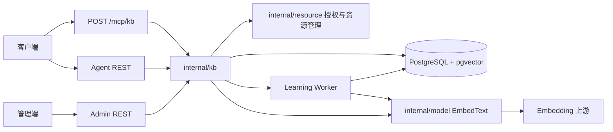
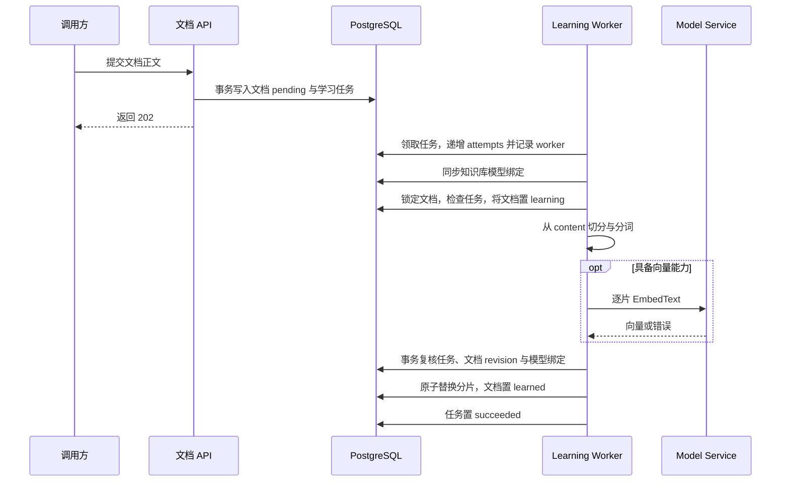
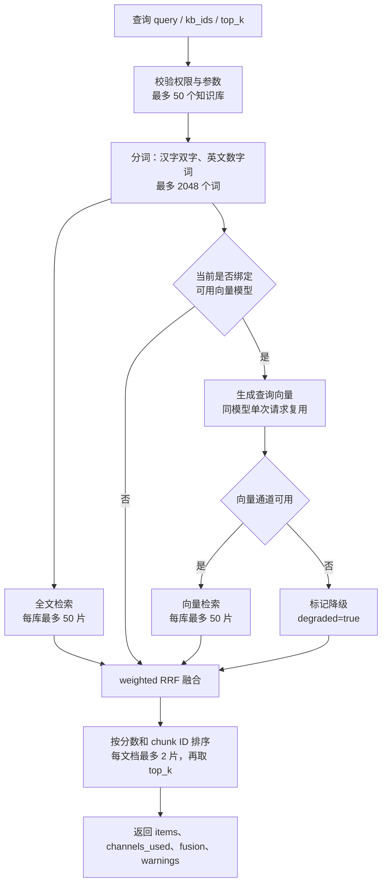

# 百智办公知识库技术设计（按当前实现整理）

> 更新日期：2026-11-11。本文描述当前工作区代码，包含尚未提交的管理端 Markdown 独立文档页。实现事实以路由、业务代码和 SQL 为准；未落地能力及契约差异单列，不作为已交付功能。

## 1. 功能范围

知识库采用 PostgreSQL 持久化文档、分片和异步任务，提供独立于 embedding 的全文检索，并在具备向量能力时执行混合检索。客户端通过 REST 或内置 MCP 显式调用，知识库模块不自动向模型上下文注入内容。

| 能力 | 当前实现 |
| --- | --- |
| 知识库管理 | 系统/个人知识库、授权、标签、启停、详情、文档统计和索引任务汇总 |
| 文档输入 | JSON 正文，支持 `text` / `file` 来源及文件元数据；管理端在浏览器读取 TXT、MD、Markdown 文件后提交正文 |
| 文档学习 | PostgreSQL 持久化队列；切分、分词、全文索引、可选向量化；更新和重试重新入队 |
| 向量模型 | 模型模块支持 embedding 配置、维度探测与在线测试；知识库由后端自动选择可用系统向量模型 |
| 检索 | lexical / hybrid 自动选择、weighted RRF、向量失败降级、多知识库召回和文档去重限制 |
| MCP | `/mcp/kb` 暴露 7 个知识库目录、文档和检索工具 |
| 管理端查看文档 | 独立路由，Markdown 源码/预览/分屏，保存后重新学习；个人知识库只读 |
| 第一期未接入 | AnyDoc、原始文件存储、独立 rerank 和向量 ANN 索引 |

全文检索是基础能力：没有可用向量模型时，文档仍可学习并检索。`embedding_model_id` 和 `embedding_dimension` 是后端维护的索引元数据，当前管理端创建/编辑知识库不提供模型选择器。

## 2. 模块与依赖

当前后端使用 chi、pgx 和 sqlc，知识库复用现有 `resource` 基础设施；没有新增 GoFrame controller / logic 层。本文记录仓库现状，不另行引入框架或服务分层。



| 代码位置（相对 `monkeyai/`） | 职责 |
| --- | --- |
| `backend/internal/kb/service.go` | 资源定义、创建校验、自动选模、统计装饰、访问控制和知识库删除 |
| `backend/internal/kb/embedding.go` | 学习任务执行前同步模型绑定；变更绑定、清空旧向量、创建模型重建任务 |
| `backend/internal/kb/admin.go` / `agent.go` | 注册管理端/客户端 REST，接收参数、执行权限校验、返回响应 |
| `backend/internal/kb/documents.go` | 文档 CRUD、文档分页过滤、用户文档权限、检索入口和参数归一化 |
| `backend/internal/kb/learning.go` / `learning_worker.go` | 切分、索引生成、任务消费、失败处理和过期任务隔离 |
| `backend/internal/kb/maintenance.go` | 手动模型切换、全库索引重建、词索引和向量更新 |
| `backend/internal/kb/retrieval.go` / `search.go` | 分词、通道决策、召回、weighted RRF、结果限制和降级 |
| `backend/internal/kb/mcp.go` / `dto.go` | MCP 协议与工具 schema、客户端字段投影 |
| `backend/internal/kb/query.sql` / `repository.go` | SQL 与资源仓储适配；`sqlc/` 为生成代码 |
| `backend/internal/model/embedding*.go` | 向量模型约束、上游探测、测试和 `EmbedText` |
| `backend/internal/app/app.go` | 依赖装配、REST/MCP 路由注册、启动和停止知识库 worker |
| `admin/src/pages/kb-page.tsx` | 知识库列表与文档列表弹窗、添加内容、学习状态和分片查看 |
| `admin/src/pages/kb-document-page.tsx` | 独立文档加载、权限判断、草稿、保存及返回导航 |
| `admin/src/components/markdown-editor.tsx` | `@ctzhian/tiptap` Markdown 编辑器、主题适配和保存回调 |

## 3. 所有权与权限

| 调用端 | 系统知识库 | 本人个人知识库 | 他人分享的个人知识库 |
| --- | --- | --- | --- |
| 管理端 | 可管理资源、文档、授权、启停和索引 | 只读 | 只读 |
| Agent REST | 有访问权限时读取、检索；不可写 | 可创建、更新、删除资源及文档 | 按授权读取、检索；不可写 |
| MCP | 有访问权限时读取、检索；不可写 | 可读写文档；不提供知识库 CRUD 工具 | 按授权读取、检索；不可写 |

- 复用 `resource_access_grants`、`resource_tags` 及已有用户/分组授权判定。权限在服务端校验，UI 隐藏按钮仅用于表达可用操作。
- 管理端文档、重试、模型切换和索引写路由拒绝个人知识库；资源 CRUD 复用资源层约束。
- 文档详情校验文档属于路径中的知识库，不能用其他知识库 ID 读取或修改文档。
- 客户端知识库目录、知识库详情及检索要求知识库已启用且可访问；文档列表/详情使用 `accessibleKB` 检查授权，其代码未额外要求知识库已启用。因此不能将所有文档读取描述为“只返回已启用知识库”。
- 知识库资源更新、删除及手动模型切换使用 revision / `If-Match`。文档更新不要求 `If-Match`，内部 revision 用于防止旧学习任务覆盖新正文，不能等同于防止多个编辑者互相覆盖。

## 4. 数据结构与迁移

### 4.1 核心表

| 表 | 主要字段与约束 |
| --- | --- |
| `knowledge_bases` | UUID 主键；名称、描述、所有权、owner/creator、启停、revision；可空模型 ID/维度；JSONB `fusion_config`；时间戳 |
| `knowledge_base_documents` | UUID 主键、`kb_id`、标题、正文、`source_type`、文件名/MIME/大小；状态、错误、chunk 数、revision、学习时间；预留 `storage_key`、`content_sha256` |
| `knowledge_base_chunks` | UUID 主键、知识库/文档 ID、从 0 开始的 `chunk_index`、正文、近似 token 数；`search_tokens`、`search_tsv`；可空 `embedding` / 模型 ID；JSONB metadata 和引用字段 |
| `knowledge_base_learning_jobs` | UUID 主键、知识库 ID、可空文档 ID、operation、status、attempts/max_attempts、可执行时间、锁时间/worker、错误与完成时间；可空文档 revision、目标模型 ID 和维度快照 |

关键索引包括 `(kb_id, document_id, chunk_index)` 唯一索引、`search_tsv` GIN 索引、模型 ID 索引和任务领取索引。`embedding` 使用未固定维度的 `vector` 列；当前没有 HNSW / IVFFlat 索引。

表间没有声明外键级联。服务层显式删除关联任务、分片、文档、授权和标签。SQL 中名为 `SoftDeleteKbDocument` / `SoftDeleteKbDocumentsByKb` 的查询实际执行 `DELETE`，属于硬删除。

`storage_key`、`content_sha256`、`heading_path`、`page_no`、`source_url` 的存在不表示文件存储或结构化文档解析已接入。当前学习流程不填充页码、标题路径和来源 URL。

### 4.2 迁移与部署

- `000038_embedding_model` 扩展模型类型和 embedding 配置。
- `000039_create_kb_tables` 一次建立四张知识库表、全文/向量字段、学习任务生命周期快照和索引，并扩展资源标签和授权类型约束。
- 迁移由外部 `migrate` CLI / Compose `migrate` 服务执行；后端在迁移服务成功后启动，不在业务启动过程中自动跑这些建表 SQL。
- `000039` 使用事务执行，失败时回滚；迁移版本统一由迁移工具的 `schema_migrations` 管理。
- 重复执行保护来自 `schema_migrations` 版本状态；应通过 `migrate up` 执行，不应直接重复执行建表 SQL。
- 数据库必须安装 pgvector 扩展，即使当前没有配置向量模型，迁移仍执行 `CREATE EXTENSION IF NOT EXISTS vector`。

从 `monkeyai/backend/` 执行迁移：

```sh
migrate -path migrations -database "$MONKEYAI_DATABASE_URL" up
migrate -path migrations -database "$MONKEYAI_DATABASE_URL" version
```

`000039` 的 down 会删除知识库相关表及全部知识库授权、标签；不是保留业务数据的回滚。

## 5. 向量模型选择与维护

### 5.1 模型能力

模型类型为 `embedding`，协议为 `openai_embeddings`，Provider 为 `passthrough`。创建/更新时探测上游维度，保存至 `models.embedding_config.dimension`；允许范围为 1—16000。

`EmbedText(ctx, modelID, input)` 校验模型启用、模型类型和非空输入，通过上游返回向量及 token 用量。维度探测超时 15 秒，在线测试和普通 embedding 调用超时 30 秒。在线测试返回实际维度、配置维度、是否一致、前 8 个向量值及 token 用量。

### 5.2 自动绑定

创建知识库时，`Service.validate` 调用 `SelectKbEmbeddingModel`，选择已启用、未删除、维度大于 0 的**系统** embedding 模型；没有可用模型则模型与维度为空。

不保存额外的自动绑定开关：`embedding_model_id IS NULL` 即表示未绑定，任何未绑定知识库都使用当前可用的系统 embedding 模型。

`SyncEmbeddingModels` 在 embedding 模型创建、更新、启停、删除后由模型服务 hook 主动触发，并在服务启动及每 5 秒周期扫描中补偿。同步只处理需要变化的候选知识库；每个学习任务执行前仍会调用单库 `syncEmbeddingModel` 复核。

1. 尚未绑定模型时，按 `created_at` 升序、ID 排序选择可用模型，并清空旧向量、逐文档排队补建。
2. 已绑定模型仍可用且维度一致时不重复排队。
3. 模型配置维度变化时保留模型 ID，更新维度、取消旧任务、清空全库向量，并逐文档重建。
4. 模型被禁用或删除时保留原模型 ID，但将有效维度置空、清空向量并取消任务。全文索引继续可检索，不自动切换到其他模型；重新启用同一模型后恢复绑定。

任务入队、文档状态和模型绑定在同一事务中完成。逐文档任务避免单篇失败阻塞整库，服务重启后继续消费持久化队列。

### 5.3 兼容维护接口

后端仍保留 `embedding-model/switch`：支持模型 UUID 或 `null`，也兼容旧 `model_id` 字段；首选 `embedding_model_id`。切换要求 `If-Match`，相同模型返回 `409 embedding_model_unchanged`。

切换事务锁定并复核 revision，取消旧任务、更新绑定、清空向量，并逐文档排队：已有分片的文档只补向量，未完成全文学习的文档重新学习。返回知识库详情及 `notice`。

显式解绑会清空模型和维度、取消旧任务并清空向量；后台同步会把它视为未绑定知识库，在下一次同步时重新选择可用模型。因此解绑不是长期关闭向量检索的产品开关。当前管理端不提供这个兼容接口的操作入口。

## 6. 文档与异步学习

### 6.0 统一学习状态与向量模型生命周期

本节描述 2026-11-11 确定并已实现的统一行为。“学习”指文档切分和检索索引生成，不会训练或修改向量模型。

界面继续使用待学习、学习中、已学习、失败，不增加独立向量化状态；排队中的向量任务也显示“学习中”。没有绑定向量模型时，全文索引完成即为已学习；绑定了向量模型时，全文索引与当前模型对应的向量全部完成才为已学习。

| 场景 | 目标处理 | 文档展示 |
| --- | --- | --- |
| 未配置向量模型，新增或修改文档 | 切分并建立全文索引 | 待学习 → 学习中 → 已学习 |
| 已配置向量模型，新增或修改文档 | 建立全文索引，并生成当前模型对应的向量 | 待学习 → 学习中 → 已学习 |
| 历史文档已完成全文学习后，首次新增或启用可用向量模型 | 自动绑定受影响知识库，全部历史文档排队补建向量；复用已有分片与全文索引 | 入队即显示学习中，逐篇完成后恢复已学习 |
| 切换知识库绑定的向量模型 | 取消旧任务，停用旧向量，全部文档使用新模型重新向量化 | 学习中 → 已学习 |
| 删除或禁用当前向量模型 | 取消相关向量任务，停用旧向量，退回全文检索；不静默切换到其他模型 | 全文索引已完成的文档显示已学习；全文学习未完成或失败的文档保留对应状态 |
| 显式解绑且存在可用模型 | 清空绑定和旧向量，下一次同步自动选择可用模型并逐文档补建向量 | 短暂仅全文检索 → 学习中 → 已学习 |
| 删除或禁用后重新启用同一模型、显式重新配置模型 | 为受影响知识库恢复绑定，全部文档排队生成新向量 | 学习中 → 已学习 |
| 学习或向量化失败 | 记录错误并显示失败，允许按既有权限重试；重试只补齐未完成的处理 | 失败 → 学习中 → 已学习 |

执行与一致性要求：

- 模型新增、重新启用等可用性变化由模型服务 hook 主动触发历史知识库同步，并在服务启动及每 5 秒后台扫描中补偿；事务内先取消该知识库旧活跃任务，再按文档创建新任务，避免重复触发产生重叠队列。
- 任何 `embedding_model_id IS NULL` 的知识库都自动选择可用模型；显式解绑不会关闭该行为。已绑定模型被删除或禁用时保留原模型 ID，保持全文检索且不自动选择另一个现存模型；重新启用同一模型或显式重新配置后再触发学习。
- 配置模型后，所有受影响文档在任务入队时即展示学习中；已有分片的文档仅补建向量，不重复切分和重建全文索引。此前尚未完成全文学习的文档仍执行完整学习。
- 向量学习或失败期间，已存在的全文分片继续参与检索，文档展示状态不单独决定分片是否可检索。模型切换时在事务内清空旧向量，旧模型结果不能继续参与召回。
- 配置了向量模型后，任一分片向量化失败都不能把文档标记为已学习；保留有效全文索引并显示失败，重试成功后才恢复已学习。
- 学习任务记录 `document_revision`、目标 `embedding_model_id` 和 `embedding_dimension`，写回前复核任务租约、文档版本和当前模型绑定。文档修改、模型切换、删除或解绑后，旧任务结果不得覆盖当前内容、恢复旧向量或重新绑定已移除的模型。
- 模型绑定、文档状态变化和任务入队应保持事务一致性；服务重启后继续处理持久化队列。

验证覆盖无模型完成学习后新增模型、已有禁用模型重新启用、切换模型、删除/禁用模型、显式解绑后自动重绑、重新配置、部分向量失败与重试、学习期间全文检索、模型变更期间旧任务写回，以及重复通知和服务重启后的任务恢复。

### 6.1 文档输入与更新

管理端添加文本，或使用 `File.text()` 读取 `.txt`、`.md`、`.markdown` 后提交 JSON。空内容被拒绝；多个文件逐个提交，不是批量事务，后续文件失败时已经创建的文档保留。

新增要求知识库 ID、标题及非空正文；`source_type` 默认 `text`，只接受 `text` / `file`。未提供正数 `size_bytes` 时，服务端按正文 UTF-8 字节数计算。新建文档和 `learn` 任务在同一事务提交，接口返回 `202`、`pending` 文档。REST 通用 JSON 解码上限为 1 MiB，因此正文输入仍受请求大小限制。

正文实际变化时，更新文档会在同一事务取消旧活跃任务、删除该文档的全部分片并创建 `relearn`，正文保存在 `content`；学习完成前全文和向量都不可检索，旧内容不会被召回。仅更新标题、文件名等元数据时直接保存，不使现有索引失效。空标题/正文会沿用旧值，不能通过传空串清空正文。文件来源不能改为文本来源，原文件名和 MIME 可以保留。重试同样取消旧任务并重新排队。

### 6.2 学习步骤



- 按 Unicode rune 切分，每片最多 1200 字符，重叠 200；切片前后去空白。
- `token_count` 是 `max(1, rune_count / 4)` 估算值，不是实际模型 tokenizer 结果。
- 每片始终生成词索引；未绑定可用模型时不调用向量服务。已绑定模型但 Embedder 不可用按向量失败处理。
- 普通学习中，单片 embedding 调用失败、维度不匹配或非有限数值时，该片保留正文和全文索引，向量为空，错误写入 `metadata.vector_error`（最多 500 字符）；其余成功分片保留向量，文档置 `failed` 并记录错误。
- 空切片或无法生成检索词等错误使学习失败。正文更新会先删除旧分片，学习成功后在同一事务原子写入新分片；重新学习完成前不会召回旧分片。
- 文档删除会取消活跃任务并硬删除分片和文档；成功写回前检查当前任务、revision 和模型绑定，防止被删除/更新的数据被旧任务写回。

### 6.3 队列与并发

| 项目 | 当前值/语义 |
| --- | --- |
| 每个服务实例 | 一个串行 worker；chunk embedding 也串行执行 |
| 空闲轮询 | 1 秒；执行过任务后立即尝试领取下一条 |
| 任务领取 | `FOR UPDATE SKIP LOCKED`，按创建时间、ID 排序 |
| 过期锁 | `running` 且 `locked_at` 超过 5 分钟可重新领取 |
| 重试 | 默认最多 3 次；失败后间隔 15 秒再领取 |
| 写回隔离 | 同时核对任务 ID、`attempts`、`locked_by` 和 `running` 状态 |
| 文档状态 | `pending`、`learning`、`learned`、`failed` |
| 任务状态 | `pending`、`running`、`succeeded`、`failed`、`canceled` |

目前没有租约续期心跳。超过 5 分钟的任务可能被其他实例重新领取；写回隔离防止旧尝试覆盖新尝试，但不能消除重复 embedding 调用。文档失败与任务待重试是不同维度：任务重新入队时，文档可能先保持 `failed`，下次开始执行才再次变为 `learning`。

### 6.4 索引重建

| operation | 实际处理 |
| --- | --- |
| `learn` / `relearn` / `rebuild_parse` | 对保存的正文重新切分，重建词索引及可选向量；`rebuild_parse` 当前不调用外部文件解析器 |
| `rebuild_lexical` | 对已有分片的文档重新分词；同时把未完成全文学习的文档重新排队 |
| `rebuild_vector` | 清空当前向量后按文档创建补建任务；已有分片的文档只处理缺失或模型不匹配的分片 |
| `rebuild_model` | 切换模型后按文档重建向量；任务记录目标模型与维度，经维护接口使用该 operation 时要求 `model_id` |

维护接口按知识库调度，没有按 `document_ids` 选择重建的实现。词索引/向量重建与手动切模会恢复未完成全文学习的文档；已有分片的文档不会重复切分。

向量补建逐文档执行。任一分片失败时保留已成功分片和全文索引，文档显示 `failed`，任务本身成功结束；用户重试只补建缺失或模型不匹配的分片，成功后恢复 `learned`。

## 7. 检索设计



### 7.1 输入和可见性

输入为 `{query, kb_ids?, top_k?, filters?}`：

- `query` 去首尾空白，必填，最多 4000 个 Unicode 字符。
- `top_k <= 0` 使用默认 8，大于 20 拒绝；最终每个文档最多返回 2 个分片。
- 未指定 `kb_ids` 时搜索入口确定的可访问集合，最多 50 个 ID；显式包含无权限 ID 返回未找到。
- MCP `kb_search` 和 Agent REST 使用 `SearchLearnedWithResponse`，先限制到至少有一篇存在分片文档的知识库；管理端检索使用 `SearchWithResponse`，不做这个集合预筛选。两处 SQL 都直接按分片检索，不依赖文档展示状态。
- `filters` 尚未应用，存在候选通道的正常返回路径会附带 `filters_not_applied`。不要把它作为已生效的业务过滤器。
- 不定义 `search_mode`、`channels`、`disable_vector` 控制项；未实现严格拒绝这些未知 JSON 字段，不能宣称传入后必然报错。

### 7.2 分词与两路召回

分词先转小写，连续汉字使用相邻双字 bigram，单汉字保留单字，其他连续字母/数字作为词；去重后最多保留 2048 个词。不依赖外部分词服务。

lexical 将查询词用 `|` 连接为 OR 表达式，用 `to_tsquery('simple', ...)` 匹配 GIN 全文索引，按 `ts_rank_cd` 排序。vector 使用 pgvector cosine 距离 `<=>` 排序，只匹配当前绑定模型 ID 的非空向量。每个知识库的每个通道最多召回 50 个候选。

检索按知识库当前是否绑定可用向量模型选择通道：模型 ID 非空且维度大于 0 时使用 lexical + vector，否则只使用 lexical。这个判断读取已同步到知识库上的绑定状态，不在每次检索时重新扫描模型表；模型启用、禁用或删除后的绑定变化由后台同步维护。能力装饰本身不实时校验模型服务健康，上游调用失败时再降级。查询向量按模型 ID 在单次请求中复用成功结果，不跨请求缓存。

### 7.3 融合与降级

默认配置：

```json
{"type":"weighted_rrf","k":60,"weights":{"lexical":0.3,"vector":0.7}}
```

每个分片分数按其所属知识库的配置计算：

```text
score(chunk) = Σ weight(channel) / (k + rank(channel, chunk))
```

各通道排名从 1 开始，按 `chunk_id` 聚合，分数相同时按 chunk ID 排序，然后执行每文档最多 2 片和 `top_k` 截断。多库结果共同排序，不直接比较不同模型的原始 cosine 相似度。仅 lexical 时仍使用 RRF 分数，不将向量权重重新分配到词通道。

query embedding 或向量 SQL 失败时，相关知识库保留 lexical，响应 `degraded=true`、`warnings` 包含 `vector_channel_failed`。lexical SQL 失败直接返回错误。有向量能力但没有任何向量命中不等于通道异常，不自动标记降级。

响应包含 `query`、`retrieval_mode`、`channels_used`、`fusion`、`degraded`、`warnings` 和 `items`；结果包含知识库/文档/分片 ID、序号、正文、标题、RRF 分数、`retrieval_source=lexical|vector|both` 和 citation。citation 三个字段目前可能为空。

`fusion_config` 按当前归一化逻辑处理：负权重先归零，非正 `k` 回落默认值，再检查类型及权重是否同时为零。原文“所有非法负权重、非正 k 都直接拒绝”与代码不符。

## 8. REST 与 MCP 契约

现有接口沿用资源式路径。此处列出实际注册路由，不将新增接口命名规范追溯改写成不存在的 `/list`、`/detail` 等接口。

### 8.1 管理端

前缀为 `/api/admin/v1`，资源 CRUD 由 `resource.CRUD.Register` 注册，文档与索引接口由 `kb.RegisterAdmin` 注册。

| 方法 | 相对路径 | 实际行为 |
| --- | --- | --- |
| GET / POST | `/kb` | 资源列表 / 创建系统知识库；模型由后端选择 |
| GET / PUT / DELETE | `/kb/{id}` | 详情 / 更新 / 硬删除；写入遵循资源版本与所有权约束 |
| PATCH | `/kb/{id}/enabled` | 启停 |
| POST | `/kb/search` | 按当前管理员的可访问知识库集合检索 |
| GET / POST | `/kb/{id}/documents` | 完整文档列表（含正文，无分页）/ 创建并入队（202） |
| GET / PUT / DELETE | `/kb/{id}/documents/{documentId}` | 详情 / 更新并重新学习（202）/ 删除（204） |
| POST | `/kb/{id}/documents/{documentId}/restudy` | 重新入队（202） |
| GET | `/kb/{id}/documents/{documentId}/chunks` | 分片正文、序号、token 估算、`has_vector` 等 |
| POST | `/kb/{id}/embedding-model/switch` | 兼容手动切模/解绑，返回详情和提示（200） |
| POST | `/kb/{id}/index/rebuild` | 接收 `operation`、`model_id`，调度全库任务（202） |

当前没有注册 `/kb/{id}/documents/upload`；请求结构、状态码和字段细节另见 `backend/api/admin.yaml`，与实现的差异见第 10 节。

### 8.2 Agent REST

前缀为 `/api/v1`。

| 方法 | 相对路径 | 实际行为 |
| --- | --- | --- |
| GET / POST | `/kb` | 可访问且启用的知识库目录 / 创建本人的个人知识库 |
| GET | `/kb/tags` | 可访问知识库标签目录 |
| GET / PUT / DELETE | `/kb/{id}` | 可访问且启用的详情 / 更新本人个人知识库 / 删除本人个人知识库 |
| GET / POST | `/kb/{id}/documents` | 分页文档摘要 / 为本人个人知识库创建文档（202） |
| GET / PUT / DELETE | `/kb/{id}/documents/{documentId}` | 可访问文档详情 / 更新本人文档（202）/ 删除本人文档（204） |
| POST | `/kb/search` | 可访问且有已学习文档的知识库检索 |

知识库目录支持 `owner=all|team|mine|shared`、`q`、`tag_id/tag_ids`、`page/page_size`，返回 `knowledge_bases`、总数和页信息。文档列表支持标题/文件名搜索、状态、来源类型，默认 20 条、最多 100 条，返回 `items`、`total_count`、`page`、`page_size`。目录与相关详情使用已有 ETag 机制。

客户端 DTO 通过白名单投影：

- 知识库基础字段包括检索能力、模型绑定、融合参数、文档统计、任务汇总、标签等；REST 目录/详情另附所有者 `user`。
- `shared_users`、`shared_groups` 及详情 `grants` 仅本人个人知识库所有者可见；不向被分享者暴露内部授权关系。
- 文档列表摘要排除 `content`；文档详情可返回正文，排除 `created_by_user_id`、`storage_key`、`content_sha256`。
- 管理端返回治理所需字段，不套用完全相同的客户端投影。

### 8.3 内置 MCP

`POST /mcp/kb` 使用 JSON-RPC 2.0 和 JSON 响应，要求 `Authorization: Bearer <key>`、`mcp:invoke` 作用域及 `Content-Type: application/json`，请求体上限 1 MiB。

支持 `initialize`、`ping`、`tools/list`、`tools/call`，无 ID 通知返回 `202`。兼容协议版本 `2024-11-05`、`2025-03-26`、`2025-06-18`、`2025-11-25`，默认协商最新值。当前是无状态 POST 处理器，没有 GET SSE、会话恢复或服务端推送实现。

| 工具 | 主要参数与行为 |
| --- | --- |
| `kb_list` | 同 REST 目录的所有权、搜索、标签、分页语义；返回目录 DTO 和内容 hash `version` |
| `kb_list_documents` | `kb_id` 必填；分页文档摘要，支持搜索、状态、来源过滤 |
| `kb_get_document` | `document_id`；默认不返回正文，需 `include_content=true` |
| `kb_create_document` | `kb_id`、标题、正文；仅本人个人知识库可写 |
| `kb_update_document` | `document_id` 和至少一个更新字段；仅本人个人知识库可写 |
| `kb_delete_document` | `document_id`；仅本人个人知识库可写 |
| `kb_search` | `query`、可选 `kb_ids/top_k/filters`；自动选择通道 |

成功结果同时包含文本 `content` 与 `structuredContent`；工具业务错误使用 `isError=true` 结果，协议错误使用 JSON-RPC error。没有知识库 CRUD、分片读取或索引维护 MCP 工具，不应按数据库中存在对应查询就推导为已开放工具。

## 9. 管理端文档页面

知识库主路由为 `/console/resources/kb`。点击知识库仍以弹窗展示文档列表；“查看内容”和文本菜单中的“修改文本”进入独立路由：

```text
/console/resources/kb/:kbId/documents/:documentId
```

- 页面并行加载文档详情和知识库详情，刷新或直接访问 URL 均可重新加载，加载失败显示错误，不挂载空编辑器。
- 复用 ragcloud 使用的 `@ctzhian/tiptap@3.0.4`，提供 Markdown 编辑、预览及分屏、工具栏和行号；页面通过 React lazy 按路由加载，编辑器主题随管理端明暗切换。
- 系统知识库可修改标题和正文；个人知识库只读，默认预览并隐藏编辑工具栏及保存按钮。服务端仍执行独立权限检查。
- 保存调用既有文档 PUT，保留来源类型、文件名和 MIME，以 UTF-8 字节数填写大小；成功提示已保存并开始重新学习。
- 通过标题/正文与已加载文档比较显示未保存状态；保存期间禁用编辑，失败保留草稿。页面返回按钮遇到未保存修改时要求确认，刷新/关闭通过 `beforeunload` 提示；没有通用 SPA 导航拦截或草稿持久化。
- 返回 `/console/resources/kb?kb=<id>`，列表页重新加载目标知识库与文档，恢复原知识库弹窗，包括个人知识库和不在当前列表页中的知识库。
- 文档处于 `pending` / `learning` 时，列表每 2.5 秒刷新；UI 将 pending 合并显示为“学习中”。

当前没有搜索测试 UI、融合参数编辑器、模型切换/解绑 UI、索引任务汇总面板和向量降级提示面板。后端返回字段不等于管理端已经展示对应功能。

## 10. 已知差异与后续边界

| 项目 | 当前事实与后续要求 |
| --- | --- |
| AnyDoc / 多格式解析 | 未接入；当前只接受 JSON 正文 |
| 原始文件存储 | 数据表预留字段，当前 JSON 输入没有上传/下载原文件链路 |
| 模型绑定 | 自动选择与兼容手动切换并存；手动解绑会在后续同步中自动重新绑定，不能作为长期关闭向量的产品开关 |
| 重建范围 | 实现只接收 `operation/model_id`，不支持原文中的 `document_ids` |
| 重建接口契约 | OpenAPI 对重建统一声明 `If-Match` 和 202；代码仅 `rebuild_model` 分支校验版本，该分支经重建路由返回 202，经专用切模路由返回 200；其他重建分支不校验该请求头 |
| API 校验 | 搜索无通道控制字段，但未严格拒绝未知字段；融合参数先归一化，部分非法值回退默认 |
| 迁移幂等 | 有名称登记但无 DDL 前名称检查；迁移 CLI 的版本保护与 SQL 自身幂等应分别描述 |
| 检索能力状态 | 绑定字段不实时检查上游健康；模型变动到同步发生前，能力目录可能暂时滞后 |
| 队列租约 | 无续租，长任务可能重复执行；任务尝试隔离只保证旧尝试不能错误写回 |
| 文档并发编辑 | 无文档 `If-Match`，任务 revision 校验不能替代编辑冲突检测 |
| 搜索过滤 | `filters` 未落地；没有 rerank、query rewrite、Graph/Wiki 索引和 ANN 索引 |
| 前端加载体积 | 编辑器按独立页面懒加载，但编辑器及图形依赖较大；后续优化应以构建产物为依据 |

后续修改应同时核对 `api/admin.yaml`、`api/agent.yaml`、`MCPTools()`、DTO 和管理端行为，避免只更新契约或设计文案。本文不将上述差异隐含为本次已经修复。
