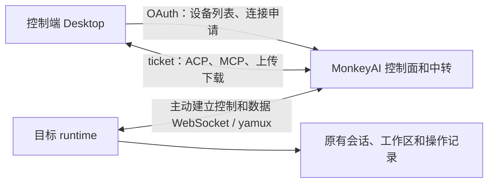

# 多设备远程执行后端实现方案

状态：2026-10-16 按剩余互通清单修复代理接入、租约核验、控制存活、条件撤销和 fg1 边界。本轮本仓验证与跨仓未验收项单独记录于[互通验证记录](remote-runtime-interop-validation.md)，线路细节以[远程执行协议 v1](remote-runtime-protocol.md)为准。服务端默认开启，可显式关闭。已包含托管与独立设备授权、会话聚合、网关密钥隔离及 HTTP 产物预览。真实 Desktop/Mobile/Headless 发行物联调与部署发布仍独立验收，不以本仓代码代替跨仓交付。

代码核对基线：最初为 MonkeyCode `13ad6555`，实施同步至 `1b70fb15`，范围为 `monkeyai/backend`。除特别说明外，本文路径均相对 `monkeyai/`。

设计依据为用户提供的 `REMOTE-RUNTIME-PLAN.md`、`REMOTE-RUNTIME-BACKEND.md`、`REMOTE-RUNTIME-MILESTONES.md` 三份文档，其核对日期为 2026-10-12。本文将产品约束落实为当前后端的增量实现方案；原文中“设备表、桥接和会话接口尚不存在”的描述与当前代码不一致，按下文现状处理。原始文档未随本文复制入库，本文包含实现所需的主要边界，跨仓协议仍需共同冻结。

## 1. 目标和交付范围

首期支持同一用户的 Mac/Windows Desktop 访问另一台 Desktop 托管的 runtime，查看、创建和继续目标设备的普通会话，包括审批、取消、附件、下载和 HTML 预览。

设备是稳定目标，控制面外使用 `(server_id, user_id, machine_id)`，当前数据库内使用 `(user_id, machine_id)`。Desktop 托管和独立 runtime 沿用同一设备记录，不新增第二层执行目标 ID。已有会话 ID、数据目录和工作区保持归属，控制端离开不取消已受理的任务。

后端负责用户身份、设备身份、访问策略、连接授权和中转。执行设备负责会话正文、工作区、队列、审批、操作受理记录和引擎执行。操作去重、审批首答和断线恢复需要跨仓联合验收，但不在控制面另建任务数据库。

交付拆分：

- 首期：Desktop 安装授权族、设备证明与登记、连接 ticket、双通道、业务和文件代理、诊断及真实 Desktop 联调。
- 随身份改造完成：已有会话上报的认证宿主校验，保留关闭托管远程访问后的补传能力。
- 本人会话摘要目录：已实现，经策略控制 `session_index`，不阻塞直接访问目标 `session/list`。
- 独立执行：已实现设备码授权、专用网关密钥及服务端同机接管；客户端安装、服务监督和原地数据接管仍按客户端里程碑验收。
- HTTP 产物预览：已实现独立产物域名与 opaque-origin 无存储沙箱，配置模板和泛域名证书后开放。
- 不作为首期能力：跨用户分享、远程 PTY、跨端画布写入、独立设计能力、多节点中转及独立安装更新。

## 2. 当前实现和增量缺口

| 范围 | 当前代码 | 本次改造 |
| --- | --- | --- |
| 设备 | `internal/endpoint` 已有设备资料、PUT、列表、改名、撤销和恢复；`000002_endpoint_create` 已创建表 | 在已有表上增加受保护执行字段和安全版本，不重复建表 |
| 桥接 | `/api/v1/endpoints/connect` 使用 OAuth Bearer，转发 JSON request/response/event，在线状态在单进程内存 | 保留旧协议，另建双 WebSocket/yamux 和 HTTP 业务代理 |
| OAuth | `internal/identity` 已有授权码、PKCE、刷新和撤销；token 记录没有授权族、业务 scope 和设备证明绑定 | 扩展完整授权流程，增加安装授权族、Principal、轮换链和设备绑定 |
| 长连接认证 | `AccessCredential` 包含用户、token 引用和到期时间；旧桥接复验失败即断开 | 新连接绑定授权族；已有访问执行有界核验宽限 |
| 会话 | `internal/session` 已有会话 PUT、轮次 POST、统计和管理查询 | 从认证授权族取得宿主；本人摘要目录已实现 |
| 网关密钥 | `internal/apikey` 已有用户密钥、轮换和撤销 | 托管保持现有语义；独立阶段补设备和专用授权族归属 |
| 路由 | `internal/app` 为整个 Agent 路由挂载 `RequireAgent` | 将 OAuth、ticket 和文件 grant 入口分开组装 |

相关已有设计：

- [单进程端点桥接设计](endpoint-bridge-design.md)：旧协议和现有部署边界。
- [会话上报后端一期方案](session-reporting-backend-phase1.md)：会话、轮次、统计和资料上报。
- [后端技术栈决定](../backend/docs/adr/0002-technical-stack.md)：Go 1.27、标准库优先、chi、pgx、sqlc。
- [后端开发约束](../backend/AGENTS.md)：业务目录、共享集成点和生成规则。

当前旧桥接的两项行为不能照搬：新连接替换同 machine 的旧连接不符合“活跃进程优先”；数据库复验失败立即关闭不符合新协议已有访问的 180 秒宽限。

## 3. 架构和模块边界

沿用模块化单体，首期只有一个活动中转进程。新增锁定版本的 yamux，WebSocket 复用 `github.com/coder/websocket`；继续使用 net/http、chi、PostgreSQL、pgx 和 sqlc，不引入 Redis、消息队列、ORM 或 DI 容器。



| 模块 | 职责 |
| --- | --- |
| `internal/identity` | OAuth 授权族、权限、Principal、设备授权绑定、轮换链和撤销、设备码流程 |
| `internal/endpoint` | 设备资料、执行公钥、登记和访问状态机、列表、撤销 |
| 新增 `internal/relay` | 新 WebSocket 入口、握手编排、双通道、内存路由、ticket、访问租约、HTTP/WebSocket/文件代理 |
| `internal/session` | 认证宿主认领、已有上报兼容、可选本人摘要目录 |
| `internal/apikey` | 独立执行授权的设备密钥归属和撤销 |
| `internal/app`、`internal/httpapi` | 显式依赖适配、鉴权入口、发现接口和服务生命周期 |
| `internal/config` | 稳定控制面标识、可信公开地址、签名密钥来源和预算 |
| `internal/audit` | 登记、绑定、恢复和撤销的安全审计 |

`relay` 以业务边界承载新隧道，不扩展为通用传输框架；旧 JSON 桥接继续在原模块维护。接口定义在使用方，由 `app` 显式适配，不建立公共类型仓库或全局注册表。

资料存储与在线路由分离。数据库是身份、版本和撤销的权威来源，内存只保存当前有效控制连接、数据连接、流及已核验状态。服务重启后所有设备先显示离线，数据库残留 epoch 或观测时间不能直接成为路由。

## 4. 数据模型和迁移

### 4.1 首期结构

| 表 | 增量字段或结构 | 约束 |
| --- | --- | --- |
| `endpoints` | `execution_public_key`、`key_id`、`deployment_mode`、`remote_access_state`、`active_grant_id`、`registration_version`、`grant_version`、`lease_epoch`、执行能力和协商资料 | 保留原 `id` 及 `(user_id, machine_id)` 唯一约束；业务查询带 owner；旧资料字段不能修改安全字段 |
| 新增 `oauth_grants` | 用户、client、权限、受众、授权用途、机器绑定、公钥标识、允许角色、撤销状态和版本 | 一个授权族至多绑定一个设备；同设备可以存在多个合法登录授权族，但仅一个活动执行授权 |
| `oauth_tokens` | `grant_id`、轮换关系、已消费状态、撤销原因 | 刷新保留 grant；保存足够的旧 refresh token 摘要和状态以检测重放 |
| OAuth 请求和授权码 | 请求及批准的 scopes、audience | 从申请到用户确认和兑换保持冻结；批准只能收窄 |
| 新增 `device_client_connections` | 控制端 grant、目标 owner/machine、协议、scopes、当前和宽限 ticket hash、ticket/access 版本、期限、撤销状态 | 续期不改目标；权限不扩大；轮换和连接数限制在事务中执行 |
| `sessions` | 宿主验证标记或修订、需要的摘要更新时间 | 沿用 `device_id`；旧宿主不得被普通更新覆盖 |

现有 `endpoints.status` 是旧桥接的 `active/revoked` 管理状态，不能直接改成新在线状态枚举。新 `remote_access_state` 单独表达远程开关和撤销；新目录的 `status` 从有效连接、授权及运行状态推导。正式枚举和旧接口映射在契约阶段冻结。

首期不要求建立独立的活动连接表：在线连接的 boot、心跳期限及节点信息保存在内存，epoch 在 `endpoints` 持久递增。控制端连接授权单独落 `device_client_connections`，与实际 socket 生命周期区分。

### 4.2 独立授权结构（已实现）

- `oauth_device_requests`：冻结设备、公钥和权限，保存设备码摘要、短码 HMAC 索引、状态和期限。
- `oauth_login_states`：增加 device purpose 及独立设备申请关联，调整现有 CHECK 约束，不冒用授权码申请 ID。
- `api_keys`：增加独立执行设备和专用授权族归属，保留托管密钥语义。

### 4.3 迁移方式

当前工作树新增的远程执行结构统一合并为 `000024_remote_runtime`，连接权限代次由 `000025_remote_runtime_access_version` 补充；历史 1–23 版本保持不变。SQL 保存在迁移目录，使用 `make generate` 更新 schema 和 sqlc 产物。

旧 token 不能按 `user_id + client_id` 合并成授权族，这会混淆不同安装。可为仍有效的旧 token 记录分配独立兼容授权族，保持原权限；无法从历史记录可靠还原的轮换关系不推测。旧 token 刷新不自动获得新增远程权限。

先扩展 schema 和兼容读写，再启用设备证明及中转能力。回滚功能时先关闭能力声明并拒绝新访问，不借回滚取消 runtime 已受理的任务。

## 5. 身份和安装授权族

### 5.1 Principal

扩展现有认证结果，至少包含：

```text
userId、clientId、grantId、scopes、audience、revocationVersion
machineId、keyId、允许角色（设备证明后才具备）
```

owner 来自认证上下文，URL 只定位目标。绑定前不能把请求参数或 `X-MAI-Machine-ID` 写入可信机器身份。设备签名也不能补齐 OAuth 未授予的权限。

| 权限 | 用途 |
| --- | --- |
| `device:bind` | 设备身份绑定 |
| `device:publish` | 发布执行服务 |
| `device:connect` | 控制端申请目标连接 |
| `device:manage` | 显式设备管理和撤销 |
| `session:report` | 已认证设备上报自己的会话 |
| `session:read`、`session:control` | 会话读取和变更 |
| `files:read`、`files:write` | 文件读取和上传 |
| `resources:manage` | 获准的目标资源配置 |

授权请求、用户确认、授权码、token 和刷新均保留 scope/audience。已有 API 的兼容权限映射必须逐入口列明，不能以“旧 token 没有 scopes”为由赋予所有新权限。

### 5.2 刷新和重放

每个安装持有自己的授权族，刷新生成新 token 但保持 `grant_id` 和机器绑定。用事务锁或条件更新处理刷新竞争，检测已消费 refresh token 重放后按族撤销，不能只撤销当前 token 行。

控制端 ticket 绑定 grant，不绑定某一 access token 行，避免普通刷新被误判为退出。首期执行端 OAuth 刷新后采用同 boot 重新证明、重建隧道，更新 epoch，但不因此增加 `grant_version` 或让全部未过期 ticket 失效。

### 5.3 撤销传播

撤销先持久化，再同步标记本节点访问失效，关闭流并通知 runtime。通知失败重试；权威状态校验和宽限硬截止限制未收到通知的残留访问。

| 事件 | 服务端动作 |
| --- | --- |
| Desktop logout | 撤销该安装授权族及其目标连接，关闭其托管隧道 |
| 移除托管远程执行登记 | 撤销目标远程访问和相关 ticket/file grant，保留 Desktop 登录、上报授权、网关密钥和已受理任务 |
| 后续 Mobile logout | 只撤销 Mobile 自己的授权族及目标连接 |
| 独立执行授权撤销 | 撤销专用授权、关联网关密钥及访问 |
| 用户禁用 | 拒绝新访问，停止有效租约续签并关闭关联中转 |

本地任务是否停止由目标确认；控制面不能根据撤销提交成功推断网络分区中的 OS 命令已经结束。

## 6. 设备证明和登记状态机

### 6.1 入口和握手

使用 `/api/v1/endpoint-bridge`，按 `channel_kind=control/data` 和 `tunnel_version` 协商。控制通道实现 `hello → challenge → proof → ready`，不新增登记、challenge 或 renew REST 路由。

1. Upgrade 前核验 OAuth、scope、通道版本和限流。
2. 冻结 hello，包含 machine、公钥、boot、运行方式及 `publish/bind_identity` 意图，读取当前登记版本。
3. 签发绑定当前 WebSocket 的单次 challenge，以签发端单调钟执行 60 秒期限。
4. Ed25519 proof 覆盖规范化 hello 和完整 challenge，绑定 server、owner、授权族、公钥、登记版本、用途和通道。
5. 事务重新核验授权、版本、公钥和访问状态，原子建立设备及授权族绑定。
6. 提交后发送 ready；保存和确认的消息格式在契约阶段固定，publish/data 完成确认后才启用业务。

challenge 等待期间不保持数据库事务或设备锁。登记事务按固定顺序锁定需要的记录，避免绑定、刷新和撤销形成锁顺序冲突。

设备写入和授权族绑定必须在一个事务中完成。由用例组织事务，各模块暴露接受调用方 `pgx.Tx` 的最小接口，分别执行自己的 SQL，不通过两个独立事务制造半绑定状态。

### 6.2 三种行为

- `publish`：证明成功后检查显式启用意图、当前进程和授权，分配 epoch，建立路由。
- `bind_identity`：只给授权族绑定设备身份，完成后关闭，不改变运行方式、远程开关、活动执行授权或在线租约。
- `data`：只能附着已存在且同 boot、同活动授权、同 epoch 的控制连接，不发布或恢复设备。

资料记录尚无执行公钥时，仅 proof 成功后补齐。已有公钥必须一致，不允许 PUT 或重登录覆盖。资料 PUT 和首次证明任意先到，都通过同一唯一约束复用记录。

### 6.3 版本和竞争

| 版本 | 作用与变化 |
| --- | --- |
| `registration_version` | 执行身份登记变化、首次补齐身份或撤销时递增，阻止旧 challenge/proof 生效 |
| `grant_version` | 首次开启、显式恢复、活动执行授权切换、权限收窄或撤销时递增，使旧访问凭据失效 |
| `lease_epoch` | 每次控制连接建立或替换时递增，隔离旧连接回调和流 |

普通资料更新不触碰以上版本；仅向新授权族附加同公钥绑定不恢复远程访问。同设备、同活动授权合法重连只切 epoch。

有效控制租约期间，不同 boot 的 publish 返回 `device_process_conflict`，不能替换旧进程。原连接明确释放或 45 秒失联租约到期后，新 boot 才能接入。同 boot 重连可在证明后原子切 epoch。

ready 丢失不回滚已提交的身份，下次以同 owner/machine、公钥和授权族恢复。旧连接关闭、心跳和清理只影响匹配 epoch；事务提交到路由激活期间仍需防范撤销竞态，不能安装已经失效的登记版本。

已撤销访问仅允许用户再次启用时以一次性 `restore_revoked=true` 配合新证明恢复，后台重连不能持久保存此意图。

## 7. 路由鉴权和连接 ticket

### 7.1 分开组装入口

当前整个 `/api/v1` 使用 `RequireAgent`。新代理不能直接放在此中间件后面，也不能因路径特殊而跳过鉴权；集成层按入口显式挂载不同验证器。

| 入口 | 凭据和检查 |
| --- | --- |
| GET/PUT/DELETE endpoints、POST connections | OAuth Principal、相应 scope、本人设备归属 |
| endpoint-bridge | OAuth + 设备私钥证明 |
| endpoint proxy | 目标 ticket、当前授权和路由；文件路径另检查对应文件授权 |
| files origin | 限定文件 grant、当前执行绑定和授权族；不接受其扩权为 ACP/MCP |

其他用户与不存在的设备对普通查询统一返回 404。Origin/CORS 使用固定白名单；原生请求缺少 Origin 仍执行凭据检查。

### 7.2 创建和续期

`POST /api/v1/endpoints/{machine_id}/connections` 同时处理创建和续期，实时核验用户、client、grant、目标归属、访问状态、策略和协议。目标离线返回 `device_offline`，协议无交集返回 `upgrade_required`，不签发不可路由的连接。

- ticket 为 32 字节随机值，只存 hash，默认 15 分钟。
- 绑定 server、user、控制端 grant、目标、connection、scopes 和目标 `grant_version`。
- 每设备最多 8 个有效控制端连接，检查与创建在同一事务串行化。
- 续期保持 connection ID，原子轮换 ticket，版本单调递增；权限只能保留或收窄。
- 旧票据最多宽限 30 秒且不超过原期限；撤销或收窄没有宽限。
- 已过期或撤销的连接不能续期复活，可在有效 OAuth 下另建连接。
- 续期同步更新匹配的访问租约，不因正常轮换每 15 分钟重建 ACP。

响应包含 server time 和剩余寿命，客户端用剩余寿命安排续期。所有含凭据的响应使用 `Cache-Control: no-store`。

## 8. 双通道和业务代理

控制和数据使用两条独立 WebSocket/TCP，各自承载一份 yamux。控制面打开业务 stream，runtime 接入专用 HTTP listener，继续使用原有 HTTP/WebSocket 业务协议。

| 路径 | 通道 | 转发规则 |
| --- | --- | --- |
| `/acp` | 控制 | 双向 WebSocket，保持 JSON-RPC ID、错误和业务消息 |
| `/cap/{server}/mcp` | 数据 | 保留 POST/GET/DELETE、SSE、session、协议版本及事件恢复头 |
| `/uploads/*` | 数据 | 仅允许契约固定的方法、分块和 offset 元数据，流式读取 |
| `/files/*` | 数据 | 校验文件授权，支持 GET/HEAD、Range 和原始响应状态 |
| `/health` | 内部 | 只探活，不授予用户数据访问权限 |

代理只能命中白名单路径和方法，不能接受任意 URL，不开放本机宿主管理、能力注册或内部网关凭据接口。外部自报身份头先删除，再注入控制面签名断言。

访问断言绑定 owner、machine、connection、client grant、scopes、grant version 和 epoch，并包含 issuer、audience、用途和 kid。runtime 验签后，还需匹配有效访问租约，才建立 owner-client AccessContext。

传输池和上下文按设备、epoch、connection 隔离，不跨身份复用。WebSocket 票据子协议的编码、移除及实际业务子协议协商在契约阶段固定，不能把 ticket 透传到业务日志。

数据通道故障只重建数据通道；控制故障关闭同 epoch 的数据和观察流。两者均不取消已持久受理的任务。不自动重放 POST、RPC 变更或上传完成操作。

独立管理握手超时、逐流超时和隧道生命周期。使用 coder/websocket `NetConn` 时重新验证消息限制和 deadline 行为，不将握手 context 或逐流 deadline 作用于整条连接。

## 9. 访问租约和授权核验故障

正常访问 TTL 60 秒，每 20 秒续租。runtime 从发出请求的本地单调起点计算期限，校验 nonce、序号、boot、epoch 和版本；迟到或已消费回应不能恢复权限。

控制面为每个已验证连接保存最后一次权威核验成功时间。正常和故障访问都受以下硬截止限制：

```text
访问硬截止 = min(ticket 到期时间, 最后一次权威核验成功时间 + 180 秒)
```

| 状态 | 行为 |
| --- | --- |
| 正常 | 权威核验成功，更新最后成功时间并签发有限 TTL |
| 核验存储暂不可用 | 仅延续已建立且验证通过的流，按原权限短续租，不越过硬截止 |
| 已知撤销 | 立即失效，清除待续租请求并关闭观察流，无宽限 |
| 缓存缺失、重启或超期 | 拒绝；不能恢复未经证明的核验状态 |
| 新连接、业务重连、ticket 签发或轮换、新文件授权 | 必须实时核验；失败返回 `authorization_state_unavailable` |

缓存命中、失败查询、合并查询的等待和发出一次续租，都不能推进最后成功核验时间。可按授权族合并权威查询和失效通知，但不得让缓存刷新重置宽限。

runtime 只接受匹配请求且未消费的签名回应，本地截止为请求起点加 TTL，计入在途耗时。已知失效版本不能被旧 nonce 或旧序号恢复。

授权存储故障与中转物理断开分别展示；链路断开时无法靠宽限继续通信。对 30/90/180 秒以上核验故障、丢撤销通知和旧回应重放分别注入测试。

## 10. 文件、公开地址和预览

### 10.1 文件流与授权

控制面不保存工作区文件，目标 runtime 负责上传槽位、临时文件、摘要校验和原子发布。中转流式转发，支持目标产品现有单文件 64 MiB 上传限制，不整文件缓冲。

远程 file grant 使用 `fg1.<payload>.<signature>`，签名用途为 `monkeyai.file-grant.v1\n`，默认 5 分钟，绑定完整 server、owner、machine、connection、client grant、grant/access/lease 版本、scopes、session、精确路径、purpose、时间和 key ID。本机 HMAC grant 格式和原有 12 小时语义保持独立，远程入口不接受本机 grant。

中转解析出的身份字段仅用于寻找候选公钥；验签并匹配完整 owner/machine、路径后才成为可信路由身份。中转验证签名、活动执行授权、版本、方法、范围和期限；runtime 再验证实际工作区、符号链接、文件类型和大小。

路径采用一致的单次解码与规范化规则，拒绝遍历和歧义编码。跨平台路径只在目标解释。流式响应已经开始后关闭失败流，不拼接 JSON 错误。

### 10.2 可信地址和授时

控制面配置稳定 `server_id`、issuer、bridge URL、files origin 和签名密钥来源，禁止每次启动随机改变标识。公开地址来自部署配置，不根据请求 Host、Origin 或任意转发头拼接。公网与内网均支持 HTTP/HTTPS 根地址：HTTP 对应 WS，HTTPS 对应 WSS；文件 origin 独立采用同一规则，中转保持默认开启。

发现接口发布带 kid 的访问断言公钥。新公钥先发布再签发，旧公钥保留覆盖缓存和有效租约的重叠期。设备只从已确认 issuer 获取公钥，不接受业务数据指定的地址。

授时参考最大年龄固定为 120 秒、最大不确定度为 5 秒，文件 grant 签发时间最多领先控制面 5 秒，有效期最多 5 分钟且控制面严格拒绝已过期凭据。runtime 按可信 nonce 回应估算跨机时间，休眠恢复、长停顿或重启后重新确认授时和租约；客户端原生实现仍需跨仓验收。

### 10.3 产物预览

Desktop 保留产物级自定义 origin，隔离键包含 server/user/machine/session/产物，宿主仅读取获准的远端字节。稳定文件引用与临时 URL 分开保存，链接到期合并续签并有界重试。

共享文件 origin 默认作为下载入口。直接执行 HTTP HTML 时，必须完成产物独立 origin、Host 和 grant 绑定、证书、资源加载及登录 cookie/父域共享渠道隔离，才发布 `preview_origin_template`。CSP、no-referrer 和 nosniff 是附加措施，不能替代存储隔离。

HTTP 执行预览已实现产物派生域名、Host/grant/目录范围绑定和 opaque-origin 无存储沙箱，只有配置独立 HTTPS 模板时声明。共享文件域继续下载交付，Desktop 自定义 origin 保留原存储语义；链接续签和页面状态由客户端实现并联合验收。

## 11. 会话宿主与可选目录

已有会话 PUT 和轮次 POST 继续保留，但宿主必须取自认证设备授权族。`X-MAI-Machine-ID` 和正文机器字段只做一致性检查，不能覆盖 Principal。

- 未绑定会话由认证宿主逐条认领；已有 `device_id` 必须匹配。
- 增加宿主验证信息，防止已升级会话被旧自报身份降级写入；冲突返回约定的宿主错误。
- 旧兼容路径只允许声明范围内、尚未验证的旧设备/会话，不能覆写已验证归属。
- 托管远程关闭不删除机器绑定；有效 `session:report` 授权继续补传，重新登录通过 `bind_identity` 恢复认证。
- 历史报告按原游标补传，不要求活动隧道；实时在线摘要才检查 boot/epoch。
- `input.origin` 来自 runtime 当时认证的控制端上下文；未知来源保持未知，不能把目标伪装成来源。
- 独立执行授权撤销后，不允许依据绑定缓存继续上报。

本人摘要查询单独实现 owner 固定、machine 过滤、分页、更新时间和 stale 状态，不能直接复用管理员接口放开权限。遵循元数据上报策略，验收后才声明 `session_index`；未启用时从目标 `session/list` 读取。

控制面不实现 operationId 操作账本、多端审批仲裁和引擎恢复。这些由 runtime 持久实现，中转不重放写入；联合验收覆盖创建、消息、插入、取消、删除、审批和上传完成的全部恢复路径。

## 12. 旧协议兼容与发现

新旧接口分开演进：

| 入口或行为 | 兼容规则 |
| --- | --- |
| `/api/v1/endpoints/connect` | 保留旧 JSON 桥接，新 runtime 走独立 endpoint-bridge，不将旧 hello 当作执行证明 |
| 设备资料 PUT | 白名单更新资料，不写执行公钥、活动授权、安全版本或在线租约 |
| 设备列表及对象 | 旧形状、时间和 status 保留；新契约通过显式版本协商返回，具体机制在契约阶段冻结 |
| 旧 revoke | 对已绑定新执行身份的目标必须同步收紧远程访问，不能遗留另一入口继续访问 |
| 旧 restore | 只能处理旧管理状态，不设置新远程开关；恢复新访问仍需显式意图和新证明 |
| 新 DELETE | 仅撤销远程执行登记，幂等返回 204；按托管/独立模式应用不同授权影响 |
| 旧 OAuth | 已有 token 保持原有权限；启用远程中转时，新的 Desktop 授权请求若省略 scope，由服务端申请并经浏览器确认 `device:bind`、`device:publish`、`device:connect` 和 `session:report` |

扩展 `/.well-known/oauth-authorization-server` 的 `monkeyai_runtime` 对象，按实际交付声明 `device_binding`、`desktop_managed`、`runtime_relay`、`device_grant`、`session_index`。

只认证握手可先支持 `device_binding`，但不能据此声明业务中转已经可用。独立 device grant、文件执行预览和会话目录未验收时不发布能力。

## 13. 独立执行授权与接管

独立运行阶段新增 `monkeyai-runtime` client，使用 RFC 8628：

- `POST /oauth/device/authorization` 冻结 machine、公钥和申请权限。
- `/device` 复用浏览器登录、SSO 和明确的 CSRF 防护；扩展 client-requests 的 device 展示分支。
- `POST /api/auth/v1/device/decision` 只允许 pending 原子进入 approved/denied，权限只能收窄。
- `/oauth/token` 增加 device grant，按协议实现 pending、slow_down、拒绝、过期和重复消费。
- 默认 600 秒，初始 5 秒轮询；32 字节 device code 只存 hash，短码用 HMAC 索引并限流。
- 兑换事务只成功一次，提交后响应丢失需要重新授权，不反复返回旧明文凭据。

专用执行授权只允许证明、发布和上报本设备，不能申请控制另一设备的 ticket。凭据保存实际 client ID，刷新和撤销不得写死 desktop client。

同机接管保留 machine、执行私钥、数据密钥、会话和路径，先停止旧托管进程并释放锁，再证明新专用授权，原子切换运行方式和活动授权。失效旧执行访问，但不撤销 Desktop 自身用户登录。不同 boot 仍不能抢占有效租约。

网关密钥关联独立 owner/machine 和 grant，仅能管理本设备的密钥；专用授权撤销传播至网关认证。托管关闭远程访问不撤销本机密钥。

## 14. 预算、部署和诊断

### 14.1 资源预算

| 对象 | 首期预算或要求 |
| --- | --- |
| 管理请求和证明消息 | 64 KiB，读取时执行上限 |
| challenge | 60 秒，单次消费、连接绑定、签发端单调期限 |
| 在线心跳 | 15 秒；45 秒失联 |
| ticket | 15 分钟；轮换宽限最多 30 秒 |
| 访问租约 | TTL 60 秒，20 秒续租，距最后权威核验最多 180 秒且不越过 ticket |
| 控制端授权连接 | 每目标设备合计 8 个 |
| yamux 并发流 | 控制 64、数据 16，负载测试后细化逐流和总量预算 |
| 应用队列 | 每设备合计 16 MiB，同时限制条目数；额外计算传输和编码缓冲 |
| ACP 消息 | 建议 1 MiB，先提供文件引用或分页，不直接截断历史 |
| 文件 grant | 5 分钟 |
| 单文件上传 | 64 MiB，保持流式 |

心跳、取消、授权和撤销有独立有界发送预算，不在会话或设备锁内等待网络。不能无限创建 goroutine 后等待锁或队列，也不能将应用缓冲当作进程内存总上限。

### 14.2 部署与停机

Nginx 和开发代理新增 endpoint-bridge、ACP WebSocket、SSE 及文件入口的精确配置，按需启用 Upgrade、关闭响应/上传缓冲并设置超时。API 与 WebSocket 使用一致的代理策略，跨仓声明环境变量代理、CONNECT、认证、系统代理和 PAC 的支持范围。

首期部署只允许一个活动中转进程。普通多副本或粘性会话不能解决控制端与目标落在不同节点的问题。后续扩容时再共享完整 owner/machine 到节点的路由，不提前建立分布式协调层。

停机流程：进入 draining，拒绝新登记和连接，撤销本节点路由，通知并关闭双通道及观察流，限时等待工作循环退出，最后释放数据库。HTTP Shutdown 不会代替应用关闭已升级 WebSocket。发布采用先停止旧中转再启动新中转，runtime 已受理任务继续。

### 14.3 诊断

日志记录 server、user、machine、boot、connection、operation、session、路由模板、状态、耗时和字节数。观测队列深度、发送等待、重连、租约失败、授权年龄、epoch 冲突、时钟偏差及代理错误。

不记录 token、ticket、设备码、文件 grant、签名 URL 或业务正文。应用、Nginx 和其他入口日志均需过滤文件凭据路径段及短码查询；指标不使用上述 ID 等高基数字段作为标签。

## 15. 实施顺序和发布门槛

| 阶段 | 交付 | 前置 | 验收门槛 |
| --- | --- | --- | --- |
| 契约冻结 | 权限矩阵、OpenAPI、签名规范、流类型、时间参数、地址规则、兼容版本及共享样例 | 产品边界 | 两仓能独立运行正反例，Go 替身可构建 |
| 身份基础 | 授权族、刷新链、Principal、绑定事务、认证宿主上报 | 契约 | 不串安装，旧 token 不扩权，重放按族撤销 |
| 设备上线 | 证明、publish/bind_identity、目录、删除、epoch | 身份 | ready 丢失、并发登记、进程冲突和撤销竞态通过 |
| 连接中转 | ticket、双通道、租约、代理和预算 | 设备 | 跨用户隔离、90 秒核验故障续接和 180 秒硬截止通过 |
| 文件与首期联调 | 文件 grant、上传下载、预览、代理配置和诊断 | 中转；runtime 操作恢复 | Mac/Win、第三观察者、慢流及生命周期通过 |
| 会话目录 | 本人摘要、过滤、stale 和策略 | 认证宿主 | 不串宿主、不泄露他人数据；单独发布能力 |
| 独立授权 | 设备码、专用凭据、网关归属和同机接管 | 首期验收 | 并发兑换、丢响应和原身份接管通过 |

契约阶段必须冻结的项目：

- 新旧列表的版本协商、错误兼容和远程状态枚举。
- 公钥编码、key ID、规范化签名、签名用途隔离及 ready 保存确认。
- stream 类型和控制消息：heartbeat、access_lease_request/update、connection_revoked、device_revoked、status、draining。
- ticket WebSocket 子协议、权限映射、受众及控制端来源身份。
- 授时年龄、不确定度、grant 偏差及休眠恢复规则。
- 上传方法、分块、offset、路径解码和预览产物范围。
- 帧、窗口、队列、并发、控制延迟及代理支持矩阵。

共享 JSON/签名测试向量在两仓同步校验，客户端仓提供可构建 Go 中转替身；替身使用锁定的相同 yamux 版本。替身控制接口不进入生产，替身通过不代替真实后端联调。

## 16. 验证与交付记录

实现时按业务目录运行测试，集成执行：

```bash
go test ./internal/identity/... ./internal/endpoint/... ./internal/relay/... ./internal/session/...
go test -race ./internal/identity/... ./internal/endpoint/... ./internal/relay/... ./internal/session/...
make check
```

`internal/relay` 已接入，具体消息、签名与共享向量见[远程执行协议 v1](remote-runtime-protocol.md)。本仓验证与跨仓发布验收分别记录。

必须额外完成：

- 隔离 PostgreSQL 的升级、兼容数据迁移、回滚重建、并发绑定、刷新重放和票据轮换测试。
- 两用户、两目标设备和三个控制端的身份隔离、审批竞争与全部变更恢复测试。
- ready 丢失、旧 proof、撤销与激活竞争、不同 boot 冲突、旧 epoch 回调和控制面重启。
- 30/90/180 秒以上核验故障、通知丢失、旧租约回应重放、权限收窄及物理链路断开。
- 双通道独立故障、慢读、长 SSE、并发大文件、内存和 goroutine 回收。
- 真正经 Nginx 的 WebSocket、SSE、流式上传、Range、代理认证、空闲连接和日志脱敏。
- 时钟跳变、网络延迟、休眠恢复、文件授时失败、链接续签及预览存储隔离。
- 真实 Mac/Win 旧会话互访、控制端退出、目标退出、附件、产物和第三观察者审批。

发布前记录接口样例、迁移、测试命令及结果，明确环境缺失的未验收项。首期必须包含 runtime 的持久受理、未知结果查询和审批首答能力，不能以中转已经连通代替完整闭环。

### 已完成的后端能力

- [x] 按三个输入文档及当前代码整理并归档后端增量方案。
- [x] 完成后端协议、OpenAPI、兼容规则和共享签名向量；客户端仓采用相同向量仍需跨仓验证。
- [x] 完成安装授权族、权限批准、Principal、刷新轮换与族撤销。
- [x] 完成设备绑定与认证宿主上报。
- [x] 完成设备证明、目录和撤销的后端实现。
- [x] 完成连接授权、双通道和有界访问租约的后端实现。
- [x] 完成受限文件代理、Nginx 配置和后端集成测试。
- [x] 默认开启服务端中转，补齐身份自动持久化、显式关闭和部署卷配置。
- [x] 完成本人会话目录、策略控制和在线摘要投影。
- [x] 完成独立设备码授权、确认页、专用执行凭据和服务端同机接管。
- [x] 完成独立网关密钥归属、隔离、轮换与撤销传播。
- [x] 完成 HTTP 产物隔离预览、TLS 配置与真实浏览器无存储验证。
- [x] 恢复旧成员数据库测试夹具和当前接口断言，完成迁移升级及回滚重建验证。

### 外部发行与发布验收

- [ ] 客户端仓使用同一协议向量完成真实 runtime/Desktop 接入。
- [ ] Mac/Win 发行物验证全部操作恢复、多端审批、上传和 Desktop 产物预览。
- [ ] Mobile/Headless 原生发行、凭据写入和服务生命周期验证。
- [ ] 生产代理、容量、长期故障和休眠恢复验证；推送、部署及发布记录。

### 授权基础实现记录

- 远程执行新增的授权族、设备证明、中转连接、会话目录、设备码授权和独立密钥绑定统一进入 `000024_remote_runtime`；旧拆分编号仅保留在提交历史中。
- OAuth 授权请求和授权码冻结 scope/audience，批准只能收窄；刷新返回稳定 `grant_id` 和批准的 scope。
- 新增 Principal、scope 校验和授权族复验，普通 token 轮换保留设备绑定字段。
- refresh token 轮换保留消费链，重放原子撤销整个族；退出可通过族内旧凭据撤销，不影响同用户其他安装。
- 带 scope 的浏览器授权增加权限展示、显式确认、来源及 CSRF 校验；启用远程中转时新的 Desktop 无 scope 请求由服务端补齐远程执行权限，已有无 scope token 不回溯扩权。
- 基础设施故障返回 OAuth `server_error`，不误报 `invalid_grant` 或伪装撤销成功。
- 主线身份与应用集成测试已补成员写入替身并恢复；不改变生产成员/License 边界。

已验证：后端常规全量测试、go vet、sqlc 生成一致性及 OpenAPI YAML/内部引用；临时 PostgreSQL 上的完整 identity 集成和竞态测试；授权页构建、定向 ESLint 和前端 198 项测试。

### 设备和中转实现记录

- `000024_remote_runtime` 合并设备执行、公钥、连接票据、会话目录、独立设备码授权和独立密钥绑定；`000025_remote_runtime_access_version` 区分票据轮换与权限收窄，生成产物由 `make generate` 更新。
- 增加设备公钥和安全版本、授权族事务绑定、publish/bind_identity、ready_ack、活跃 boot 优先及旧 epoch 清理隔离。
- 已认证会话宿主从 OAuth 绑定取得；机器头仅做一致性检查，已验证设备与会话不接受旧自报身份降级写入；关闭托管远程仍可补传。
- `/api/v1/endpoint-bridge`、connections、DELETE、proxy 和独立文件 origin 按 OAuth/ticket/file grant 分开鉴权；目录通过 `X-MAI-Runtime-API: 1` 或已获 `device:connect` 的新 Desktop 授权协商平铺形状。
- 双通道采用锁定 yamux v0.1.2；逐流预算、控制消息队列、Upgrade 限流、访问 deadline、过期连接回收和停机协调均有界。
- 票据只存摘要，串行原子轮换，30 秒旧票据宽限；权限收窄、授权族退出及设备撤销传播到已有流，版本保护并发准入。
- 实现访问断言、nonce/seq/boot/epoch 绑定租约、fresh/grace 和 180 秒硬上限；未知连接及新访问不使用故障缓存放行。
- 文件入口同时校验签名、完整设备归属、路径范围、当前执行授权及版本；共享文件域强制下载，原始路径日志关闭。
- 提供稳定签名配置及可选重叠公钥集合；公开地址只来自配置，关闭功能时不发布发现能力。未显式配置时，控制面标识和私钥首次原子保存到持久状态目录并跨重启复用，文件 origin 默认使用 PublicURL。
- 新增[固定握手签名向量](../backend/internal/relay/testdata/proof.json)，由独立 Python Ed25519 生成，Go 测试核验待签字节和签名。

### 会话目录、独立授权和产物预览实现记录

- `000024_remote_runtime` 的 up/down 支持重复执行；`000025_remote_runtime_access_version` 为连接权限代次提供独立版本。回填仅处理未绑定 token，保留现代授权族、刷新链和安全版本。回滚按远程执行整体处理，保留已有撤销时间及原因，重新升级不恢复已撤销凭据。
- 本人会话目录固定 owner、设备过滤和分页；摘要只来自认证宿主，上报策略关闭时拒绝，stats 不返回标题，旧 boot/epoch 或过期报告标记 stale。
- 设备码采用冻结申请、HMAC 短码、单次兑换、限流、pending/slow_down/拒绝/过期；/device 明确批准并展示账号、公钥和恢复影响，SSO 使用独立申请字段。
- 专用执行授权只能证明申请设备和公钥，绑定前不能上报；客户端 ID 贯穿刷新和撤销，不能申请其他目标的 ticket 或修改账号及资源。
- 服务端同机接管沿用 machine 和会话归属，切换活动授权及运行方式，保留 Desktop 登录；旧专用授权和密钥随替换或移除失效，撤销设备恢复需要一次明确批准。
- 调用密钥绑定 owner/machine/grant，列表、轮换、删除限定专用授权；网关逐次校验活动绑定，撤销立即拒绝，并同步标记与周期回收。
- HTTP 预览按完整设备和产物派生域名，校验 Host/签名/目录范围，阻断预览域登录接口，覆盖执行端 Cookie/CSP 等冲突头。
- HTTP opaque 沙箱禁止来源存储、服务工作线程、表单、外部请求与嵌套应用；Desktop 自定义 origin 保持原语义。
- Nginx 提供独立泛域名 TLS server 和证书挂载配置，不尝试用单域名 HTTP-01 申请泛域名证书。
- 修复旧测试的成员接口注入、Cookie 管理认证、当前目录分页形状、完整规则更新和用户模型无收费交易断言，不改变生产成员或计费权限。

### 验证结果与限制

已通过的检查：

| 检查 | 结果 |
| --- | --- |
| `make check` | sqlc/schema 一致性、后端常规全量测试和 go vet 通过 |
| 启用 PostgreSQL/RustFS 的 `go test ./... -count=1 -timeout=3m` | 全量通过，包含应用组装、计费、资源、成员、迁移与中转 |
| `TestRuntimeMigrationsIdempotent` | `000024_remote_runtime` 和 `000025_remote_runtime_access_version` 重复 up/down、回滚后升级、业务数据不变、约束和旧写入触发器有效、撤销时间保留通过 |
| PostgreSQL identity/endpoint/relay/session | 正常授权、重放、并发绑定、宿主防降级、会话目录、双通道、票据、文件、设备码和接管测试通过 |
| identity/endpoint/session/apikey/relay/app `go test -race` | 真实数据库与应用测试通过，identity 约 92 秒，其余模块通过 |
| `MONKEYAI_TEST_NGINX_IMAGE=nginx:1.28-alpine` | 真实双 WebSocket、流式上传、预览证书验证、有效 HTML 与隔离头通过 |
| 真实 Chromium 浏览器 | 设备确认页批准后可兑换；预览 localStorage/Cookie/IndexedDB/ServiceWorker 全部 blocked |
| SSE/Range/数据饱和 | MCP 会话、协议和事件恢复头保留，文件 206/Range 保留，数据预算满时 ACP 控制仍可用 |
| `TestRuntimeRelayApplication` | 独立 PostgreSQL/RustFS 上的实际应用路由及 race 通过，覆盖新旧目录、身份恢复、代理鉴权和撤销后补传 |
| PostgreSQL stats/resource/billing | 相关回归通过；计费单独重跑约 27 秒通过 |
| 前端构建、授权页 ESLint、198 项测试 | 通过 |
| 公网与内网 HTTP origin | 配置启动、WS 双通道/ACP、目标票据、签名文件下载、设备码批准与授权 CSRF 检查通过；HTTPS/WSS 地址映射保留 |
| 默认开启与身份持久化 | 配置默认值、显式关闭、首次保存、并发启动、重启复用及坏文件不覆盖通过；Compose 展开确认默认开启和 `./data/runtime:/app/runtime` 绑定目录 |
| OpenAPI YAML、唯一键及内部引用 | 通过 |

前期全量检查中的成员测试注入和旧接口断言问题已修复，全量数据库测试通过。同步主线 `e3398d61` 后，本分支保留主线 22 号视频迁移，并将远程执行新增迁移统一为 `000024_remote_runtime`，连接权限代次追加为 `000025_remote_runtime_access_version`；schema/sqlc 重新生成。`make check`、PostgreSQL/RustFS/Nginx 全量回归、前端构建及 198 项测试复验通过。测试专用写入替身只由测试显式注入，生产成员/License 边界不变。

真实 Mac/Win/Mobile/Headless 的 AccessContext、单调租约与授时、operationId 恢复、多端审批、Desktop 产物 origin 及链接续签、原生代理和休眠恢复，仍按跨仓发行验收；生产容量和长期故障需要实际部署环境证据。这些是外部集成与发布工作，不再是本方案内未实现的后端入口。服务端默认开启，设备侧仍由用户明确发布并取得新增权限。
