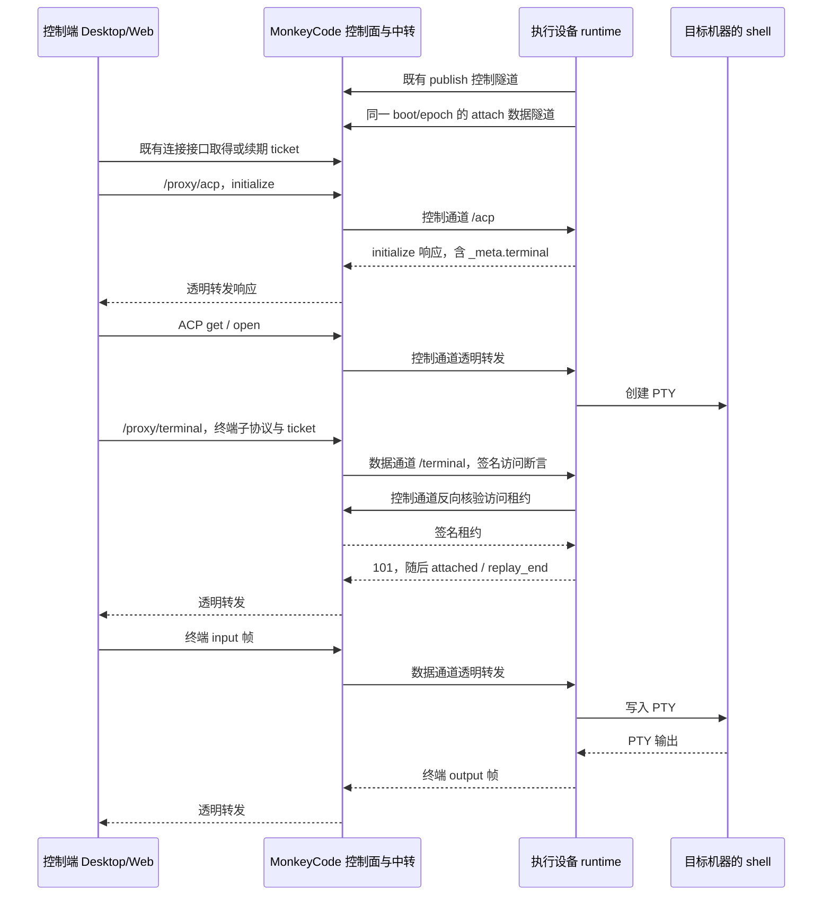

# 远程终端：服务端实施与接口契约

日期：2026-10-20。客户端代码基线：MonkeyAI `160e8f98`。

本文交给 MonkeyCode 服务端团队实施。客户端团队负责 Desktop、Web 和执行设备上的 Go runtime；服务端团队负责控制面、中转、部署和服务端回归。本文以客户端已实现的协议为依据，不要求采用此前本地联调工作树中的服务端草稿。

本文是既有远程运行时协议的终端扩展，完整定义服务端增量。前置条件是设备上线、双通道隧道、票据和签名访问租约已经实现；这些基础能力沿用原接口，不在本次重新设计。基础契约见 [REMOTE-RUNTIME-BACKEND.md](REMOTE-RUNTIME-BACKEND.md)。终端进程和界面设计见 [REMOTE-TERMINAL-PLAN.md](REMOTE-TERMINAL-PLAN.md)。

## 1. 交付目标与职责

用户在 Mac 的远程设备工作台打开 Windows 会话的终端，shell 必须在 Windows 的原工作目录运行。另一控制端可以观看同一个终端并申请输入控制权。控制端关闭面板、断网或退出，目标上的 shell 继续运行；明确结束终端、删除所属会话或退出目标 runtime 才按执行端生命周期回收。

| 对象 | 本次职责 |
| --- | --- |
| MonkeyCode 控制面 | 发现能力、复用连接票据、核验账号和设备、传播撤销 |
| MonkeyCode 中转 | 终端 WebSocket 路由、子协议转发、数据流配额、断流回收 |
| 执行端 Go runtime | 创建和结束 PTY、终端状态、输出缓存、输入仲裁、尺寸和会话归属 |
| Desktop/Web | xterm 显示、票据核验、创建意图、输入与确认、恢复和错误提示 |

服务端不启动 shell，不运行 node-pty/ConPTY/WinPTY，不保存终端屏幕或按键，不仲裁输入控制权。终端不需要新数据库表、新登录流程、终端专用 OAuth scope 或第二种 ticket。

macOS/Linux、现代 Windows 和 Win7 分别由目标 runtime 选择 PTY 后端。控制端的系统版本不决定目标是否有终端能力。服务端只处理协议和权限。

### 必须完成的增量

1. 发现文档增加布尔能力 `terminal_ws`。
2. 既有设备代理增加 `GET /proxy/terminal` 的 WebSocket 分支。
3. 将该分支路由到目标的**数据通道**。
4. 复用 ticket、`session:control`、签名断言和访问租约。
5. 在开 yamux 流前实现终端配额和重连候选名额。
6. 覆盖续票、撤销、权限收窄、超时、断网和中转重启。
7. 通过本文验收后，再在部署环境声明能力。

## 2. 术语与连接结构

| 术语 | 本文含义 |
| --- | --- |
| ACP | 现有 Agent Client Protocol，会话业务使用 JSON-RPC；终端生命周期复用此协议 |
| PTY | 伪终端，为 shell 提供交互输入、尺寸和终端控制字节 |
| ticket | 控制面签发的短期连接票据，不是用户 OAuth token |
| 执行设备 | 保存会话和工作区，并实际运行 shell 的机器 |
| 控制端 | 用户当前操作的 Desktop/Web 工作台 |
| 控制通道 | 执行端主动建立的一条 WS/WSS 隧道，承载 ACP 和内部控制交换 |
| 数据通道 | 执行端主动建立的另一条 WS/WSS 隧道，承载文件、SSE 和终端等业务流 |
| yamux 流 | 一条外层隧道中的独立有序字节流；不是新的公网 TCP 连接 |
| 终端附着 | 一个控制端到某个既有终端的观察/输入连接，不等于 shell 进程 |
| 候选连接 | 带 `reattach=1` 的有界附着尝试，用于替换尚未释放的旧连接 |
| 逻辑访问连接 | 票据接口分配的 `connection_id`；ACP 和多个业务流可以共同使用 |
| lease_epoch | 设备隧道路由的连接代次；不能当作终端服务的实例标识 |



外层 WS/WSS 承载 yamux。内层终端 WebSocket 是其中一条数据流上的 HTTP Upgrade。不要把终端 JSON 包进 ACP 通知，也不要为每个终端新增一对设备隧道。

HTTP server 使用 HTTP API 和 WS；HTTPS server 使用 HTTPS API 和 WSS。沿用部署配置，不新增客户端 HTTPS 强制限制，也不自动跨协议重试。公网中转可以看到转发内容；现有方案不是端到端加密。

## 3. 接口清单与能力协商

| 入口 | 变化 | 权限与用途 |
| --- | --- | --- |
| `GET /.well-known/oauth-authorization-server` | 增加 `features.terminal_ws` | 无凭据的公开发现 |
| `POST /api/v1/endpoints/{machine_id}/connections` | 复用 | 用户 OAuth；创建或续期逻辑连接 |
| `GET /api/v1/endpoints/{machine_id}/proxy/acp` | 复用 | ticket；终端生命周期仍走 ACP |
| `GET /api/v1/endpoints/{machine_id}/proxy/terminal` | **新增代理分支** | ticket + `session:control`；WebSocket |
| `GET /api/v1/endpoints/{machine_id}/proxy/terminal?reattach=1` | 同一分支 | 同样验权，另申请候选预算 |
| `/_control/access-lease`、`/_control/events`、`/_control/status` | 复用内部路径 | 仅在已认证控制隧道中使用，不对公网开放 |

### 3.1 发现文档

在现有 `monkeyai_runtime.features` 中加入：

```json
{
  "terminal_ws": true
}
```

这段 JSON 是 `features` 的增量，不是替换整份发现文档。原有 `issuer`、`server_id`、`bridge_url`、`files_origin`、`runtime_api`、`tunnel_versions`、签名公钥和其他功能位保持原契约。

三个版本概念必须分开：

| 位置 | 当前值 | 作用 |
| --- | --- | --- |
| `monkeyai_runtime.features.terminal_ws` | 布尔 `true` | 中转已完整支持终端 |
| `_meta.terminal.version` / WebSocket 子协议 | `1` / `monkeyai.terminal.v1` | 终端业务协议 |
| `_meta.terminal.profile` | `xterm6-unicode15-v2` | runtime 与 Web 的终端解析配置 |

不能写 `terminal_ws: 1`，也不能因为 profile 带 `v2` 就把子协议改成 `monkeyai.terminal.v2`。

执行端读取发现结果。只有中转声明能力、目标 PTY/解析器可用，且当前访问具有 `session:control` 时，runtime 才返回以下 initialize 能力片段：

```json
{
  "agentCapabilities": {
    "_meta": {
      "terminal": {
        "version": 1,
        "profile": "xterm6-unicode15-v2",
        "runtimeInstanceId": "10000000-0000-4000-8000-000000000006",
        "maxTerminals": 8,
        "maxAttachmentsPerTerminal": 4,
        "maxInputBytes": 16384
      }
    }
  }
}
```

Web 只从 ACP `initialize` 读取该能力，不直接请求发现文档。服务端不得自行拼接或改写 `_meta.terminal`。缺失或 false 不开放远程终端；本机终端不受该中转功能位影响。

### 3.2 沿用连接票据

创建连接的最小请求示例：

```http
POST /api/v1/endpoints/10000000-0000-4000-8000-000000000003/connections
Authorization: Bearer <用户 OAuth access token>
Content-Type: application/json

{"supported_protocols":{"acp":[1],"runtime_api":[1]},"scopes":["session:read","session:control"]}
```

返回字段继续包括 `connection_id`、`machine_id`、`http_base`、`ticket`、`ticket_version`、`expires_at`、`expires_in`、`server_time`、`scopes`、`protocol`。`http_base` 必须是当前 server 下的：

```text
https://control.example.test/api/v1/endpoints/10000000-0000-4000-8000-000000000003/proxy/
```

尾部 `/` 必须保留。客户端在此基址下拼接 `acp` 或 `terminal`。`files_origin` 是控制端本机身份层从可信发现附加给宿主的字段，不要求票据 REST 响应新增该字段。

续期仍 POST 同一接口，并携带原 `connection_id`。同一次逻辑连接保持 ID，`ticket_version` 增加；不因重新查询端点而新占一个连接名额。权限只可保留或收窄，不能借续期扩权。

`session:read` 用于 ACP 初始化；终端四个 ACP 方法及终端 WebSocket 均要求 `session:control`。即使 attach 的 mode 是 `observe`，也不能用只有 `session:read` 的票据观看终端。

## 4. 公网 WebSocket 握手

### 4.1 请求形状

```http
GET /api/v1/endpoints/10000000-0000-4000-8000-000000000003/proxy/terminal?reattach=1 HTTP/1.1
Host: control.example.test
Origin: app://monkeyai
Connection: Upgrade
Upgrade: websocket
Sec-WebSocket-Version: 13
Sec-WebSocket-Key: <WebSocket 客户端生成>
Sec-WebSocket-Protocol: monkeyai.terminal.v1, monkeyai.token.<连接接口返回的 ticket>
```

首次普通附着省略整个 query。浏览器通过子协议携带 ticket，不依赖 Cookie，也不能设置任意 Authorization 请求头。若既有代理支持原生客户端的 `Authorization: Bearer <ticket>`，可继续支持；此处的 Bearer 是连接 ticket，不是用户 OAuth。

若同时提供两种 ticket 来源，必须一致，否则拒绝。去掉 ticket 子协议后，业务子协议列表必须恰好为 `monkeyai.terminal.v1`；原生 Bearer 方式也必须提供该业务子协议。拒绝重复凭据、额外业务子协议及无业务子协议的请求。客户端当前固定发送上例中的两个子协议。

查询参数仅允许：

- 无 query：普通附着。
- 恰好一个 `reattach`，解码后的值为 `1`：候选附着。

拒绝其他参数、重复 `reattach`、非法编码及 `reattach=0`。不得接受 query 中的 token、sessionId、terminalId、上游地址或 owner。`reattach=1` 不提升权限，也不证明替换合法。

### 4.2 Upgrade 前的处理顺序

1. 校验目标路径、GET、WebSocket Upgrade、子协议和 query。
2. 校验 Origin；安装版允许 `app://monkeyai`，开发版仅放行明确配置的 localhost/回环地址和端口。
3. 缺少 Origin 的原生请求仍按票据和权限鉴权。不得把缺少 Origin 当成本机身份；不得将任意 Origin 反射为允许来源。
4. 从 ticket 取得 owner、设备、逻辑连接及授权族。路径 machine_id 必须匹配票据，不能只按 machine_id 路由。
5. 核验 ticket、逻辑连接、用户授权族、设备授权版本、当前权限和目标在线状态。
6. 要求 `session:control`，确认当前 boot/epoch 的数据通道已 ready。
7. 预留第 7 节定义的数据流名额，再开 yamux 流。
8. 注入签名访问断言，转发 HTTP Upgrade。
9. 上游返回有效 101 后才向客户端完成升级。失败释放本次全部资源。

未知设备不得泄露其他账号信息。错误路径不能被通用 `/proxy/*` 分支兜底放行。应拒绝反斜杠、路径穿越、编码分隔符等可能导致代理与 runtime 对路径解释不同的输入。

## 5. 隧道转发契约

### 5.1 路由与头部

| 公网请求 | 通道 | runtime 看到的路径 | 业务子协议 |
| --- | --- | --- | --- |
| `/proxy/acp` | control | `/acp` | `monkeyai.v1` |
| `/proxy/terminal` | data | `/terminal` | `monkeyai.terminal.v1` |
| `/proxy/terminal?reattach=1` | data | `/terminal?reattach=1` | `monkeyai.terminal.v1` |

runtime 的控制通道没有终端 HTTP 回调。误投到控制通道会失败；数据通道断开时返回 `device_offline`，不能回退到控制通道。

每条终端 WebSocket 独占一条新开的数据 yamux 流，直到关闭。通过该流发送 HTTP/1.1 Upgrade，逻辑上游地址为 `http://device.internal/terminal`；`device.internal` 不做 DNS 或公网拨号。不要在一条已升级的流里复用另一控制端的请求，外层 WS/WSS 负责隧道传输。

给 runtime 的请求必须满足：

- HTTP Host 固定为 `device.internal`。
- 保留有效的 WebSocket Upgrade 握手头，业务子协议只保留 `monkeyai.terminal.v1`。
- 移除用户 Authorization、Cookie 和全部外部传入的 `X-MonkeyAI-*`。
- 设置唯一的 `X-MonkeyAI-Access`，值为服务端签发的访问断言。
- 不转发 ticket 子协议、用户 OAuth、本机 runtime token 或测试夹具身份头。
- 上游 URL 只能来自已认证设备的数据隧道，不接受客户端指定主机或端口。

成功响应示例：

```http
HTTP/1.1 101 Switching Protocols
Connection: Upgrade
Upgrade: websocket
Sec-WebSocket-Accept: <由有效握手产生>
Sec-WebSocket-Protocol: monkeyai.terminal.v1
```

返回子协议必须是终端业务协议，不能是 `monkeyai.v1`、token 子协议或空值。去掉上游 `Set-Cookie`；101 不缓存。runtime 不启用 WebSocket 压缩，代理不得单方面宣称启用了压缩扩展。

### 5.2 复用访问断言

访问断言使用既有格式。解码后的完整形状如下；所有示例 ID、时间均需替换为本次真实授权值：

```json
{
  "type": "monkeyai.access.assertion.v1",
  "issuer": "https://control.example.test",
  "audience": "monkeyai-runtime",
  "kid": "access-key-1",
  "authorization": {
    "server_id": "10000000-0000-4000-8000-000000000001",
    "owner_user_id": "10000000-0000-4000-8000-000000000002",
    "machine_id": "10000000-0000-4000-8000-000000000003",
    "connection_id": "10000000-0000-4000-8000-000000000004",
    "client_grant_id": "10000000-0000-4000-8000-000000000005",
    "grant_version": 1,
    "access_version": 1,
    "lease_epoch": 2,
    "scopes": ["session:control", "session:read"]
  },
  "expires_at": "2026-10-20T08:15:00Z"
}
```

编码为 `base64url(JSON) + "." + base64url(signature)`。两段无填充；Ed25519 签名输入是 ASCII 前缀 `monkeyai.access.signed.v1.` 加第一段原文。签发的 JSON 载荷不超过 8 KiB，编码后总长不超过 16 KiB。UUID 使用小写；版本为正 JavaScript 安全整数；scopes 按 ASCII 排序且无重复。不得添加未约定的身份字段。

这不是 JWT，不新增终端 audience、终端 scope 或第二套签名方式。签名公钥从已确认 issuer 的发现文档发布。不能只传明文 owner/machine 头给 runtime。

### 5.3 首次实时核验与内部控制路径

runtime 收到断言后，还会在控制通道反向请求访问租约。终端代理等待这个核验时，服务端必须继续接收并响应控制流；不要持有同一设备锁等待业务 Upgrade，造成自己等待自己的死锁。

| 内部入口，Host 为 `relay.internal` | 当前消息 |
| --- | --- |
| `POST /_control/access-lease` | 请求 `type=access_lease_request`，含 authorization、nonce、lease_seq、boot_id、require_fresh；成功回 `{signed}` |
| `GET /_control/events` | `application/x-ndjson`；首条 `{"type":"ready"}`，随后 heartbeat、refresh 或 revocation |
| `GET /_control/status` | `{"lease_epoch":2,"data_online":true}`；须对应当前实际数据通道 |

当前事件格式是 `{"type":"refresh","connection_id":"..."}` 和 `{"type":"revocation","signed":"..."}`。不要另发客户端不识别的 `connection_revoked` 或 `runtime_revoked` 事件名；撤销范围由签名载荷表达。

新建终端 WebSocket 要求 `require_fresh=true`。权威授权状态暂不可用时拒绝新流，不能凭旧缓存建立访问。租约签名字段、撤销签名及向量沿用基础契约中的“访问断言与租约”。

## 6. 101 后的数据转发与生命周期

101 后只做双向流式转发。不能缓存完整会话，不解析并重新执行 shell 指令，不改 JSON 字段、序号、base64、帧类型或顺序。可以使用字节代理，也可以使用保留消息语义的 WebSocket 双向泵；两种方式都必须传播关闭和取消。

### 6.1 连接何时关闭

| 事件 | 中转动作 | 目标 shell |
| --- | --- | --- |
| 用户关闭面板、控制端退出、单条 socket 断开 | 关闭本次上下游和 yamux 流，释放配额 | 保留 |
| 普通 ticket 续期 | 更新逻辑连接期限，通知 runtime 刷新租约 | 保留；已有 socket 不重建 |
| 移除 `session:control` | 撤销旧权限版本，关闭受影响的既有流 | 保留；不能继续输入 |
| 连接、用户授权族或设备被撤销 | 拒绝新流，取消既有流并推送签名撤销 | 不由中转结束 |
| 数据通道断开 | 关闭该数据通道上的终端流；允许 runtime 重建数据通道 | 保留 |
| 控制通道、控制事件流或中转进程失效 | 关闭受影响 epoch 的业务访问 | 保留，后续由 runtime 重连 |
| 用户执行终端 close、删除会话、目标 runtime 退出 | 转发已有业务请求或观察断流 | 由 runtime 按对应生命周期回收 |

关闭流不得转换成 `_monkeyai/terminal/close`、session/cancel 或杀进程请求。已建立连接不在代理层自动换后端、重试写入或重放输入。

### 6.2 续期与撤销的细节

ticket 的默认寿命是 15 分钟。正常轮换只增加 `ticket_version`；逻辑 `connection_id` 和未变化的 `access_version` 保持。已有流依赖逻辑连接当前有效期，不能绑定到建连时那张旧票据的固定到期定时器。

旧票据最多 30 秒的宽限只供轮换中的请求使用，不代表终端每 30 秒或每 15 分钟必须断开。权限收窄和撤销没有旧票据宽限。续期不能扩大 scopes，也不能复活已过期或已撤销的逻辑连接。

内部事件流每 15 秒心跳，runtime 连续 45 秒收不到有效事件即关闭 endpoint。正常访问租约最多 60 秒，每 20 秒核验；权威状态暂不可用时，既有连接最多延续到上次核验成功后 180 秒与已确认票据期限中的较早者。新建、重建终端流和换票不使用该宽限。

签名租约携带相对 TTL，不用执行设备墙钟判断控制面绝对时间。连接撤销绑定 connection_id/access_version；设备撤销绑定 boot/epoch。旧连接回调或旧撤销通知不得破坏新的数据通道或权限版本。

### 6.3 超时、背压和回收

| 项目 | 当前边界 |
| --- | --- |
| 控制端等待 WebSocket open | 10 秒；失败最多向宿主核验一次再尝试 |
| runtime 等待首个 attach | 从 runtime 预留附着名额起 5 秒 |
| 中转候选名额 | 从中转预留名额起最多 5 秒，详见第 7 节 |
| 终端应用心跳 | runtime 每 15 秒发送 JSON heartbeat，45 秒判失联 |
| 单条终端 JSON 消息 | 32 KiB，UTF-8 编码后计量 |
| 单次输入/输出数据块 | 原始字节最多 16 KiB，使用标准 base64 |
| runtime 网络写入期限 | 5 秒；输出长时间不确认会关闭该观察者 |
| runtime 输出确认 | 每附着最多 256 KiB 或 128 个在途事件，10 秒不确认会断开 |
| 外层隧道消息上限 | 1 MiB；不要与内层终端 32 KiB 混淆 |
| yamux 逐流窗口 | 256 KiB；数据通道总流上限 16 |

中转应限制开流、等待响应头和转发缓冲。不能把多个阶段的独立长超时相加，让客户端超时后仍占着流。候选只有一个累计期限，不能每阶段重新计 5 秒。

升级后不要保留普通 HTTP 请求的固定总时长截止点，也不要把用户没按键当成空闲；runtime 会发送心跳。网关空闲超时必须留足 45 秒心跳判失联窗口之外的调度余量。

任一方向结束、调用方取消、授权失效或数据隧道结束时，都要关闭两端并释放本次配额。`OpenStream` 若不支持 context，取消后必须回收迟到返回的流；不能无限启动 goroutine 等待名额。所有清理必须幂等。

## 7. 满额重连：必须实现的配额算法

普通文件、SSE 和终端共用数据通道。仅把 HTTP 终端连接数增加到 9，仍可能被已有 16 条 yamux 流堵住。因此必须在**开流前**统一预留。

### 7.1 配额

| 范围 | 上限 | 执行方 |
| --- | --- | --- |
| 活动 PTY | 每 profile 8 个 | runtime |
| 常规附着 | 每 profile 8 条，每终端 4 条 | runtime |
| runtime 候选 | 额外 1 条，含未完成 attach；物理终端连接最多 9 条 | runtime |
| 常规数据流总量 | 每个活动数据隧道 15 条，含文件、SSE 和终端 | 中转 |
| 其中常规终端流 | 最多 8 条，含尚未完成 Upgrade/attach 的预留 | 中转 |
| 数据隧道候选流 | 额外 1 条，只供终端 `reattach=1` | 中转 |
| 数据物理流总量 | 最多 16 条；终端物理流最多 9 条 | 中转 |

配额作用于完整设备身份和具体数据隧道实例，不能只用裸 machine_id，也不能按每张 ticket 各给一份预算。重连或更换数据通道后，旧回调只能释放旧预算对象。

### 7.2 中转状态机

为活动数据隧道保存 `regularCount`、`terminalCount`、`candidate`。普通请求和终端请求使用同一份数据总量计数。名额从准入开始保留，直到失败回收或实际流关闭。

普通终端准入：

1. 先完成鉴权。
2. 在锁内检查 `regularCount < 15` 且 `terminalCount < 8`。
3. 增加两个计数，获得一次性释放句柄。
4. 解锁后开 yamux 流并转发 Upgrade。
5. 满额直接返回 429；不借候选名额等待。

普通文件/SSE 也必须经过 `regularCount < 15` 的准入。可沿既有策略快速拒绝或有界等待，但不能占第 16 个保留流，等待者数量也必须有界。

候选准入：

1. 仅终端合法路径且 `reattach=1` 能申请；权限仍完整核验。
2. 同一数据隧道已有候选时返回 429。
3. 锁内保存候选及创建时间，允许占预留的第 16 条流。
4. 若两个常规计数已有空间，可以立即将候选转为常规。
5. 否则让候选先连到 runtime，等待 runtime 验证并替换旧附着。

某条流关闭时，锁内按其**当前类别**减少计数，再优先执行：

```text
若 candidate 存在，regularCount < 15 且 terminalCount < 8：
    从 candidate 槽移除它
    将该连接标为常规终端
    regularCount += 1
    terminalCount += 1
    结束其候选期限，允许下一次候选申请
然后才放行等待的普通请求
```

五秒内仍不能转入常规的候选必须关闭。候选转入后继续正常使用，不能在原五秒到点时误关；它最终关闭时按常规类别减数。候选失败、取消或超时先释放自身，不改变仍存活的旧流。

中转只根据流的释放和计数转移类别，不读取 attach/attached/replay_end 判断是否替换成功。runtime 独立校验身份和视图代次。中转的名额转移不是附着成功证明。

不得等候选 socket 最终断开才释放候选类别的名额。成功重连后的 socket 可能使用数小时；若一直占候选槽，下一次重连将永远被拒绝。

### 7.3 runtime 如何防止候选滥用

首帧 attach 携带原 viewId 和更大的 viewGeneration。runtime 以已认证账号、runtimeInstanceId、sessionId、terminalId、viewId 定位原附着，验证后使旧附着失效，丢弃旧附着未写入的输入，再转移名额。

错误 viewId、旧代次或未知恢复记录会被拒绝，不会踢掉合法观察者。恢复记录释放后保留 60 秒，合计最多 64 条。记录已过期时 runtime 返回 `terminal_conflict`、`reason=view_expired`；客户端重新建立普通附着，不能绕过常规配额。

`reattach=1` 只代表请求使用候选预算。中转不得仅凭该参数关闭任意旧流，或增加终端进程配额。

## 8. 业务协议速查与可执行握手示例

本节供服务端构造互通测试与定位故障。业务方法和帧由 runtime 实现，服务端透明转发。

### 8.1 ACP 四个方法

| 方法 | params | 返回 |
| --- | --- | --- |
| `_monkeyai/terminal/get` | `{sessionId}` | 默认槽位的 TerminalState；不创建 |
| `_monkeyai/terminal/list` | `{}` | `{runtimeInstanceId, activeCount, maxTerminals, items}`；只列 starting/running/closing |
| `_monkeyai/terminal/open` | `{sessionId,runtimeInstanceId,terminalId,expectedRevision,cols,rows}` | TerminalState；按标识和槽位版本去重 |
| `_monkeyai/terminal/close` | `{sessionId,runtimeInstanceId,terminalId}` | TerminalState；只结束指定实例 |

四个方法均走原 ACP，不新增 REST 路由。若服务端有 ACP 方法白名单，应放行这些方法；权限仍由 runtime 再次检查。

open 的去重依据是 runtimeInstanceId、terminalId 和槽位版本，由 runtime 实现；中转不另建终端持久操作表，也不在重连时生成新 terminalId。

`sessionId` 是执行端已有会话标识，不要求重建旧会话。当前 open 接受 1–128 字符的字母、数字、`_`、`-`，首字符为字母或数字。runtimeInstanceId、terminalId、viewId 为小写 UUID。所有序号和版本为非负 JavaScript 安全整数，viewGeneration 从 1 开始。终端尺寸为 cols 2–500、rows 1–300。

TerminalState 必含 runtimeInstanceId、sessionId、slotRevision、state、deleting、cols、rows、initialSize、firstSeq、lastSeq、controlGeneration。非 empty 状态包含 terminalId；可另含 title、cwd、shell、createdAt、exitCode、lastError、controller、controlPending、outputTruncated。empty 的尺寸可以为 0。

state 取值：empty、starting、running、closing、exited、closed、failed。controller 为 `{attachmentId,name}`。runtimeInstanceId 表示 runtime 终端服务实例，不使用每次隧道重连都会变化的 lease_epoch。

### 8.2 从创建到输入

先 initialize，再查询默认槽位：

```json
{"jsonrpc":"2.0","id":2,"method":"_monkeyai/terminal/get","params":{"sessionId":"demo-session"}}
```

只有用户明确创建且槽位允许时，取查询返回的 runtimeInstanceId、slotRevision，并生成 terminalId：

```json
{"jsonrpc":"2.0","id":3,"method":"_monkeyai/terminal/open","params":{"sessionId":"demo-session","runtimeInstanceId":"10000000-0000-4000-8000-000000000006","terminalId":"10000000-0000-4000-8000-000000000007","expectedRevision":0,"cols":80,"rows":24}}
```

等待 get 返回 running，再用第 4 节路径打开 WebSocket。普通首个附着省略 reattach，首个文本帧是：

```json
{"type":"attach","sessionId":"demo-session","runtimeInstanceId":"10000000-0000-4000-8000-000000000006","terminalId":"10000000-0000-4000-8000-000000000007","viewId":"10000000-0000-4000-8000-000000000008","viewGeneration":1,"afterSeq":0,"mode":"control-if-free"}
```

runtime 返回 attached，包含完整 TerminalState，以及 attachmentId、viewId、viewGeneration、replayTo。以下是尚无输出的合法示例：

```json
{
  "type":"attached",
  "attachmentId":"10000000-0000-4000-8000-000000000009",
  "viewId":"10000000-0000-4000-8000-000000000008",
  "viewGeneration":1,
  "replayTo":0,
  "runtimeInstanceId":"10000000-0000-4000-8000-000000000006",
  "sessionId":"demo-session",
  "terminalId":"10000000-0000-4000-8000-000000000007",
  "slotRevision":1,
  "state":"running",
  "deleting":false,
  "cols":80,
  "rows":24,
  "initialSize":{"cols":80,"rows":24},
  "firstSeq":1,
  "lastSeq":0,
  "controlGeneration":1,
  "controller":{"attachmentId":"10000000-0000-4000-8000-000000000009","name":"Desktop"}
}
```

runtime 按 afterSeq 回放 output/size/exit，然后发送 replay_end。客户端确认回放完成，并在拥有当前控制权后输入：

```json
{"type":"replay_end","seq":0}
```

```json
{"type":"ack","seq":0}
```

```json
{"type":"input","inputSeq":1,"controlGeneration":1,"data":"ZWNobyByZWFkeQ0="}
```

输入示例的 base64 解码结果是 `echo ready\r`。runtime 可能返回：

```json
{"type":"input_ack","inputSeq":1,"writtenBytes":11}
```

输入确认与输出事件是不同序列，先后顺序不作绑定。不要把 input_ack 当作命令执行成功；它只确认这批字节写入 PTY。

### 8.3 数据帧清单

所有业务帧都是 UTF-8 JSON 文本消息。data 使用**标准 base64**，含必要填充；不同于票据和签名中的无填充 base64url。服务端不要解码再按字符重分块。

| 方向 | type | 关键字段与语义 |
| --- | --- | --- |
| 客户端→runtime | attach | 上述身份、viewId、viewGeneration、afterSeq、mode；mode 为 observe 或 control-if-free |
| 客户端→runtime | ack | seq：已完成显示的输出事件序号 |
| 客户端→runtime | input | inputSeq、controlGeneration、data |
| 客户端→runtime | resize | controlGeneration、cols、rows |
| 客户端→runtime | claim | expectedControlGeneration：申请接管 |
| 客户端→runtime | release | controlGeneration：释放输入控制权 |
| 双向 | heartbeat | nonce：小写 UUID，接收端回显 |
| runtime→客户端 | attached | 完整 TerminalState、attachmentId、viewId、viewGeneration、replayTo |
| runtime→客户端 | output | seq、data |
| runtime→客户端 | size | seq、cols、rows |
| runtime→客户端 | exit | seq，可选 exitCode、reason、outputTruncated |
| runtime→客户端 | replay_end | seq：本次回放边界 |
| runtime→客户端 | input_ack | inputSeq、writtenBytes |
| runtime→客户端 | control | controlGeneration、controller 或 null、pending |
| runtime→客户端 | error | code、requestType；可选 reason、resource、inputSeq、writtenBytes、outcomeUnknown |

output/size/exit 共用从 1 开始的连续 seq；输入使用每附着独立递增的 inputSeq。重连不能自动重发未确认输入；断线时可能已经写入 shell，不能由代理推断为未执行。

观察者看到实际 PTY 尺寸；只有控制者能输入和 resize。claim、控制代次、在途输入屏障和旧控制者拒绝均由 runtime 完成。中转不可把多个连接的按键合并成一条写入队列。

输出有界缓存，当前每终端最多 2 MiB/4096 个事件，profile 合计 16 MiB/32768 个事件。历史缺口返回 terminal_history_lost，不能伪造一段连续回放。runtime 重启后不会恢复原 shell，隧道重连则保留原 shell。

## 9. 错误与诊断

中转自身在 Upgrade 前拒绝时返回既有 JSON 错误信封，Content-Type 为 application/json，Cache-Control 为 no-store：

```json
{"error":{"code":"terminal_limit_reached","message":"terminal_limit_reached"}}
```

`error.code` 必须保留；message 可省略或使用安全摘要。不要返回登录页或重定向到 OAuth。runtime 返回的非 101 响应按实际状态和内容类型透传；部分早期失败是 text/plain，不能因不是 JSON 就改成成功或通用 500。

| HTTP 状态 | 典型 code | 场景 |
| --- | --- | --- |
| 400 | invalid_request | 方法、子协议、query、路径格式不合法 |
| 401 | connection_expired | ticket 或逻辑连接缺失、到期或已失效 |
| 403 | permission_denied | scope 不足、来源不允许或授权归属不符 |
| 403 | device_revoked | 目标设备访问已撤销 |
| 404 | not_found | 未知代理路径；或终端入口未启用 |
| 429 | terminal_limit_reached | 中转终端/候选/数据名额不足 |
| 429 | access_limit_reached | runtime 访问上下文容量已满 |
| 503 | device_offline | 当前数据隧道不可路由或建立上游失败 |
| 503 | authorization_state_unavailable | 无法完成实时权威核验 |
| 503 | terminal_unavailable | runtime 暂不可提供终端服务 |

runtime 的 HTTP 参数拒绝还可能返回 invalid_terminal_attachment、invalid_access_message、invalid_access_lease。101 后只能关闭连接或转发 runtime 的终端 error 帧，不能再写 HTTP 错误正文。

常见业务 code 包括 terminal_unavailable、terminal_not_found、terminal_exited、terminal_stale_instance、terminal_conflict、terminal_limit_reached、terminal_control_changed、terminal_history_lost、terminal_protocol_failed、invalid_terminal_input、invalid_terminal_size、invalid_terminal_sequence、invalid_terminal_attachment。代理不应把这些业务错误转成重建 shell。

浏览器 WebSocket API 通常不向应用暴露握手失败正文。因此服务端必须保留可定位的结构化日志：请求关联 ID、设备/逻辑连接、boot/epoch、授权版本、通道、普通或候选类别、拒绝原因、建连耗时、收尾原因及剩余配额。

禁止记录 token 子协议完整值、Authorization、Cookie、签名断言、终端输入输出正文。指标至少包含活跃普通数据流、普通终端流、候选流、429 次数、候选超时和转入次数、开流失败、撤销收尾及流量。

## 10. 上线、兼容和回滚

1. 先部署代理、鉴权、预算和回收逻辑，保持 `terminal_ws` 为 false 或不发布。
2. 用真实 runtime 和隔离会话完成第 11 节验收。不能只用回声 WebSocket。
3. 所有可能承接该设备数据通道的中转节点均支持后，再声明 `terminal_ws: true`。
4. 保持发现、数据通道路由和实际功能一致，避免同一部署节点交替返回不同能力。
5. 发布到测试环境，验证已有登录无需重新授权即可使用已有 scope 内的终端。
6. 回滚时撤回能力、拒绝新终端流并关闭已有终端观察流；不发送终端 close。

客户端基线 `160e8f98` 会每分钟发现在线能力变化，也支持本机主动刷新。terminal_ws 或代理地址改变后，目标 runtime 用原授权重建隧道；控制端重新核验当前票据和文件域名，再 initialize。普通升级不要求重新登录；新增权限超出现有 OAuth 授权或凭据失效仍需重新授权。

发现声明缺失、无效或不兼容时，已保存开启状态的执行端关闭访问并退避发现；恢复合法声明后才重新发布。身份改变、明确撤销和凭据失效不自动恢复。不要通过客户端自动恢复来掩盖服务端返回无效协议字段。

网关需允许长连接双向 Upgrade、保持子协议，不缓存发现中的过期能力和 101，不把终端路由转到普通登录中间件。带 Origin 的请求沿原精确白名单；本项不新增宽泛 CORS 放行。

## 11. 服务端验收清单

以下每项保存服务端提交号、客户端版本、配置、执行平台和可重复步骤。明确标记通过、失败或未测。功能位 true、HTTP 101、本仓测试替身通过，均不能单独作为完整验收。

| 场景 | 操作 | 必须观察到的结果 |
| --- | --- | --- |
| 能力开关 | 不发布、false、true；再撤回和恢复 | 缺能力无终端入口；开启后返回匹配 profile；已有终端进程不因开关断流被误杀 |
| 正常使用 | initialize、get、open、attach、输入、resize、close | 命令与文件变更发生在执行设备；明确 close 后活动名额释放 |
| 多端 | 两端观看；第二端 claim；旧端继续输入 | 只有当前控制者可写；旧输入被拒，显示同步 |
| 普通重连 | 隐藏、关闭控制端、断网后恢复 | terminalId 和 runtimeInstanceId 保持；无重复输入或重复创建 |
| 只读权限 | 只有 session:read；即使 mode=observe | 不声明终端能力；终端 WebSocket 和业务方法拒绝 |
| 身份边界 | 错账号、设备、grant、过期票据、伪造内部头 | 在转发前或 runtime 实时核验处拒绝；不分配错误设备流 |
| 握手边界 | 错子协议、重复 ticket、未知 query、非 GET、路径编码歧义 | Upgrade 前拒绝，未泄漏流名额 |
| 来源 | 安装版、已配置开发来源、恶意网页来源 | 合法来源通过；未知来源拒绝；无 Origin 不绕过 ticket |
| 通道隔离 | 终端误投 control；仅断 data | 误投失败；data 独立恢复，ACP/撤销通知仍能工作 |
| 续票 | 跨建连时旧票据到期点持续续期 | 终端 socket 不因正常换票重建，connectionId 不变，不扩权 |
| 权限收窄 | 续期移除 session:control | 旧权限版本的终端访问关闭；新只读 ACP 不能恢复终端 |
| 撤销 | 撤销连接、设备或授权族；再重放旧票据 | 已有流关闭，新请求拒绝；原 shell 不被中转 close |
| 授权故障 | 中断权威核验 30/90/180 秒以上 | 新流拒绝；既有流不越过 180 秒及已确认票据期限 |
| 慢观察者 | 保持连接但停止消费或 ACK | 该观察者有界回收；其他观察者、心跳和 ACP 可推进 |
| 输出正确性 | 中文、emoji、分块 UTF-8、Vim/top | 无字节重编码、重复自动应答或尺寸失真 |
| runtime 重启 | 目标 runtime 退出再启动 | 新实例标识，客户端不自动创建替代 shell |
| 中转重启 | 结束中转并恢复路由 | runtime 重连；原 shell 保留；无旧 epoch 回调污染新连接 |
| 发现恢复 | 暂时返回无效声明后恢复；变更 files_origin | 不要求重新登录；恢复后文件预览使用新可信域名 |
| 资源回收 | 取消、超时、失败和连续重连 | 两端 socket、goroutine、流和预算回到预期值，无持续增长 |

### 11.1 满额场景不能省略

1. 用两个终端各四个附着占满八条常规终端流，再保持七条确实占用数据通道的长 SSE 或受控慢文件流。
2. 核对实际已占用 15 条常规数据流；额外普通终端必须被限流。
3. 建立一个 `reattach=1` 候选但不发 attach，确认五秒内回收，旧附着保持。
4. 用错误 viewId 发起候选，确认拒绝且旧附着保持。
5. 使用原 viewId 和更大 viewGeneration 替换旧连接，确认旧流关闭，候选原子转常规。
6. 不关闭刚成功的新 socket，再连续替换至少三次；每次仍能获得候选槽。
7. 测试旧关闭回调延迟、attach 确认丢失、候选超时和新请求竞争，不重复扣数或超发。
8. 收窄权限关闭终端流后，重新取得合法授权，确认可再次占满 15 条常规数据流。

数据代理上限、终端附着上限、候选上限必须分别检查；不能仅看 HTTP 请求总数。临时故障入口只能存在于隔离测试，不能随生产路由发布。

### 11.2 并发负载与平台

在同一设备上并发 64 MiB 上传、64 MiB 下载、持续 SSE 和 PTY 输出。记录查询、变更、审批、终端回显的空载与负载 P95，以及内存、goroutine 和连接数。

客户端已有可比较基线：100 Mbps、实测 RTT 50±5 ms；负载查询/变更/审批 P95 相对空载增加不超过 200 ms，空载终端回显 P95 不超过 150 ms。服务端回归需记录实际链路和机器；未经同样校准的结果不能直接声称达到该基线。

正式双机至少覆盖 Mac 控制现代 Windows、Windows 控制 Mac，以及 Win7 作为目标和控制端的约定场景。先用支持平台隔离验收中转；目标机缺少 PTY 资源或客户端版本过旧不能记为中转协议通过。

## 12. 客户端现有测试与联调入口

### 12.1 本仓基线测试

在 MonkeyAI 仓库按 [BUILDING.md](BUILDING.md) 准备工具链和依赖。以下命令使用本仓测试中转，只验证客户端及契约基线：

```sh
pnpm install --frozen-lockfile
go -C apps/runtime test -race ./internal/tunnel ./internal/remote ./internal/terminal
pnpm test:terminal
```

`pnpm test:terminal --browser`、`--electron`、`--legacy` 分别运行浏览器或对应 Electron 探针。`--winpty` 需要 Windows 主机；现代 Windows 强制 WinPTY 不等于 Win7 真机通过。`--pressure` 在 Unix 单独运行校准负载探针。

这些命令默认不会连接待交付的 MonkeyCode 服务端；服务端团队必须另用其实现和独立数据库运行上节用例。

未设置探针环境时，部分 Go 跨语言用例会跳过；`pnpm test:terminal` 会配置对应 Node 探针。验收记录必须区分通过与跳过。

### 12.2 对接真实服务端的现成探针

`apps/web/test/helpers/terminal-client.integration.ts` 可接收实际设备代理端点，使用真实 ACP、终端客户端和 xterm 验证输入、续接、接管及结束。

准备一个隔离测试 profile，并新建一个从未打开过终端的普通会话。该会话的终端槽位须为 empty、slotRevision 为 0，profile 当前没有其他活动终端；探针会断言 activeCount 从 0 变 1 再回 0。目标默认 shell 使用 Unix sh 兼容 shell 或 Windows cmd。会话工作目录须已存在且可写。

用真实用户授权经既有接口取得包含 session:read、session:control 的 ticket，保存如下 `terminal-case.json`。示例值须替换，marker 仅使用字母、数字和短横线：

```json
{
  "endpoint": {
    "httpBase": "https://control.example.test/api/v1/endpoints/10000000-0000-4000-8000-000000000003/proxy/",
    "token": "<真实短期 ticket，不是 OAuth token>",
    "target": {
      "serverId": "10000000-0000-4000-8000-000000000001",
      "userId": "10000000-0000-4000-8000-000000000002",
      "machineId": "10000000-0000-4000-8000-000000000003",
      "transport": "relay",
      "name": "terminal-test-device"
    }
  },
  "sessionId": "<执行端已有会话 ID>",
  "platform": "windows",
  "marker": "terminal-backend-20261020"
}
```

platform 取执行设备的 `windows`、`darwin` 或 `linux`，不是运行探针的控制端平台。配置含短期凭据，应临时保存并在测试后删除，不入库或发到普通日志。

探针从 stdin 读取**一行 JSON**。在仓库根执行：

```sh
node -e 'process.stdout.write(JSON.stringify(JSON.parse(require("node:fs").readFileSync("terminal-case.json","utf8"))) + "\n")' | node apps/web/test/helpers/terminal-client.integration.ts
```

成功 stdout 返回 `{"ok":true,"terminalId":"..."}`。还须在执行设备核对 `terminal-client.txt` 内容为 marker，且没有生成 `terminal-old-controller.txt`。该探针持有一张短期票据，不覆盖续票、撤销、Origin、满额和真实 GUI；这些仍按第 11 节补测。

内部测试 CA 通过受控信任配置提供，不关闭 TLS 校验。Node 探针没有浏览器 Origin，不能代替安装版和开发版来源验收。

### 12.3 对照源码与交付材料

| 契约依据，均位于 MonkeyAI | 用途 |
| --- | --- |
| `packages/protocol/src/terminal.ts` | 常量、状态、帧、固定路径和 base64 校验 |
| `packages/protocol/src/methods.ts` | 四项 ACP 方法及参数形状 |
| `apps/runtime/internal/app/` 中的 `terminal.go`、`remote.go` | 能力及权限门禁、方法白名单 |
| `apps/runtime/internal/httpserver/remote.go` | 内部 Host、访问断言、租约与数据入口 |
| `apps/runtime/internal/terminal/` 中的 `websocket.go`、`attachments.go` | 首帧、心跳、候选替换与输入控制 |
| `apps/runtime/internal/tunnel/` 中的 `data_budget.go`、`streams.go` | 开流前预算、原子转移、超时和迟到流回收 |
| `apps/runtime/internal/relayfixture/` 中的 `proxy.go`、`tickets.go`、`control.go` | 可执行中转契约参考；不是生产鉴权/数据库实现 |
| `apps/runtime/internal/remote/` 中的 `service_capabilities_test.go`、`service_refresh_test.go` | 能力增减、终端保活和发现恢复 |
| `packages/contract/vectors/access.json` | 访问断言、租约和撤销的签名向量 |
| `apps/web/test/acp-connection.test.ts` | 重连核验当前票据、文件域名与账号隔离 |

服务端交付需提供：实现提交/PR、实际启用版本、发现响应、部署来源白名单、各验收项结果、配额和收尾证据、残留问题及回滚步骤。客户端团队依据相同契约共同联调；无需接收或合入此前本地服务端草稿。

[PROTOCOL]: 变更时更新此头部，然后检查 guidelines.md
